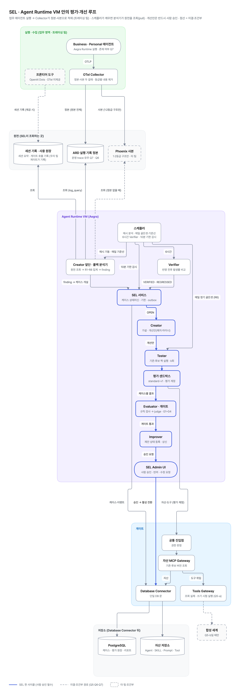
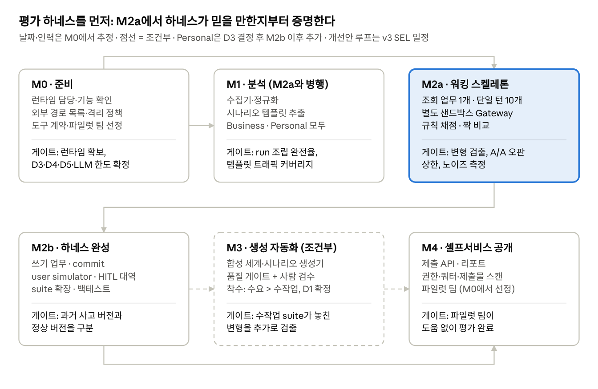

# PRD · SEL (Agent Runtime 안의 평가·개선 루프)

Oct 27, 2026 · @WIGTN · 상태: 논의용 초안 v0.4 (v0.3 + 스케줄·이벤트·기한·용량)

## 0. 바뀐 것

**v0.4**: SEL 애플리케이션 설계 v0.1(2026-10-23) 9장의 스케줄, 이벤트, 케이스 상태별 기한, 용량·우선순위를 9장으로 넣었다. 카나리와 판정 세트 크기는 이 문서의 결정과 달라서 9장에 차이를 표시했다(D12–D14).

**v0.3**: 플랫폼 설계 방향 문서(2026-10-22, 논의용)와 대조해 구조와 역할을 다시 맞췄다.

| 항목 | v0.2 | v0.3 |
| --- | --- | --- |
| 위치 | SEL을 별도 플랫폼으로 그리고, Aegra를 그 안의 박스 하나로 둠 | **SEL 전체가 Agent Runtime VM(Aegra) 안에서 돈다.** 스케줄러, SEL 오케스트레이터, 평가 샌드박스, Admin UI가 같은 VM이다 |
| 순서 | 분석 → 생성 → 평가 → 개선 | 스케줄러 신호 → **Creator → Tester → Evaluator → Improver** |
| Creator | 새 skill만 | 실패 분석, **개선안 작성**(패치·마이너), 새 SKILL 후보와 평가셋 |
| Evaluator | 규칙 채점 | **judge 채점**과 버전 비교. 규칙으로 판정 가능한 검사는 judge 앞에 둔다 |
| Improver | 패치 생성 | **등록·상신과 승인 요청까지.** 활성 전환은 사람이 승인할 때 일어난다 |
| 분석 | 별도 영역 A | **Creator 앞단**. Deep Tracer가 빠졌으므로 그 기능(finding, 상태 추적)을 여기로 가져온다 |
| 세션 기록 | 없음 | 실패 신호, 새 자산 후보, 개선 효과 확인의 원천으로 추가 |
| 수정 범위 | 자체 정의 | 문서의 자산별 SEL 개선 대상 표를 따른다 (SKILL 패치·마이너, Prompt는 persona 파생본만, Tool 제외) |
| 결과 저장 | git + 자체 JSONL | PostgreSQL 평가 작업 원장·리포트 (Database Connector 경유) |

설계 방향 문서와 이후 바뀐 전제가 충돌하는 곳은 미결로 표시했다(2장, 3장, 12장 Q5–Q7). 가장 큰 충돌은 **평가를 실제 도구로 하느냐, 합성 세계로 하느냐**(Q5)다.

## 1. 개요

SEL은 공용 자산(Agent, SKILL, Prompt)을 평가하고 고치는 루프다. Agent Runtime VM(Aegra) 안에서 스케줄러 신호로 Creator → Tester → Evaluator → Improver를 차례로 실행한다. Improver가 개선안을 자산 저장소에 등록·상신하고, 사람이 승인하면 활성 버전이 되어 다음 실행부터 모든 창구에 반영된다.

**배경**

- 플랫폼은 실행 도구가 바뀌어도 세 가지를 유지한다: 업무 자산의 정본을 두는 **자산 저장소**, 진입과 도구·데이터 접근을 통제하는 **게이트**, 자산을 평가하고 고치는 **SEL**.
- Agent Runtime을 두는 이유는 SEL이다. 개선안을 반영하기 전에 기존 버전과 새 버전을 같은 케이스로 돌려 비교해야 하고, 그 실행을 맡을 곳이 Runtime이다.
- Deep Tracer는 설계에서 빠졌다. 그래서 실행 기록 분석을 SEL Creator 앞단에 둔다(설계 방향 문서 4.4의 "Deep Tracer 없이 동작" 경로).
- 트레이싱(계측, Collector, Phoenix 운영)은 다른 팀이 맡는다.
- 팀 설계자의 지시는 분석 → 생성 → 테스트·평가의 태스크 분해다. 테스트와 평가는 샌드박스로 열려 비즈니스 영역에서 활용할 수 있어야 한다.

**지시와 SEL 단계의 대응**

| 지시 | SEL 단계 | 이 문서 |
| --- | --- | --- |
| Phoenix 데이터를 가져와 분석 | Creator 앞단 (실패 분석, finding) | 4장 |
| 그걸 기반으로 데이터를 새로 생성 | Creator (개선안, 새 SKILL 후보, 평가셋). 평가를 합성 세계로 하게 되면 합성 세계도 포함 (Q5) | 5장, 7장 |
| 테스트하고 평가 | Tester, Evaluator | 6장 |
| (반영) | Improver, 승인 | 7장 |

**목표**

1. G1 · 실패 분석: 실행 기록과 세션 기록에서 실패 패턴을 찾아 고정 ID를 가진 finding으로 만들고, 해소·재발을 추적한다.
2. G2 · 개선안: finding마다 수정 허용 범위 안의 개선안(패치·마이너 버전)을 만든다.
3. G3 · 신뢰할 수 있는 평가: 기존·후보 버전을 같은 케이스로 짝지어 반복 실행하고, 노이즈를 넘는 차이만 회귀·개선으로 판정한다.
4. G4 · 반영과 확인: 회귀 없이 개선된 후보만 승인을 거쳐 활성화하고, 반영 후 운영 기록으로 효과를 확인한다.
5. G5 · 셀프서비스: 비즈니스 영역 담당자가 자기 자산 버전을 제출해 평가를 돌리고 결과를 해석할 수 있다.

**비목표**

- 트레이싱 계측, Collector, Phoenix 운영 (타 팀)
- Tool 자산 수정 (개발자 작업), 자산의 메이저 버전 변경 (사람만)
- 사람 승인 없는 활성 전환
- 개인화, 개인 지식 고도화. 세션 기록은 공용 자산을 고치는 재료로만 쓴다
- fine-tuning용 학습 데이터 생성

**성공 판정 (제안값)**

- M2a 종료: 일부러 망가뜨린 변형(심각도별 3종 이상)을 모두 회귀로 잡고, A/A 회귀 오판이 상한 이하이며, 반복 노이즈 폭과 judge·사람 일치율이 측정되어 있다.
- M2b 종료: 과거 롤백·사고 버전과 정상 버전을 백테스트로 구분한다 (Q3 이력이 있을 때).
- M2c 종료: finding 1개 이상에서 Creator 후보가 판정 규칙(6장)을 통과하고, Improver를 거쳐 승인·활성화된다. 표본 규모가 검정력 기준에 못 미치면 "루프가 끝까지 돈다(dry-run)"를 종료 기준으로 쓴다.
- M4 종료: 파일럿 팀이 우리 도움 없이 평가를 돌리고 결과를 참고 지표로 쓴다.

## 2. 입력 데이터와 미결 전제

SEL이 읽는 원천은 아래와 같다. 원천마다 접근 가능 여부가 설계를 크게 바꾼다.

| 원천 | 담는 것 | 경로 | 미결 |
| --- | --- | --- | --- |
| 실행 기록 정본 (ARD) | Runtime·프론티어 도구 trace 원본 | Database Connector (`log_query`) | ARD 적재 준비 시점 미확정 (트레이싱 PRD: 준비 전엔 임시 모드). **Q6** |
| 실행 기록 사본 (Phoenix) | 1·2등급·미표시 span은 구조만, 3등급은 마스킹본 | Phoenix API (트레이싱 스케줄러) | 정본이 없을 때의 대안 |
| 실행 원장·평가 작업 원장 (PostgreSQL) | validator, HITL, 피드백, 평가 결과 | Database Connector | 읽기 권한 (D5) |
| 세션 기록 요약 | 세션별 의도, 사용 자산·버전, 사용자 수정·재요청, 반복 절차 | Database Connector | 저장 위치 미정. 대상 범위 정책(동의, 익명화, 보안 등급 제외) 선행 |
| 자산 MCP Gateway 사용 원장, Tools Gateway 감사 번호 | 누가 어떤 자산의 어느 버전을 썼는지, 어떤 도구를 위임했는지 | Database Connector | OTel trace가 없는 구간(프론티어 도구)에서 남는 유일한 실행 신호 |

**운영 실패 원천은 Q7에 달려 있다.** 설계 방향 문서 구도에서는 Runtime에 업무 오케스트레이터가 없고(업무는 프론티어 도구), 프론티어 도구(OpenAI Dots)는 OTel trace를 내보내지 않는다. 그러면 ARD에도 Phoenix에도 운영 trace가 없고, 운영 실패 원천은 **세션 기록과 사용 원장뿐**이다. 이 경우 Creator 앞단은 세션 기록의 수정·재요청 신호와 사용 원장의 자산·도구 호출 패턴으로 finding을 만들고, 원인 진단은 전부 평가 샌드박스 재현으로 한다. 반대로 Runtime 안에서 Business·Personal 에이전트가 돈다면(이후 전제) 그 trace가 원천이 된다. 그래서 Q6(정본 vs 사본)은 Q7이 정해진 뒤에야 의미가 있다.

**운영 trace가 있고 정본(ARD)을 읽을 수 있으면** 운영 실행 기록에 내용이 있으므로, Creator가 운영 실패를 직접 진단할 수 있다. **사본(Phoenix)만 있으면** 1·2등급 실패는 구조만 남으므로, 진단은 평가 샌드박스에서 같은 실패를 재현해서 한다(7장).

**연동 규약에 반드시 있어야 하는 것** (설계 방향 문서 5장 중 SEL 판정에 직결되는 항목. 계약 번호는 그 문서 3장 연결 계약)

| 데이터 | 빠지면 | 계약 | 담당 |
| --- | --- | --- | --- |
| 실행 기록마다 사용한 자산 버전 (`종류/이름@범위`) | 어느 버전의 결과인지 몰라 버전 비교와 개선 효과 판단 불가 | 4·9·10 | 자산 저장 규격, 트레이싱 팀 |
| 실행 출처 표시 (운영·평가·재생) | 평가·재생 실행이 운영 통계에 섞여 판정 오염 | 5·6 | FW (Tools Gateway), Database Connector |
| 쓰기 도구의 시험 실행 여부·감사 번호 | 평가가 운영 데이터를 바꿨는지 추적 불가 | 5 | FW (Tools Gateway) |
| 도구 실패의 오류 상태·span 종류 | 실패가 성공처럼 기록됨 | 8·10 | 트레이싱 팀 |
| 배포·변경 시점 신호 | 반영 전후를 나누지 못해 해소·재발 판단 불가 | 8·9 | 자산 저장 규격 |
| 프론티어 도구 trace의 요청 ID·사용자 | 공통 진입점 원장과 연결 불가 | 2·10 | FW (공통 진입점), 트레이싱 팀 |

응답마다 요청 ID, 검증 단계 거절의 원장 기록 같은 나머지 5장 항목은 SEL 판정에 직접 쓰이지 않아 여기에 넣지 않았다.

## 3. 전체 구조



**Agent Runtime VM 안** (프로세스 간 통신)

- **스케줄러**: 매시 분석, 매일 정기 골든셋·기준선 재계산, 6시간마다 Verifier, 10분마다 기한 감시를 돌린다(9장). 자산 버전 등록, 셀프서비스 제출, finding 발행은 이벤트로 들어온다.
- **Creator 앞단**: 실행 기록·세션 기록을 읽어 finding을 만든다(4장).
- **SEL 오케스트레이터**: Creator → Tester → Evaluator → Improver를 차례로 실행한다.
- **평가 샌드박스와 워커**: 후보 버전과 기존 버전을 같은 케이스로 짝지어 실행한다. 워커는 요청마다 자산을 받아 DeepAgents로 실행하고 상태를 갖지 않는다. 낮은 우선순위로 돈다. 평가 대상이 "워커 + 자산 조합"인지 "Business·Personal 에이전트"인지는 Q7이다.
- **SEL Admin UI**: 승인자가 개선안을 보고 승인한다.

**VM 밖** (LLM 추론과 Redis를 빼면 모두 게이트를 거친다)

- 평가 샌드박스가 자산·도구를 쓸 때는 다른 창구와 같은 경로를 탄다: 공통 진입점(권한 판정) → 자산 MCP Gateway → 자산은 Database Connector → 자산 저장소, 도구는 Tools Gateway. 평가 실행은 평가 계정으로 표시한다.
- 저장소 접근은 Database Connector 하나로 한다(Redis만 예외). 체크포인트, 실행 원장, 평가 작업 원장과 리포트는 PostgreSQL에, 자산 본문·버전·상태는 자산 저장소에 있다.
- LLM 추론은 LLM Gateway로 직접 호출하고(Chat Completions 호환), Redis(실행 큐, 응답 스트림)는 직접 연결한다.
- Phoenix는 타 팀이 운영하는 사본이다. 설계 방향 문서에서 SEL은 DB(ARD) 기준으로 읽고, Phoenix API는 Deep Tracer가 읽었다. SEL이 Phoenix를 읽는 경로는 그 문서 밖의 예외이며, 10-27 팀 설계자 지시("Phoenix 데이터를 가져와 분석")에서 왔다(Q6).

| 경계 | 우리 팀 (FW) | 다른 팀 |
| --- | --- | --- |
| SEL | 오케스트레이터 4단계, Creator 앞단 분석, 평가 샌드박스 실행 루틴, Admin UI | — |
| 게이트 | 공통 진입점, Tools Gateway (평가 계정 처리 포함) | 자산 MCP Gateway·Database Connector 담당 (미확인) |
| 런타임 | 평가 샌드박스 요구사항 | Agent Runtime VM 운영 (담당 미확인 · Q2) |
| 트레이싱 | 필요 필드 요구사항 | 계측, Collector, ARD 적재, Phoenix 운영 |
| 자산 | 개선안 등록·상신 | 자산 저장 규격, 자산 저장소 운영 |

**평가 실행 경로는 미결이다 (Q5).** 두 안이 있다.

| | Q5-a · 실제 도구 (설계 방향 문서) | Q5-b · 합성 세계 |
| --- | --- | --- |
| 도구 호출 | 평가 계정으로 실제 Tools Gateway. 조회는 실제 호출, 쓰기는 시험 실행까지 (도구 호출 계약 5) | 자격증명 없는 샌드박스 Tools Gateway가 합성 세계에서 응답 |
| 정답 | 계산할 수 없다. 조건·규칙·judge로 채점 | 합성 세계에서 계산. 규칙 채점 비중이 높다 |
| 공수 | 작다. 합성 세계가 필요 없다 | 크다. 합성 세계와 SAP 동작 재현(5장) |
| 위험 | 평가 중 실데이터가 LLM·리포트에 들어간다. 셀프서비스로 열면 다른 팀에 노출될 수 있다. 쓰기 본실행 차단은 플래그가 아니라 **평가 계정 권한 자체**로 막아야 한다 | 합성 세계가 운영과 달라 결과가 운영을 예측하지 못할 수 있다 |
| 성립 조건 | 평가 샌드박스에서 실데이터 조회가 보안상 허용될 것 | 도구 계약과 SAP 동작 검증 인력 확보 |

**Q5 답 전 원칙**: 6장 Tester·Evaluator와 7장 Creator·Improver는 두 안에 공통이므로 먼저 만든다. 평가 샌드박스는 도구 경로를 어댑터로 분리해, 어느 쪽으로 결정돼도 어댑터만 바꾸게 한다. 합성 세계(5장 B)는 Q5-b로 결정될 때만 착수한다. Q5-b라면 M2a 하네스도 합성 세계 위에서 돌아야 하므로, M2a 선행 작업으로 손으로 만든 최소 세계(B1·B2, op 2–3개)가 들어간다. Q5는 M0 게이트다.

## 4. Creator 앞단 · 실패 분석

Deep Tracer가 맡기로 했던 분석을 Creator 앞단에 둔다. 범위는 SEL이 고칠 수 있는 자산 범주의 실패를 찾는 데까지다. 트레이스 저장소, 조회 화면, 자동 수정은 만들지 않는다.

**finding 모델** (설계 방향 문서 4.4의 Deep Tracer 설계를 가져옴)

- **고정 ID**: 정규화 단계에서 결정적 fingerprint로 finding ID를 정한다. 같은 구간을 다시 분석해도 ID가 바뀌지 않는다.
- **상태**: new, known, fixed, regressed, suppressed. 사실 기록을 추가만 하고, 현재 상태는 projection으로 계산한다.
- **처리 경로**: 자산 범주(`context.skill`, `context.prompt`)는 SEL 루프로, 코드·워크플로·인프라 범주는 개발자 작업으로 넘긴다.
- **LLM의 역할**: 원인 서술, 범주 분류, 대안 생성에만 쓴다. ID와 그룹핑은 규칙으로 정한다. 사내 LLM만 쓴다.
- **판정 제외**: 평가·재생·빈 실행은 운영 판정에서 뺀다 (실행 출처 표시).
- **fixed 판정**: 점수만으로 닫지 않는다. 반영 후 운영에서 실제 실패가 줄어야 fixed가 된다.

**세션 기록 경로** (설계 방향 문서 4.5)

| 경로 | 세션 기록에서 보는 것 | SEL에서 쓰는 곳 |
| --- | --- | --- |
| 실패 신호 | 공용 SKILL로 만든 결과를 사용자가 고치거나 다시 요청한 기록. 여러 사람에게 같은 수정이 반복되는지 | Creator의 개선 근거. trace로는 보이지 않는 "기대와 달랐다" 신호 |
| 새 자산 후보 | 여러 사용자가 반복하는데 이를 덮는 공용 자산이 없는 절차 | Creator가 후보 SKILL과 평가셋을 만든다 |
| 개선 효과 확인 | 새 버전 활성 이후 같은 업무에서 수정·재요청이 줄었는지 | 반영 후 실제 효과. 평가 점수와 따로 본다 |

세션 기록은 OTel trace와 별개의 전제다. 대화 원문이 있어야 사용자가 결과를 고쳤는지 알 수 있다. 여러 사용자의 기록을 모으는 분석이므로 대상 범위(동의한 사용자, 익명화 통계, 보안 등급 제외)를 정책으로 먼저 정한다. 기밀 구간 클라이언트는 PC에서 나가는 경로가 없어 이 분석에서 빠진다.

| # | 작업 | 내용 | 메모 |
| --- | --- | --- | --- |
| A1 | 원천 접근 | ARD 실행 기록(Database Connector), 정본이 없으면 Phoenix 읽기 전용 key, 실행 원장, 세션 기록 요약 | Q6, D5 |
| A2 | 필드 요구사항 | 2장의 필수 데이터 표를 트레이싱 팀에 전달 | 없는 필드는 분석 불가 항목으로 표시 |
| A3 | 수집 | 정본: `log_query` 증분 조회. 사본: `phoenix-client`의 `spans.get_spans_dataframe`를 시간 창 단위로 조회한다. 기본 `limit` 1000에 닿으면 창을 쪼개 재조회하고, `(trace_id, span_id)`로 중복을 제거한다 | 재스캔 폭은 최대 지연 이상 |
| A4 | run 조립·정규화 | 실행 ID로 span을 묶어 RunRecord/StepRecord로 만든다. 내용 유무(`full / masked / none`)를 표시한다 | HITL 재개는 수시간 뒤 다른 trace로 이어진다 |
| A5 | 라벨·세션 기록 join | 실행 원장(validator, HITL, 피드백) + 세션 기록의 수정·재요청 신호 | 출처별 열 분리 |
| A6 | finding 생성 | fingerprint, 고정 ID, 상태 projection, 처리 경로 분류 | 4장 finding 모델 |
| A7 | 평가 케이스 재료 | finding마다 시험 사례 묶음. Q5-b면 구조만 담은 시나리오 템플릿 (5장) | 템플릿 규칙은 5장 |

## 5. 평가셋과 평가 환경

**평가셋의 출처**

- SKILL 자산에 평가 케이스가 들어 있다 (설계 방향 문서 4.2: SKILL = 업무 절차·허용 도구·평가 케이스).
- Creator가 개선안과 함께 만든 평가셋과, finding별 시험 사례 묶음이 있다.
- **판정용(held-out) 케이스는 위 어느 것과도 분리한다.** SKILL 내장 케이스와 Creator가 만든 평가셋은 Creator가 볼 수 있으므로 진단·작성용(dev)으로만 쓴다. held-out은 사람(대상 자산 소유 팀)이 관리하는 별도 평가셋이며 Creator는 집계만 받는다. 그렇지 않으면 Creator가 자기 개선안을 판정할 케이스를 보고 맞추게 된다.
- SEL 패치는 SKILL의 평가 케이스 필드를 바꿀 수 없다. 평가 케이스의 결함은 사람 검토 경로로 넘긴다.
- 평가 케이스는 기대 결과를 구조화 조건으로 적는다: 필수·금지 도구 호출, 구조화 답 필드(숫자 정규화), 정책 준수(HITL 요청, 등급 처리), judge rubric.

**Q5-a (실제 도구)일 때**

- 조회 결과가 시간에 따라 바뀐다. 그래서 기존·후보 버전을 같은 시간대에 짝지어 실행해 데이터 변화를 상쇄한다.
- 정답 값을 미리 정할 수 없다. 그래서 같은 실행 안에서 도구가 돌려준 값과 답이 일치하는지(근거 일치)를 규칙으로 검사하고, 나머지는 judge로 채점한다.
- 쓰기는 시험 실행 결과(어떤 변경을 하려 했는지)를 기대 변경과 비교한다.

**Q5-b (합성 세계)일 때**

합성 업무 세계(가짜 회사)를 만들고 그 위에서 시나리오와 정답을 만든다. 정답을 세계에서 계산하므로 규칙 채점 범위가 넓다 (τ-bench의 최종 DB 상태 비교, AppWorld의 상태 기반 테스트와 같은 방식).

원칙
1. 실값 복사 금지. 실행 기록에서는 구조와 분포만 가져온다.
2. 누가 봐도 가짜인 값. ID는 예약 범위(예: 거래처 9xxxxxxx), 이름은 "가상거래처-0418" 같은 규칙으로 만든다.
3. 정답은 세계에서 계산한다. 시나리오마다 참조 풀이를 둔다.
4. op별 동작(필터 의미, 페이지네이션, row limit, 권한 오류, 통화)은 SAP 기능 담당자가 검증한다. 합성 백엔드와 참조 풀이를 같은 사람이 짜면 같은 착각을 공유하기 때문이다.
5. 템플릿에는 닫힌 분류 라벨만 넣는다. 사용자 입력에서 나온 자유 텍스트는 넣지 않는다. 표본이 최소 건수(제안 30건) 미만인 템플릿은 버린다.
6. 생성 LLM은 사내 LLM만 쓴다.

| # | 작업 | 산출물 | 메모 |
| --- | --- | --- | --- |
| B1 | 도구 계약 수집 | op 목록, 입력·응답 스키마, 오류 코드 | Tool 자산·도구 호출 계약이 원천 |
| B2 | 합성 업무 세계 | 엔티티 모델, 참조 무결성, 회계 불변식, op별 동작 테스트 | 규칙 + Faker(`ko_KR`) + 텍스트만 LLM. 비운영 SAP 클라이언트를 쓸 수 있으면 먼저 검토 (02 문서 Q1) |
| B3 | 합성 문서 | 가짜 규정·매뉴얼, 등급 메타데이터 | |
| B4 | Personal 페르소나 | 가짜 사용자 작업 공간 | Personal 대상 여부 확인 후 (Q7) |
| B5 | 시나리오·정답 | 템플릿 × 세계 → 사용자 목표, 초기 상태, 정답 | |
| B6 | 품질 게이트 | 풀이 가능, 누출 검사(예약 범위 위반 + 소유 팀 해시 대조), 사람 검수 표본 | |
| B7 | 버전 관리 | `world@v`, `suite@v` | 도구 스키마 변경 시 재계산 |

시나리오 예시 (Q5-b, 가상값)

```yaml
scenario_id: biz.fi.open_items_by_vendor/0007
world: corp-sim@0.3
turns: single
user_message: "가상거래처-0418의 9월 미결 전표 합계 알려줘"
expected:
  answer: {vendor_id: "90000418", open_item_count: 12, total_amount: {value: 48210000, currency: KRW}}
  final_state: unchanged
  tool_calls_must_include: [tool.sap.fi/query_open_items]
reference_solver: solvers/fi_open_items.py
exercises_failure_mode: vendor_ambiguous
```

## 6. Tester · Evaluator

**Tester: 짝 실행**

1. SEL 오케스트레이터가 Agent Runtime에 평가 작업을 제출한다 (후보 버전, 기존 버전, 평가셋).
2. 케이스마다 기존·후보 버전을 짝지어 실행한다. 실행 루틴은 `standard-v1`이다: 체크포인트 복원 → 자산 로드 → 쓰기 도구 앞 승인 중단 → 시간 상한 → 응답 검증 → 체크포인트·실행 기록(OTel) 발행.
3. 자산은 공통 진입점 → 자산 MCP Gateway로 기존·후보 버전을 조회하고, 도구는 평가 계정으로 위임한다(Q5 경로).
4. 체크포인트와 평가 실행 기록은 평가 표시를 붙여 Database Connector로 남긴다.
5. 케이스를 k회 반복하고 케이스별 결과를 오케스트레이터에 돌려준다.

쓰기 도구 앞 승인 중단에는 케이스에 적힌 정책으로 자동 응답한다(HITL 대역). 대화가 필요한 케이스는 user simulator가 숨은 목표를 들고 사용자 역할을 한다(M2b부터).

**Evaluator: 채점과 버전 비교**

- 채점 순서: 규칙 검사(필수·금지 도구 호출, 구조화 답, 근거 일치, 정책 준수)를 먼저 하고, 규칙으로 판정할 수 없는 부분만 judge로 채점한다. 규칙 검사가 노이즈가 작고 judge 비용이 들지 않기 때문이다.
- judge 본문은 Prompt 자산이며 **SEL이 고칠 수 없다**. 평가자가 고정돼 있어야 루프가 채점을 공략하지 못한다.
- judge를 쓰므로 judge·사람 판정 일치율을 M2a부터 잰다.

**판정 규칙** (회귀·개선 판정, 8장 지표, `regressed_cases: 0`은 모두 이 정의를 쓴다)

- 케이스마다 기존·후보 버전을 각각 k회 실행하고 통과 횟수를 센다.
- 회귀 케이스: 기존 대비 통과 횟수 감소가 케이스 노이즈 상한을 넘는 케이스. 노이즈 상한은 M2a에서 A/A로 잰다(제안: A/A 감소 분포의 95% 분위).
- 개선 케이스: 같은 기준으로 통과 횟수가 늘어난 케이스.
- 임계값과 k는 판정 전에 고정한다.
- `regressed_cases: 0` = 회귀 케이스 0개. 이 이름은 전달받은 v3 요약에서 왔다(원문 미확인).
- 통계: 케이스별 짝 비교, pass@1과 pass^k, A/A 오판률. 평가셋 크기는 검정력 계산으로 정한다. pass^k를 쓰는 이유는 업무 에이전트는 "가끔 되는 것"보다 "매번 되는 것"이 중요하기 때문이다. n번 중 c번 성공했을 때 추정치는 C(c,k)/C(n,k)의 케이스 평균이다(τ-bench).

**결과 저장**: 평가 작업 원장과 리포트는 PostgreSQL에 Database Connector로 남긴다. Phoenix datasets·experiments는 쓰지 않는다. 쓰려면 member 권한이 필요한데, Phoenix에는 프로젝트 단위 권한이 없어 운영 프로젝트에도 쓸 수 있게 되기 때문이다.

| # | 작업 | 내용 | 메모 |
| --- | --- | --- | --- |
| C1 | 평가 샌드박스 | Runtime VM 안 평가 샌드박스, 버전 고정 실행, 체크포인터 분리, 낮은 우선순위 | Q2 |
| C1b | 외부 경로 목록 | 평가 실행이 밖으로 나가는 경로 전부와 각각의 처리(평가 계정, 시험 실행, 차단) | M0 산출물 |
| C2 | 평가 도구 경로 | Q5-a: 평가 계정과 Tools Gateway 시험 실행. 쓰기 본실행은 평가 계정의 권한으로 막는다. Q5-b: 샌드박스 Tools Gateway | 어댑터로 분리 |
| C3 | HITL 대역·user simulator | 승인 중단 자동 응답, 숨은 목표 대화 | user simulator는 M2b |
| C4 | Tester | 평가 작업 제출, 짝 실행, k회 반복, 비용 한도, 동시 실행 제한 | `standard-v1` |
| C5 | Evaluator 채점 | 규칙 검사 → judge | judge는 Prompt 자산, SEL 수정 불가 |
| C6 | 비교·통계 | 판정 규칙, A/A, 검정력 | 25케이스 × 5회면 10–15pp 미만 하락은 놓칠 수 있다는 거친 추정(M2a 실측) |
| C7 | 셀프서비스 | 제출 → 평가셋 선택 → 실행 → 리포트, 팀별 분리, 쿼터, 제출물 실값 스캔 | Q5-a면 실데이터 노출 범위 결정이 선행 (D8) |

## 7. Creator · Improver

**역할**

| 역할 | 하는 일 | 입력 | 출력 |
| --- | --- | --- | --- |
| Creator | finding을 골라 원인을 진단하고, 수정 허용 범위 안의 개선안 묶음(finding 하나를 고치는 패치 세트, 패치·마이너)을 만든다. 세션 기록의 반복 절차에서 새 SKILL 후보와 평가셋을 만든다 | finding, 실행 기록, 세션 기록, 대상 자산 | 개선안 묶음, 평가셋 |
| Improver | 판정을 통과한 개선안을 새 버전(제안 상태)으로 등록·상신하고 승인을 요청한다. 해소·재발 추적을 설정한다. 활성 전환은 하지 않는다 (계약 9: SEL은 등록과 상신까지) | Evaluator 결과, 개선안 | 제안 상태 버전, 승인 요청 |

**사이클** (한 사이클 = finding 하나 → 개선안 하나)

1. **finding 선택** (Creator): 상태가 new·regressed이고 처리 경로가 자산 범주인 finding을 빈도 × 심각도로 정렬한다. 최소 지지 건수 미만은 뺀다.
2. **진단 근거 확보** (Creator)
   - 운영 실행 기록에 내용이 있으면(정본, 3등급) 그것으로 진단한다.
   - 내용이 없으면(사본의 1·2등급), 또는 운영 trace가 아예 없으면(Q7, 세션 기록·사용 원장만 있음) 평가 샌드박스에서 같은 실패를 재현해 진단한다. 재현 = 운영 실패 서명(op 시퀀스, 오류 코드, result_class)과 샌드박스 실패 서명이 일치하는 것. 재현되지 않는 finding은 미진단으로 남기고, 그 비중을 리포트에 싣는다.
3. **진단** (Creator): 원인 위치를 분류한다. SKILL 절차·Prompt persona·Agent 허용 필드 → 개선안 작성. Tool·코드·인프라 → 개발자 작업으로 넘김. 평가 케이스·채점 결함 → 사람 검토 경로로 넘김(SEL이 고치지 않음). 모델 한계·원인 불명 → 사이클 중단. 분류 결과는 사람이 표본 점검한다.
4. **개선안 작성** (Creator): 증분 패치로 만든다. finding당 개선안 하나.
5. **짝 실행** (Tester) → **채점·비교** (Evaluator): 판정용(held-out) 케이스와 나머지 평가셋을 판정 규칙대로 돌린다. 판정 전에 held-out에서 기준 버전의 실패율을 기록한다. 기준 버전이 이미 통과하는 케이스로는 개선을 확인할 수 없기 때문이다.
6. **채택 조건**: 대상 finding 케이스에서 개선 케이스가 있고, 전체에서 회귀 케이스 0, 정책 준수 케이스 전부 통과, 비용·지연 예산 이내.
7. **등록·상신** (Improver): Database Connector로 새 버전을 제안 상태로 등록하고 승인을 요청한다.
8. **승인** (사람, SEL Admin UI): diff, 판정 리포트, held-out 실행 기록 표본을 보고 승인한다. 승인하면 Database Connector가 자산 저장소에서 활성 버전으로 전환하고, 다음 실행부터 모든 창구가 새 버전을 쓴다.
9. **효과 확인**: 반영 후 운영 기록과 세션 기록으로 해소(fixed)·재발(regressed)을 판단한다. 점수만으로 fixed로 닫지 않는다.

**자산 수정 허용 범위** (설계 방향 문서 4.2)

| 자산 | 내용 | SEL 개선 대상 |
| --- | --- | --- |
| Agent | 조립 정의. SKILL·Prompt를 참조하고 필요 역할을 적는다 | 허용 필드만 (예: `max_turns`) |
| SKILL | 업무 절차, 허용 도구, 평가 케이스 | 대상. 패치·마이너 버전. 단, 평가 케이스 필드는 SEL이 바꾸지 않는다 (이 문서의 추가 제한) |
| Prompt | persona와 judge 본문 | persona 파생본만. judge는 SEL이 고칠 수 없다 |
| Tool | 외부·내부 도구와 ML 엔진, 오퍼레이션별 필요 역할 | 대상 아님. 개발자 작업 |

- 참조 표기는 `종류/이름@범위`다(예: `prompt/fi-expense-persona@1.x`).
- 등록한 버전은 고치지 않고 새 버전으로 쌓는다. SEL은 패치·마이너만 만들고, 메이저 변경은 사람만 한다.
- 상태 전이는 제안 → 검토 → 활성 → 폐기다.
- few-shot 예시에는 합성 값만 쓴다. 실값이 들어가면 셀프서비스로 노출된다.

**held-out 관리**

- 진단·작성용 케이스와 판정용(held-out) 케이스를 나눈다. held-out은 개선안을 만드는 경로와 다른 경로(사람)가 만들고 관리한다 (5장).
- held-out을 같은 템플릿의 값만 바꾼 것으로 채우지 않는다. 가능하면 일부를 같은 실패 유형의 다른 업무에서 뽑는다. 케이스 구조에 맞춘 개선안을 걸러내기 위해서다.
- Creator에게는 held-out의 통과·실패 집계만 돌려준다.
- finding당 판정 시도는 2회(제안)까지이고, 재시도할 때는 held-out을 새로 뽑는다. held-out마다 사용 횟수를 기록하고 상한(제안 3회)을 넘으면 교체한다.

**기준 버전, 누적, 롤백**

- 기준 버전은 **현재 활성 버전**이다. 승인 = 활성 전환이므로 별도 배포 단계가 없다.
- 판정은 자산 단위로 직렬화한다. 판정 중에 활성 버전이 바뀌면 진행 중인 후보는 새 기준 위에서 다시 판정한다.
- 노이즈 상한 아래의 하락이 누적될 수 있다. 승인이 곧 활성 전환이라 "배포 전" 시점이 따로 없다. 그래서 **승인 요청 직전마다** 후보를 고정 앵커 버전과 전체 평가셋으로 비교하고, 앵커 대비 회귀가 없어야 승인 요청을 올린다. 비용이 크면 같은 자산의 N번째(제안 5번째) 후보마다로 줄이되, 그때도 채택 조건에 넣는다.
- 롤백은 이전 활성 버전으로 되돌리는 것이다(버전은 불변). 트리거는 finding regressed, 세션 기록의 수정·재요청 증가다. 결정은 승인자가 한다.

**잠정 원칙** (원문 미확인. 각 원칙은 괄호 안의 우리 쪽 근거로 선다. 논문은 11장에서 확인할 참고 후보다)

- release line은 하나만 둔다. (판정 비용이 후보 수에 비례한다. 추적과 롤백이 단순하다.) 참고 후보: GEPA
- 개선안은 증분으로 만든다. (전체를 다시 쓰면 잘 되던 지시가 사라지고 diff 검토가 불가능하다.) 참고 후보: ACE
- 판정은 케이스별 변화로 한다. (평균은 개선과 회귀가 상쇄돼 회귀를 숨긴다.) 참고 후보: AgentDevel
- 새 SKILL 후보는 보수적으로 채택한다. (skill 선택을 바꿔 영향 범위가 가장 크다. 전체 평가셋과 라우팅 회귀 검사가 필수다.) 참고 후보: SkillsBench
- 안전 행동을 모든 판정에 넣는다. (개선 압력이 HITL 요청처럼 비용이 드는 행동을 줄이는 쪽으로 작용할 수 있다.) 참고 후보: Misevolution

**개선안 기록 예시** (가상값)

```yaml
candidate_id: sel-2026-11-0003
finding: fnd-7c21a9                      # 고정 ID, 상태 regressed
target: skill/fi-open-items@1.4.2        # 기준 = 현재 활성 버전 (정확한 버전)
proposed: skill/fi-open-items@1.4.3      # 패치 버전
diagnosis: 기간이 없을 때 기본값(당월) 규칙이 없어 전체 기간을 조회하고 row limit에 걸림
evidence_source: ard                     # ard | sandbox_repro
patch: patches/sel-2026-11-0003.diff
attempt: 1
judged: {heldout: ho-fi-03, uses: 1, eval_job: ej-0192, improved_cases: 7, regressed_cases: 0, policy_pass: true}
state: proposed                          # proposed → reviewed → active → retired
```

| # | 작업 | 단계 | 메모 |
| --- | --- | --- | --- |
| L1 | finding 선택, 진단 근거 확보 | Creator | 정본 / 샌드박스 재현 (Q6) |
| L2 | 진단·개선안 작성 | Creator | 수정 허용 범위를 기계적으로 검사 (SKILL 평가 케이스 필드 변경 금지 포함) |
| L3 | 새 SKILL 후보·평가셋 | Creator | 세션 기록 반복 절차. 개선안 루프가 한 사이클 이상 돈 뒤 |
| L4 | 판정 연동 | Tester·Evaluator | 판정 규칙, held-out 관리, 직렬화 |
| L5 | 등록·상신·승인 요청 | Improver | Database Connector, 제안 상태 등록. 활성 전환은 승인 시 |
| L6 | 승인 화면 | SEL Admin UI | diff, 리포트, held-out 표본 |
| L7 | 효과 확인·롤백 | Creator 앞단 | finding 상태, 세션 기록 신호 |

## 8. 지표와 수용 기준

평가 자체가 믿을 만한지를 재는 지표가 먼저다. 목표값은 모두 제안값이며 M2a 측정치를 보고 확정한다.

| 지표 | 정의 | 목표 (제안) | 측정 시점 |
| --- | --- | --- | --- |
| 변형 검출률 | 일부러 망가뜨린 버전(심각도별) 중 회귀로 잡힌 비율 | 중대 변형 100% | M2a |
| A/A 오판률 | 같은 버전끼리 비교했을 때 회귀로 판정된 비율 | 5% 이하 | M2a |
| 반복 노이즈 | 같은 버전 반복 시 점수 표준편차, 케이스별 뒤집힘 비율 | 측정 후 결정 | M2a |
| judge·사람 일치율 | judge 판정과 사람 판정의 일치 비율 | 측정 후 결정 | M2a– |
| 규칙 판정 비율 | judge 없이 규칙만으로 판정된 케이스 비율 | 높을수록 좋음 | M2a– |
| 백테스트 판별력 | 과거 사고 버전과 정상 버전을 구분한 비율 | 측정 후 결정 | M2b (Q3) |
| 채택률 | 개선안 중 판정과 승인을 모두 통과한 비율 | 측정 후 결정 | M2c– |
| finding 해소율 | 활성 전환한 개선안의 finding 중 fixed가 된 비율 | 측정 후 결정 | M2c– |
| 재발률 | fixed 후 regressed가 된 비율 | 0으로 수렴 | M2c– |
| 미진단 비중 | 진단 근거를 확보하지 못한 finding의 운영 빈도 비중 | 측정 후 결정 | M2c– |
| 평가 중 쓰기 본실행 | 평가 계정으로 쓰기 본실행에 도달한 건수 | 0건 | 상시 |
| 셀프서비스 성공 | 파일럿 팀이 도움 없이 완료한 평가 비율 | 측정 후 결정 | M4 |

Q5-b로 가면 행동 현실성(샌드박스와 운영의 op 시퀀스 차이)과 누출 0건(예약 범위 위반, 소유 팀 해시 대조)을 추가한다.

## 9. 스케줄 · 이벤트 · 기한 · 용량

SEL 애플리케이션 설계 v0.1(2026-10-23) 9장을 옮기고, 이 문서의 결정과 다른 곳을 표시했다. 원칙은 두 가지다. SEL은 이벤트로 움직이고, 시간에 묶인 일(분석, 기한 감시, 반영 후 비교)만 스케줄로 돈다. 평가 실행은 배치 런타임의 동시 상한 안에서만 돌아 사용자 경로와 경쟁하지 않는다.

### 9.1 스케줄

| 작업 | 주기 | 내용 | 단계 |
| --- | --- | --- | --- |
| 폴백 분석 | 매시 | 자산 버전별 신호 발생률을 집계해 finding을 낸다 (R1–R5, R7, R8). 4장 Creator 앞단의 실행 주기 | M1 |
| 정기 골든셋 | 매일 1회 | 활성 버전으로 고정 세트를 실행한다. R6(eval_fail)의 입력. 시각은 지난 7일 시간대별 부하가 가장 낮은 구간 | M2a |
| 기준선 재계산 | 매일 | 자산 버전별 28일 발생률. finding 임계(기준선 × 1.5)의 분모 | M1 |
| Verifier | 6시간 | 카나리 코호트·대조 코호트 비교, 릴리스 전후 비교 (9.3) | M2c |
| 기한 감시 | 10분 | 기한을 넘긴 케이스를 다음 상태가 아니라 HELD 또는 REJECTED로 보낸다 (9.3) | M2a |

24시간 서빙이라 "야간"이라는 고정 시각을 두지 않는다. 부하를 실측해서 가장 낮은 구간을 고른다.

### 9.2 이벤트

케이스 상태 전이는 `case_event`에 추가 기록하고, 같은 트랜잭션에서 outbox를 거쳐 발행한다.

| 토픽 | 생산 | 소비 | SEL 동작 |
| --- | --- | --- | --- |
| `erp.sel.findings.v1` | 폴백 분석기 | SEL 서비스 | 중복 키로 병합, 임계를 넘으면 케이스 개설 |
| `erp.sel.case.v1` | SEL 서비스 (outbox) | Admin UI, ARD | 화면 갱신, 이력 적재 |
| `erp.runtime.jobs.v1` | Tester | 평가 실행 제출기 | 쌍대 실행 |
| `erp.sel.eval.v1` | Evaluator | SEL 서비스 | 결과 저장, 게이트 계산 |
| `erp.asset.release.v1` | 자산 저장소 | SEL 서비스 | 기준 버전 변경 감지(STALE), 카나리·릴리스 시각 기록 |
| `erp.asset.lifecycle.v1` | 자산 저장소 | SEL 서비스 | 후보 상태 확인 |

메시지 브로커를 쓸 수 없는 구간은 HTTP 수신 경로(`POST /v1/findings`)로 대체한다. 소비가 3회 실패하면 DLQ로 보내고, 해당 케이스는 기한 감시가 HELD로 처리한다.

### 9.3 케이스 상태와 기한

기한은 단계가 멈췄을 때 케이스가 영원히 열려 있지 않게 하는 장치다. 기한을 넘기면 다음 상태가 아니라 HELD 또는 REJECTED로 간다. 수행 주체는 이 문서의 역할 정의(7장)로 바꿔 적었다.

| 상태 | 진입 조건 | 다음 상태 | 수행 주체 | 기한 (설계값) |
| --- | --- | --- | --- | --- |
| OPEN | finding이 개설 임계를 넘음 | TRIAGED, DISMISSED | Creator | 24시간 |
| TRIAGED | 가설·대상·평가 세트 확정 | CANDIDATE_READY | Creator (개선안 작성) | 2시간 |
| CANDIDATE_READY | 후보 버전이 정적 검사 통과 | EVALUATING | Tester | 즉시 |
| EVALUATING | 쌍대 실행 제출 | GATE_PASSED, GATE_FAILED, HELD | Tester, Evaluator | 6시간 |
| GATE_FAILED | 게이트 미통과 | TRIAGED (반복 ≤ 3), REJECTED | 오케스트레이터 | 즉시 |
| HELD | 실행 실패율·judge 불안정으로 판정 불가 | EVALUATING, REJECTED | SEL 서비스, 사람 | 48시간 |
| GATE_PASSED | 게이트 통과 | AWAITING_APPROVAL | Improver (등록·상신) | 즉시 |
| AWAITING_APPROVAL | 승인 요청 게시 | APPROVED, REJECTED, TRIAGED(수정 요청), STALE | 사람 (Admin UI) | 7일 |
| STALE | 대기 중 기준 버전이 바뀜 | TRIAGED | SEL 서비스 | 즉시 |
| APPROVED | 승인 기록 | CANARY, RELEASED | 릴리스 | 즉시 |
| CANARY | 코호트에 릴리스 | RELEASED, ROLLED_BACK | Verifier, 릴리스 | 최대 14일 |
| RELEASED | 전체 릴리스 | VERIFYING | 릴리스 | 즉시 |
| VERIFYING | 관측 창 진행 | VERIFIED, REGRESSED | Verifier | 7일 |
| REGRESSED | 반영 후 같은 패턴 악화 | ROLLED_BACK | 사람 승인 후 릴리스 | 48시간 |

종료 상태는 VERIFIED, REJECTED, DISMISSED, ROLLED_BACK이다. 반복 상한 3은 같은 케이스에서 후보를 바꿔 가며 게이트를 두드리는 다중 검정을 막는다. 그래서 반복마다 유의수준을 나눠 쓴다(α' = 0.05 / 3, 앱 설계 7.3).

**이 문서와 다른 점: 카나리.** 7장은 "승인이 곧 활성 전환"이라고 적었다. 앱 설계는 충실도에 따라 릴리스 방식을 나눈다.
- full·relay 충실도 케이스는 게이트가 실질 판정이므로 바로 전체 릴리스한다.
- gateway·action 충실도 케이스와 new_asset은 카나리로 시작한다. 주체 해시 버킷 10%에만 후보를 노출하고, 같은 패턴의 발생률을 코호트끼리 비교한다.

카나리는 자산 저장소의 코호트 해석 규칙(주체 목록, 비공개 캐시 범위)이 있어야 하고, 이 기능은 자산 저장 규격 v1.1(2027.3) 확장이다. 그 전까지는 카나리 대상 케이스를 승인 대기에서 멈추거나, 전체 릴리스하고 VERIFYING을 길게 잡는다. 어느 쪽으로 할지는 D14에서 정한다.

**반영 후 판정.** Verifier는 릴리스 전 7일 발생률과 릴리스 후 7일 발생률을 같은 요일 구성으로 맞춰 비교한다. 카나리 단계에서는 악화가 유의하면 자동 롤백한다. 노출 범위가 작고, 되돌릴 대상이 이미 승인된 직전 버전이기 때문이다. 전체 릴리스 뒤 악화는 REGRESSED로 보내고, 롤백은 사람이 승인한다.

**동시성.** 케이스 행은 `row_version`으로 낙관적 잠금을 건다. 평가 결과와 기한 감시처럼 두 이벤트가 동시에 오면 한쪽만 전이에 성공하고, 실패한 쪽은 최신 상태를 다시 읽어 판단한다.

### 9.4 용량과 우선순위

반복 1회의 평가 실행 수 = (목표 + 가드 + 고정 사례 수) × 2팔 × k.

| 기준 | 목표 | 가드 | 고정 | k | 평가 실행 | LLM 호출 (추정) |
| --- | --- | --- | --- | --- | --- | --- |
| 앱 설계 기준 | 221 | 100 | 20 | 3 | 2,046 | 약 13,000 (실행당 6회 + judge 쌍대 판정 682회) |
| M2a 예시 | 20 | 8 | 4 | 3 | 192 | 약 1,300 |

- 앱 설계 기준으로는 동시 상한 100에서 실행당 약 25초가 걸려 반복 1회에 약 8.5분이다.
- 목표 221건은 앱 설계 7.3의 MDI 산식에서 s_d = 0.25로 가정하고 5%p 개선을 잡으려 할 때의 크기다. s_d는 첫 평가 실행에서 실측해 다시 산정한다.
- **이 문서와 다른 점: 판정 세트.** 이 문서는 판정용 held-out을 사람이 관리하는 별도 세트로 둔다(5장). 그래서 목표 세트 221건을 SME가 라벨링해야 한다는 뜻이고, 이는 앱 설계의 미결 사항(SME 참여 범위)과 같은 문제다. 크기는 7장 판정 규칙의 노이즈 상한과 검정력 계산으로 정한다.

**동시 활성 케이스 상한 10.** 평가 용량과 승인 처리량에서 나온 값이다. 상한을 넘으면 우선순위 순으로 제출한다.

- 우선순위 = rate × reach_weekly × signal_weight
- 하루 LLM 사용량 상한 안에서만 제출한다. 상한은 D12에서 정한다. 활성 케이스 10개가 모두 하루에 한 번씩 반복하면 앱 설계 기준으로 하루 약 13만 회 호출이다.
- 평가 실행은 업무량이 적은 시간대에 낮은 우선순위로 돈다. 평가 실행 실패율이 10%를 넘으면 판정하지 않고 HELD로 보낸다. 런타임 장애를 자산 결과로 오인하지 않기 위해서다.

## 10. 마일스톤과 작업 분해

구현은 **Tester·Evaluator를 Creator·Improver보다 먼저** 만든다. 하네스가 회귀를 놓치면 개선 루프가 회귀를 개선으로 채택하기 때문이다. 설계는 네 단계 모두 지금 같이 한다.

- **M0 게이트**: Q7(평가 대상 에이전트) → Q6(실행 기록 원천), Q5(평가 실행 경로), Q2(평가 샌드박스 구현 상태·담당)를 정한다. Q7을 먼저 정해야 Q6이 의미가 있다.
- **M1과 M2a는 병행**한다. M2a 대상 업무는 M0에서 파일럿 팀 인터뷰로 고른다. 기준은 운영에서 알려진 실패가 있는 조회 업무다.
- **M2a**: Tester·Evaluator 워킹 스켈레톤. 조회 업무 1개, 단일 턴 케이스, 규칙 검사 + judge. 게이트는 변형 검출, A/A 오판, 노이즈, judge·사람 일치율 측정이다.
- **M2c(Creator·Improver v0)는 M2b와 병행**한다. 선행 조건은 M2a 게이트와 M1의 finding이다. 대상은 단일 턴에서 판정할 수 있는 실패로 한정한다(예: 기간 누락, row limit 초과). 되묻기처럼 대화가 필요한 수정은 user simulator(M2b) 뒤로 미룬다. M2a 케이스 수로는 held-out 판정의 통계력이 없으므로 대상 업무 평가셋 확장을 포함한다.
- **M3(합성 세계 확장)는 Q5-b일 때만** 진행한다. M2a용 최소 세계는 M3가 아니라 M2a 선행 작업이다.
- **M1 게이트**: run 조립 완전율(정해진 실행 ID로 묶인 span 비율)과 finding의 ID 안정성(같은 구간 재분석 시 ID 불변).
- **외부 일정 의존**: 자산 저장 규격 배포 계획(v0 2026.11, v1 2027.1, v1.1 2027.3 권한 연동)이 L5(제안 상태 등록·상태 전이)와 D8(셀프서비스 권한)의 선행이다. SEL Admin UI는 1차 오픈(2027.6) 전에 만든다.



| 작업 | 단계 | 산출물 |
| --- | --- | --- |
| Q7·Q6·Q5·Q2 결정, 외부 경로 목록 (C1b) | M0 | 평가 대상, 원천, 평가 실행 경로, 평가 샌드박스 확인 |
| 이벤트 스키마·sel DDL, 메시지 브로커 사용 가능 여부 (9.2) | M0 | 토픽 계약, 테이블 정의 |
| 파일럿 팀·대표 업무 선정, 도구 계약 확인 | M0 | M2a 업무 |
| 필드 요구사항 전달 (A2), 원천 접근 (A1) | M0 | 요구사항 문서, 읽기 권한 |
| 수집·run 조립·라벨 join·finding (A3–A6), 매시 분석·매일 기준선 재계산 스케줄 | M1 | RunRecord, finding 목록 |
| (Q5-b만) 손으로 만든 최소 세계: op 2–3개, 단일 턴 케이스 (B1·B2 최소본) | M2a 선행 | `world@0.1` |
| 평가 샌드박스 연동, Tester, Evaluator, 판정 규칙 (C1–C6), held-out 평가셋(사람 관리), 정기 골든셋·기한 감시 스케줄, 케이스 상태머신 | M2a | 하네스 |
| user simulator·HITL 대역, 쓰기 케이스(시험 실행), 백테스트 | M2b | 확장 평가셋, 백테스트 결과 |
| Creator·Improver v0 (L1, L2, L4–L7), 대상 업무 평가셋 확장, Verifier 스케줄(전후 비교) | M2c | 개선안 기록, 승인 화면 |
| 카나리 릴리스와 코호트 비교 (9.3) | 자산 저장 규격 v1.1 이후 | 카나리 Verifier |
| 새 SKILL 후보·세션 기록 경로 (L3) | M2c 이후 | 후보 SKILL, 평가셋 |
| 합성 세계 확장 (B1–B7) | M3 (Q5-b만) | `world@v`, `suite@v` |
| 셀프서비스 공개 (C7) | M4 | 제출 API, 리포트, 가이드 |

## 11. 학습·조사 로드맵

| 순서 | 주제 | 왜 | 산출물 |
| --- | --- | --- | --- |
| 1 | 실행 기록의 실물 | 모든 설계의 입력. ARD 정본과 Phoenix 사본에 실제로 무엇이 남는지 | 등급·HITL 재개로 층화한 trace 해부 노트 |
| 1 | 자산 저장 규격과 도구 호출 계약 | 개선안의 형식, 상태 전이, 시험 실행 동작 | 개선안 기록 형식 v1 |
| 2 | 평가 방법론과 통계 | 판정 규칙과 평가셋 크기. [τ-bench](https://export.arxiv.org/pdf/2406.12045), [AppWorld](https://arxiv.org/abs/2407.18901v1), 짝 비교, pass^k, 검정력, LLM-as-judge의 한계 | 판정 규칙 v1 |
| 2 | Agent Runtime·평가 샌드박스 코드 | `standard-v1` 루틴, 체크포인터, 평가 계정 표시 | 평가 샌드박스 설계 메모 |
| 2 | SEL 방법론 원문 | 7장 잠정 원칙의 근거 확인. GEPA, ACE, AgentDevel, SkillsBench, Misevolution | 원칙의 출처 확정 또는 수정 |
| 3 | 합성 데이터 생성 (Q5-b만) | 합성 세계 | `world@0.1` 생성 스크립트 |

## 12. 리스크, 결정 요청, 확인 필요

**리스크**

| 리스크 | 영향 | 대응 |
| --- | --- | --- |
| 평가 중 쓰기 본실행 | 운영 데이터 변경 | 평가 계정 권한으로 본실행 차단(플래그가 아니라 권한), 시험 실행 감사 번호 확인, 지표 상시 감시 |
| 평가 중 실데이터 노출 (Q5-a) | 리포트·셀프서비스로 다른 팀에 실데이터가 보임 | 셀프서비스 결과 범위 제한, 팀별 분리, 노출 범위 보안 결정 (D8) |
| 하네스 오판의 증폭 | 놓친 회귀가 개선으로 채택돼 누적 | M2a 게이트 통과 전 M2c 금지, 앵커 누적 비교 |
| judge 신뢰도 | judge가 틀리면 판정 전체가 틀림 | 규칙 검사 우선, judge·사람 일치율, judge 본문 SEL 수정 불가 |
| 하네스 공략 | 루프가 채점 사각을 찾아 통과 | judge 고정, held-out 관리, 승인 때 실행 기록 표본 점검 |
| 미진단 편향 | 내용 없는 실패가 계속 개선 대상에서 빠짐 | 미진단 비중 지표, 정본(ARD) 확보 (Q6) |
| 안전 퇴화 | 개선이 쌓이며 HITL 요청·등급 처리가 줄어듦 | 정책 준수 케이스를 모든 판정에 포함 |
| 평가 비용 | 평가셋 × 버전 × k회 | 업무량 적은 시간, 낮은 우선순위, 쿼터, 스모크와 전체 분리 |
| 합성 세계와 운영의 차이 (Q5-b) | 샌드박스 통과가 운영 성공이 아님 | 도구 계약 준수, op별 동작 검증, 백테스트 |

**결정 요청**

| # | 항목 | 제안 | 결정 주체 | 기한 |
| --- | --- | --- | --- | --- |
| Q5 | 평가 실행 경로: 실제 도구(평가 계정, 시험 실행) vs 합성 세계 | 보안이 평가 샌드박스의 실데이터 조회를 허용하면 Q5-a. 아니면 Q5-b | 팀 설계자, 보안 파트 | M0 |
| Q7 | 평가 대상 에이전트: Runtime 안 업무 에이전트(Business·Personal) 유무 | 설계 방향 문서는 업무 오케스트레이터 없음, 이후 전제는 Business·Personal 에이전트 trace 기반. 설계 방향 문서 쪽이면 운영 trace가 없어 운영 실패 원천은 세션 기록·사용 원장뿐이다(2장) | 팀 설계자 | M0 (가장 먼저) |
| Q6 | SEL 실행 기록 원천: ARD 정본 vs Phoenix 사본 (Q7에 종속) | 설계 방향 문서의 답은 ARD. 충돌 원천은 10-27 설계자 지시(Phoenix). 정본을 제안하고, 준비 전에는 사본 + 샌드박스 재현 | 팀 설계자, 트레이싱 팀 | M0 |
| D1 | "새로 생성하는 데이터"의 정의 | 개선안·평가셋. Q5-b면 합성 세계 포함 | 팀 설계자 | M2c 전 |
| D2 | 쓰기 케이스 판정 방식 | Q5-a: 시험 실행 결과 비교. Q5-b: 합성 DB 최종 상태 | 팀 설계자, 보안 파트 | M2b 전 |
| D3 | Personal 대상 범위 | Q7이 정해진 뒤 결정. Personal이 Runtime 안 에이전트면 도구 범위와 페르소나 규모를 정한다 | Personal 담당 | Q7 후 |
| D4 | 1·2등급·미표시 run의 구조를 평가 환경으로 가져와도 되는가 | Q5-b의 템플릿에 필요. 닫힌 분류 라벨과 최소 표본 수를 지키는 조건으로 허용 | 팀 설계자, 보안 파트 | M0 (Q5-b면) |
| D5 | 실행 원장·세션 기록·사용 원장 읽기 권한 | 요청 | 원장 담당 | M0 |
| D6 | 평가 결과의 용도 | M4까지 참고 지표. 게이트는 판별력 확인 후 | 팀 설계자 | M4 전 |
| D7 | 평가 실행 기록의 내용 보존 | 평가 표시 run은 Runtime이 직접 계측하므로 정본에 보존 | 트레이싱 팀 | M2a 전 |
| D8 | 셀프서비스 권한과 노출 범위 | 공통 진입점 권한 연동, 팀별 분리, Q5-a면 결과의 실데이터 노출 범위 | FW, 권한 파트, 보안 파트 | M4 전 |
| D10 | 승인자 | 대상 자산 소유 팀이 SEL Admin UI에서 승인 | 팀 설계자 | M2c 전 |
| D11 | 세션 기록 분석 범위 | 동의 사용자, 익명화 통계, 보안 등급 제외 | 팀 설계자, 보안 파트 | L3 전 |
| D12 | 하루 LLM 사용량 상한과 비용 부담 주체 | 앱 설계 기준이면 활성 케이스 10개 × 반복당 약 13,000회. M2a는 반복당 약 1,300회로 시작 | 팀 설계자, 인프라 | M2a 전 |
| D13 | 정기 골든셋 실행 시간대 | 지난 7일 시간대별 부하 최저 구간을 자동 선택 | FW, 런타임 담당 | M2a 전 |
| D14 | 카나리 대상 케이스(gateway·action·new_asset)의 릴리스 방식 (코호트 기능 전) | 승인 대기에서 멈춤. 코호트 기능이 생기면 카나리 | 팀 설계자 | M2c 전 |

**확인 필요**

- 평가 샌드박스는 설계 방향 문서에 설계로 있다. 남은 것은 구현 상태, 담당, `standard-v1` 루틴, 체크포인터 분리다 (02 문서 Q2)
- 과거 자산 버전과 운영 사고 이력 조회 가능 여부 (02 문서 Q3)
- v3 SEL 원문과 `eval-job/v1` 규격 (02 문서 Q4)
- 평가 계정이 쓰기 본실행 권한을 갖지 않도록 권한 체계에서 설정 가능한지
- 세션 기록 요약의 저장 위치와 생성 주체
- 자산 MCP Gateway·Database Connector 담당
- 사내 LLM 사양과 호출 한도, 평가 비용 부담 주체

**출처** (확인일 2026-10-27)

- [τ-bench (arXiv 2406.12045)](https://export.arxiv.org/pdf/2406.12045)
- [AppWorld (arXiv 2407.18901, ACL 2024)](https://arxiv.org/abs/2407.18901v1)
- [phoenix-client spans API](https://arize-phoenix.readthedocs.io/projects/client/api/spans.html)
- [Phoenix RBAC](https://www.arize.com/docs/phoenix/settings/access-control-rbac)
- [SDV DayZSynthesizer](https://docs.sdv.dev/sdv/single-table-data/modeling/synthesizers/dayzsynthesizer)

내부 참조: 플랫폼 설계 방향(2026-10-22, 논의용), 팀 설계자 지시(2026-10-27), 트레이싱 PRD v3.1
