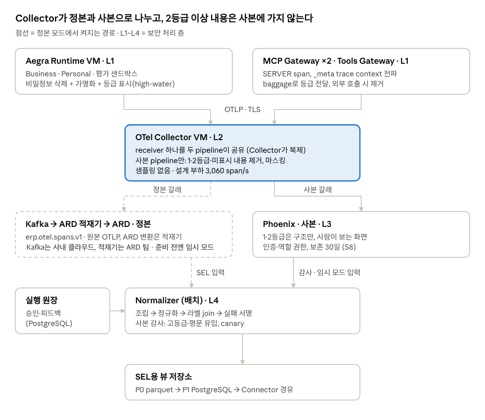
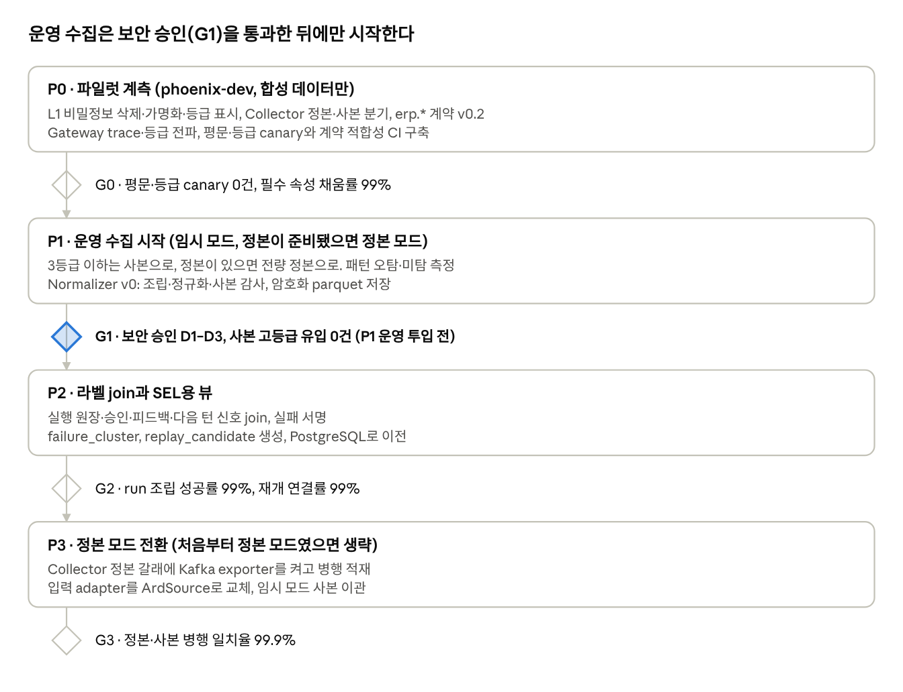

# PRD · Phoenix 기반 에이전트 트레이싱 초기 설계 (정본·사본 분리, 보안 등급 기반)

Oct 26, 2026 · @WIGTN · 상태: 논의용 초안 v3.1 (v3.2 트레이싱 규칙 + Collector 구성안 기준)

## 1. 개요

v3 Business·Personal Runtime의 실행 기록을 정본(Kafka → ARD)과 사본(Phoenix)으로 나눠 수집한다. 보안 2등급 이상 내용은 사본에 들어가지 않게 한다. v3.2 Collector 규칙대로 span은 남기고 내용만 지운다. 정본 경로의 준비 상태와 보안 등급 체계의 세부는 아직 확정되지 않았다. 그래서 확정되지 않은 사항은 설정 스위치로 빼고, 가장 보수적인 기본값으로 초기 작업을 시작한다 (3장).

**배경**

- Deep Tracer가 설계에서 빠졌다. OpenAI Dots는 OTel 트레이스를 주지 않고, 도입도 2027년 하반기다. 당분간 실행 기록의 원천은 Aegra Runtime과 우리 Gateway다. 참고 설계에는 Dots의 행동(action) 로그만 받는 경로가 있다.
- 사본(Phoenix)에는 보안 2등급 이상 데이터를 적재하지 않는다는 방침이 있다. v3.2는 이를 "span은 남기고 2등급 이상 내용만 제거"로 구현한다.
- 참고 설계는 두 가지다. ERP AI 플랫폼 아키텍처 · 연동 규약의 장면 4와, 전체 아키텍처 v3.2의 관측·비동기 영역이다. 구조는 다음과 같다. Collector가 필수 속성을 검사하고 기록을 정본과 사본 두 갈래로 나눈다. 기밀 내용은 사본에서만 제거한다. SEL은 정본만 읽는다.
- v3.2에서 정본 경로는 Kafka(사내 클라우드, topic erp.otel.spans.v1) → ARD 적재기(ARD 팀) → ARD로 그려져 있다. 언제 준비될지는 확정되지 않았다.

**목표**

1. G1 · 완전 수집: 운영·평가 run을 빠짐없이 run 단위로 조립 가능하게 수집한다. 샘플링은 하지 않는다.
2. G2 · 등급 기반 분리: 2등급 이상 내용은 사본에 들어가지 않는다. 사본에는 구조와 메타데이터만 남긴다. 3등급 이하 사본에서도 개인정보와 비밀정보를 걸러 저장한다.
3. G3 · SEL 계약: SEL이 쓸 필드(`erp.*`)를 표준 convention과 분리된 우리 계약으로 고정한다.
4. G4 · 설정으로 흡수: 미확정 사항이 정해지면 설정값을 바꾸는 것만으로 반영한다. 계측 코드와 정규화 코드는 다시 쓰지 않는다.

**비목표**

- SEL 자체의 설계 (별도 문서)
- Dots 행동 로그 수신. `erp.run.source` 값에 자리만 예약한다.
- 기밀 구간 로컬 클라이언트의 관측. ADR-0014의 관측 분리 원칙을 유지한다.
- 정본(Kafka·ARD) 자체의 접근통제 구현. 담당 파트 소관이며, 여기서는 요구사항만 적는다.
- LLM 기반 PII 탐지. 초기에는 규칙 기반만 쓴다.

**성공 판정 (P0 종료 시, 제안값)**: 다음 네 가지를 모두 만족해야 한다.

- 사본의 1·2등급 또는 등급 미표시 span에 내용이 남은 건수 0건
- 평문 canary 검출 0건
- 필수 속성 채움률 99% 이상
- run 조립 성공률 99% 이상

상세 지표는 9장에 있다.

## 2. 정본과 사본, 그리고 시작 모드

최종 구조는 참고 설계와 같다. Collector가 기록을 정본(Kafka → ARD)과 사본(Phoenix)으로 나누고, SEL은 정본만 읽는다. 정본 경로가 아직 준비되지 않았을 수 있으므로, 준비 전에는 **임시 모드**로 시작한다. 두 모드의 차이는 Collector exporter와 정규화 입력 adapter 두 곳뿐이다.

| 구성 요소 | 정본 모드 (목표) | 임시 모드 (정본 준비 전) |
| --- | --- | --- |
| 정본 저장 | Kafka → ARD (Database Connector 경유 적재) | 없음 |
| 사본 저장 | Phoenix. 1·2등급 span은 내용 없이 구조만, 3등급 이하는 본문을 걸러서 | 동일 |
| SEL·정규화 입력 | ARD | Phoenix API. 3등급 이하는 마스킹본, 1·2등급은 메타데이터만 |
| 2등급 이상 run | 내용은 정본에만 저장 | 사본에 메타데이터만. 내용은 어디에도 저장되지 않음 (S6) |
| 계측, `erp.*` 계약, Collector 규칙 | 동일 | 동일 |
| 전환 작업 | — | Collector의 정본 pipeline 활성화, adapter 교체 |

**임시 모드의 한계**: SEL은 3등급 이하 마스킹본과 2등급 이상 메타데이터만 본다. 2등급 이상 업무는 메타데이터(상태, 도구 op, result\_class, 지연)만 남는다. 실패 여부와 빈도는 셀 수 있지만 원인 진단은 할 수 없다. 이 한계는 정본 모드로 전환하면 사라진다. 그 전까지 2등급 이상 업무의 SEL 분석 결과에는 "메타데이터 기준"이라고 표시한다.

**Collector를 따로 두는 이유** (Phoenix도 OTLP를 직접 받을 수 있음)

- **분기 지점**: 정본에는 원문을 두고 사본에서만 기밀을 빼려면, 갈라지는 지점이 앱 밖에 하나 있어야 한다. 앱에서 마스킹해 버리면 정본까지 마스킹된다.
- **모드 전환 비용**: 정본 모드로 바꿀 때 Collector에 Kafka exporter 하나만 추가하면 된다. Runtime과 Gateway는 다시 배포하지 않는다.
- **장애 분리**: Phoenix나 Kafka가 멈춰도 Collector가 버퍼링한다. 에이전트 실행 경로가 관측 시스템에 묶이지 않는다.
- **단일 입구**: v4 설계에서 트레이스가 사내 클라우드로 들어오는 입구는 Collector 하나다. Phoenix와 Kafka의 수신 포트는 Collector에게만 열면 된다.

**정본 모드 전환 조건**

1. Kafka topic 규격과 ARD 실행 기록 테이블이 확정된다.
2. 병행 기간에 정본과 사본의 run 건수 일치율이 수용 기준(9장)을 넘는다.
3. 임시 모드 기간 데이터는 사본(3등급 이하 마스킹본, 2등급 이상 메타데이터)만 정본으로 1회 이관한다. 완전한 정본은 전환 시점부터 쌓인다.

정본 경로가 P1 시작 전에 준비되면 임시 모드는 건너뛰고 처음부터 정본 모드로 수집한다.

## 3. 보안 원칙: 등급 기반 내용 제거와 보조 마스킹

사본의 주된 통제는 보안 등급 기반 내용 제거다. 마스킹은 등급으로 잡히지 않는 개인정보와 비밀정보만 맡는다. 거꾸로 등급 표시가 틀리면 마스킹으로는 메울 수 없다. "2등급 문서를 요약한 문장"은 패턴으로 찾을 수 없기 때문이다. 그래서 등급을 정확히 붙이고 전파하는 것이 가장 중요한 구현 항목이다.

**원칙**

1. **등급 우선**: 모든 span에 `erp.data.grade`를 붙인다. 사본 갈래는 2등급 이상이거나 등급이 없는 span의 내용을 지우고 구조와 메타데이터만 남긴다 (v3.2 규칙, fail-safe).
2. **등급 상속 (high-water mark)**: run이 2등급 문서나 조회 결과를 읽은 시점부터, 그 run의 이후 span은 그 등급을 이어받는다. 등급은 내려가지 않는다. ADR-0013의 등급 상속과 같은 원칙이다. 그 이전 span은 2등급 내용을 담고 있지 않으므로 원래 등급을 유지한다.
3. **비밀정보는 어디에도 저장하지 않음**: 토큰, API 키, Authorization 헤더, 쿠키는 정본과 사본 모두에 저장하지 않는다. 앱(L1)에서 지운다.
4. **사본은 최소화**: 3등급 이하라도 사본에는 도구 출력과 검색 문서 본문을 넣지 않고 구조 요약만 넣는다. 남은 본문에는 개인정보 패턴 마스킹을 적용한다.
5. **키 기반 가명화**: 사번 같은 식별자는 HMAC-SHA256으로 가명화한다. 키는 시크릿 저장소에 두고, Runtime이 기동할 때만 읽는다. 시크릿 저장소는 Vault, Kubernetes Secret, 사내 KMS처럼 비밀값의 접근 통제·감사·교체를 맡는 관리 시스템이다. 키가 코드나 설정 파일, 코드 저장소에 들어가면 안 된다. 키를 가진 사람은 전 사번의 가명값을 미리 계산해 실명을 거꾸로 찾을 수 있기 때문이다.
6. **실패 시 처리**: 등급 판정에 실패한 span은 사본에서 내용을 지운다. 마스킹에 실패한 값은 `[REDACTION_FAILED]`로 바꾸고 사유를 남긴다. 버리는 것은 사본의 해당 값뿐이다. 원본은 정본과 체크포인트에 남는다.

**등급의 출처**

| 출처 | 무엇에 등급을 주나 | 확인 상태 |
| --- | --- | --- |
| 에이전트 매니페스트 `governance.data_scope.classification` | run의 시작 등급 (하한) | v3 규격에 있음 |
| RAG 문서 메타데이터 (Milvus 권한 메타데이터) | 검색된 문서 | 등급 필드가 있는지 확인 필요 |
| DRM 등급 | 보안 문서 해제 시 원본 등급 | 기밀 구간 설계에 있음. Runtime 경로 연동은 확인 필요 |
| 도구 오퍼레이션 등급 (Tool 레지스트리) | SAP 조회 결과 등 | 현재 규격에 없음. 필드 추가 제안 |
| 사용자 입력 | 자유 텍스트 | 등급 없음. run의 현재 등급을 따르고 개인정보 마스킹을 적용 |

**미확정 사항의 설정 스위치**

답을 기다리지 않고 시작하기 위해, 미확정 사항은 모두 Collector와 L1 처리기의 설정값으로 둔다. 기본값은 가장 보수적인 쪽으로 정했다. 확정되면 값만 바꾼다.

| 스위치 | 모르는 것 | 기본값 | 확정되면 |
| --- | --- | --- | --- |
| S1 `grade_threshold` | 사본에서 내용을 지울 기준 등급 | 2 (확정. 1이 가장 민감하며, 1·2등급 내용 제거) | 확정됨 |
| S2 `unlabeled_policy` | 등급이 없는 span 처리 | 사본에서 내용 제거 (구조·메타데이터만) | 등급 출처가 갖춰지면 재검토 |
| S3 `grade_scope` | 등급 단위가 span인지 run인지 | span 단위 + high-water mark | run 단위로 정해지면: 매니페스트 등급이 기준 이상인 에이전트는 run 전체의 내용을 사본에서 사전 제거 |
| S4 `pii_masking` | 개인정보의 보안 등급 | 켬 (3등급 이하 사본에도 패턴 마스킹) | 개인정보가 2등급 이상이어도 유지 권장. 패턴 탐지가 유일한 탐지 수단이기 때문 |
| S5 `canonical_content` | 정본에 원문을 어디까지 둘지 | 비밀정보만 빼고 저장, 값별 크기 상한 | 보안 파트 결정 (D1) |
| S6 `interim_high_grade` | 임시 모드에서 2등급 이상 run을 어떻게 할지 | 수집하지 않음 | 승인되면 암호화 임시 저장소에 보관 |
| S7 `copy_high_grade_metadata` | 2등급 이상 run의 메타데이터를 사본에 둘지 | 켬 (v3.2: 내용만 지우고 구조는 남김) | 메타데이터도 불허되면 span 전체 삭제로 전환 (filter processor) |
| S8 `copy_retention_days` | 사본 보존 기간 | 30일 (참고 설계 값) | 보안 파트 결정 |
| S9 `copy_sampling` | Phoenix가 설계 부하(3,060 span/s)를 감당하는지 | 없음 (전량) | 부하 시험에서 부족하면 사본 갈래에만 샘플링. 정본은 항상 전량 |

**등급 번호 방향 (확정)**: 1이 가장 민감하다. "2등급 이상"은 1·2등급을 뜻하고, 조건식으로는 `erp.data.grade <= 2`다. 일부 그림의 "L2 이하 통과, L3 이상 drop" 표기는 이와 반대 방향이므로 따르지 않는다. "L" 표기는 보안 처리 층(L1–L4)과 헷갈리므로, 이 문서에서 등급은 "N등급"으로만 쓴다.

**데이터 종류별 처리 규칙**

| 데이터 | 정본 (Kafka → ARD) | 사본 (Phoenix) |
| --- | --- | --- |
| 2등급 이상 span, 등급 미표시 span | 저장 | 내용 제거. span 이름, 시간, 상태, 식별자, result\_class만 남김 |
| 토큰, API 키, 쿠키 | 저장 안 함 | 저장 안 함 |
| 사번 등 식별자 전용 필드 | HMAC 가명화 (원값 허용 여부는 S5) | HMAC 가명화 |
| 사용자 입력, 모델 출력 | 저장 | 개인정보 패턴 마스킹 + 길이 상한 |
| 도구 출력 (SAP 조회 결과 등) | 저장 (크기 상한) | 본문 제거. `erp.tool.output.summary`(result\_class, 행 수, 컬럼명, 오류 코드)만 |
| RAG 검색 문서 | 저장 | 본문 제거. 문서 id, 등급, 점수만 |
| 자산 본문 (SKILL, Prompt, 시스템 프롬프트) | `ref@version#digest`만 (원본은 자산 저장소) | 동일 |
| 도구 정의 (LLM에 넘긴 tool schema) | 도구 op 목록만 | 동일 |
| 금액·수량 (본문 속) | 저장 | 유지 (제안, D2) |
| 임직원·거래처 이름 (3등급 본문 속) | 저장 | 규칙으로 안정적으로 잡히지 않음. 11장 리스크 |

첫 행 규칙이 우선한다. 1·2등급과 등급 미표시 span은 아래 행과 상관없이 내용이 모두 지워진다. 둘째 행부터는 3등급 이하 span에 적용하는 규칙이다.

## 4. 아키텍처

트레이스는 Runtime과 Gateway에서 나와 Collector 하나로 들어온다. Collector는 필수 속성을 검사한 뒤 정본 갈래와 사본 갈래로 나눈다. 사본 갈래에서만 2등급 이상 내용 제거, 본문 요약화, 개인정보 마스킹을 한다. Phoenix와 Kafka의 수신 포트는 Collector에게만 열린다.



점선은 정본 모드에서 켜지는 경로다. 정본 모드에서 Normalizer는 SEL 입력을 ARD에서 읽고, Phoenix는 사본 감사용으로만 읽는다. Runtime, Gateway, Collector 규칙은 바뀌지 않는다.

**구성 요소와 배포 단위** (v4 배포 배치도 기준)

| 구성 요소 | 배포 단위 | 보안 역할 |
| --- | --- | --- |
| Aegra Runtime (Business·Personal·평가 샌드박스) | Agent Runtime VM | L1: 비밀정보 삭제, 가명화, 등급 표시(high-water), 구조 요약 속성 생성 |
| 권한체계 MCP Gateway, 자산 MCP Gateway, Tools Gateway | 게이트별 VM | L1: 자기 span 계측, trace context 중계, baggage 필터, 등급 전달 |
| OTel Collector | OTel Collector VM | L2: 필수 속성 검사, 정본·사본 분기, 사본 갈래의 등급 기준 내용 제거·본문 요약화·마스킹 |
| Kafka(사내 클라우드) → ARD 적재기 (정본 모드) | Kafka는 사내 클라우드, 적재기는 ARD 팀 | 정본. topic ACL, 전송·저장 암호화, ARD RLS (요구사항만 기술) |
| Phoenix + 전용 PostgreSQL | Phoenix VM | L3: 인증, 접근통제, 보존 정책 |
| 정규화 작업 (Normalizer) | 배치 작업. 위치는 결정 필요 | L4: 사본 감사(고등급·평문 유입 스캔), SEL용 뷰 생성 |

**네트워크 경로**

| 구간 | 프로토콜 | 조건 |
| --- | --- | --- |
| Runtime·Gateway → Collector | OTLP (gRPC 또는 HTTP) | TLS. 출발지를 Runtime·Gateway VM으로 제한. 이 구간에는 원문이 흐르므로 사내 클라우드 내부 구간으로 한정 |
| Collector → Kafka (정본 모드) | Kafka 프로토콜 | TLS, topic 쓰기 ACL은 Collector 계정만 |
| Kafka → ARD | 적재기 → Database Connector | v4 `batch_load` 경로 |
| Collector → Phoenix | OTLP | Phoenix 수신 포트는 Collector 출발지만 허용 |
| 사용자 → Phoenix UI | HTTPS | reverse proxy 뒤. SSO 연동은 확인 필요 |
| Normalizer → ARD 또는 Phoenix API | Connector 규약 / HTTPS | 읽기 전용 서비스 계정 |
| Phoenix → 외부 | 없음 | 외부 LLM 호출·원격측정 차단 (7장) |

**설계 부하** (v3.2 기준): Collector 3,060 span/s, 공통 진입점 1,000 RPS, Kafka 복제 3, 디스크 1.5TB 이상. 샘플링 없이 이 양이 사본 갈래로도 흐른다. Phoenix 단일 인스턴스와 그 PostgreSQL이 이 유입량을 감당하는지는 **모른다**. 그래서 P0 부하 시험 항목으로 둔다. 감당하지 못하면 사본 갈래에만 샘플링을 거는 스위치 S9를 쓴다. 정본 갈래는 계속 전량을 보낸다.

## 5. 계측 명세

표준 속성(OpenInference, OTel `gen_ai.*`)은 auto-instrumentation이 내는 대로 둔다. SEL과 보안에 결정적인 필드는 전부 `erp.*` 네임스페이스로 따로 낸다. OTel GenAI 규약은 2026년 7월 기준으로 모든 속성이 Development 단계이고, 6월에 전용 저장소로 분리됐다. Phoenix는 15.10.0부터 `gen_ai.*`를 OpenInference로 변환한다. 표준이 바뀌어도 SEL과 등급·마스킹 규칙이 흔들리지 않게 하려고 분리한다. 자산 버전 속성 이름은 참고 설계에 맞춰 `erp.asset.refs`로 쓴다.

**run 하나의 span 트리** (v3 실행 루틴 standard-v1 기준)

```
AGENT     invoke_agent {agent_id}       root: erp.run_id, session.id = thread_id, erp.data.grade(최종)
├─ CHAIN  context_restore
├─ CHAIN  asset_load                     erp.asset.refs
├─ CHAIN  turn                           (반복)
│  ├─ LLM        chat                    erp.llm.purpose, erp.data.grade
│  ├─ CHAIN      skill.load              erp.skill.ref
│  ├─ GUARDRAIL  tool_policy             allow / deny / interrupt
│  ├─ RETRIEVER  rag_search              문서 등급 → high-water 갱신
│  └─ TOOL       execute_tool {op}       erp.tool.*, 결과 등급 → high-water 갱신
│     └─ (Gateway SERVER span들)         MCP _meta로 연결
├─ GUARDRAIL output_validator
└─ CHAIN  checkpoint_emit
```

**`erp.*` 속성 계약 v0.2**

| 속성 | 위치 | 타입 | 필수 | 누락 시 처리 |
| --- | --- | --- | --- | --- |
| `erp.run_id` | root, Gateway span (baggage 경유) | string | 예 | run 조립 실패로 집계 |
| `erp.thread_id` (= `session.id`) | root | string | 예 | 위와 동일 |
| `erp.request_id` | root, Gateway span | string | 예 | 원장 join 불가로 집계 |
| `erp.area` | resource | enum: biz, personal, sel | 예 | 위반 표시 (erp.contract.violation). 폐기하지 않음 |
| `erp.agent_id`, `erp.agent_version` | root | string | 예 | 집계 |
| `erp.run.source` | root, baggage | enum: prod, eval, replay, dev, dots(예약) | 예 | Collector가 `unknown`으로 태깅하고 eval 쪽으로 격리 |
| `erp.eval.job_id`, `erp.eval.case_id` | root | string | source=eval일 때 | 집계 |
| **`erp.data.grade`** | 모든 span | int (1이 가장 민감) | 예 | 사본에서 내용 제거 (S2) |
| `erp.data.grade.source` | 모든 span | enum: manifest, rag, drm, tool, inherited | 예 | 집계 |
| `erp.user.pid` (= `user.id`) | root | string, HMAC 가명 | 예 | 집계 |
| `erp.asset.refs` | asset\_load | string\[\]: `kind/name@ver#sha256:앞8자` | 예 | 버전 비교 불가로 집계 |
| `erp.skill.ref` | skill.load | string | 로드 시 | 집계 |
| `erp.routing.choice`, `erp.routing.confidence` | root | string, double | Orchestrator 경유 시 | 집계 |
| `erp.tool.op` | TOOL | string, 예: `tool.sap.fi/query_entries` | 예 | 집계 |
| `erp.tool.mode` | TOOL | enum: read, dry\_run, commit | 예 | 집계 |
| `erp.tool.audit_id` | TOOL | string | Tools Gateway 경유 시 | 집계 |
| `erp.tool.result_class` | TOOL | enum: ok, empty, client\_error, server\_error, denied, timeout | 예 | `unknown`으로 태깅 |
| `erp.tool.output.summary` | TOOL | JSON string: 행 수, 컬럼명, 오류 코드 | 예 | 사본에는 요약 없이 본문만 제거 |
| `erp.llm.purpose` | LLM | enum: main, router, judge, summarize, title | 예 | `main`으로 간주하고 집계 |
| `erp.validator.result` | output\_validator | enum: pass, fail + 오류 코드 | 예 | 집계 |
| `erp.hitl.decision` | 재개 root | enum: approve, edit, reject | 재개 시 | 집계 |
| `erp.hitl.wait_ms` | 재개 root | int | 재개 시 | 없음 |
| `erp.hitl.edit_ref` | 재개 root | string (원장 키, diff 본문 아님) | decision=edit일 때 | 집계 |
| `erp.redaction.profile` | root (L1이 기록) | string, 예: `l1-v1` | 예 | 사본 갈래에서 가장 엄격한 규칙으로 처리 |
| `erp.redaction.copy` | 사본 갈래의 span (L2가 기록) | string, 예: `copy-v1` | 사본에서 예 | 사본 감사(L4)에서 미처리로 경보 |
| `erp.redaction.error` | 마스킹이 실패한 span | string: 실패 사유 코드 | 실패 시 | 없음. 9장 처리기 오류 지표로 집계 |

"집계"는 9장의 계약 누락률 지표로 보낸다는 뜻이다. 계약은 버전을 붙여 관리하고, 필드 추가는 마이너, 의미 변경은 메이저로 올린다.

**필수 속성 위반은 표시만 하고 버리지 않는다** (v3.2 Collector 규칙). Collector는 누락된 필수 속성 이름을 `erp.contract.violation`에 적고 정본으로 그대로 보낸다. 사본 갈래의 등급 규칙은 별개로 적용된다. 그래서 등급이 없는 위반 span은 사본에서 내용이 지워진다(S2).

**Runtime 미들웨어와 속성의 대응** (v3.2 Aegra 미들웨어 8단 기준)

| 미들웨어 | 기록하는 속성 |
| --- | --- |
| Context | `erp.run_id`, `erp.thread_id`, `erp.request_id`, `erp.user.pid` |
| AssetResolve, Stamp | `erp.asset.refs` (해석된 자산 버전) |
| GradeGuard | `erp.data.grade`, `erp.data.grade.source` (high-water 갱신) |
| ToolRoute | `erp.tool.op`, `erp.tool.mode`, `erp.tool.result_class`, `erp.tool.output.summary` |
| Budget | 토큰·호출 수 (표준 속성) |
| HITL | `erp.hitl.decision`, `erp.hitl.wait_ms`, `erp.hitl.edit_ref` |
| Outcome | `erp.validator.result`, run 종료 상태 |

공통 진입점은 응답 `_meta`의 `erp/assetRef`를 보존한다(v3.2). Gateway span은 이 값을 `erp.asset.refs`로 싣는다. 그래서 Aegra 밖(Dots 등)에서 온 호출도 어떤 자산 버전을 썼는지 정본에 남는다.

**등급 high-water 구현**: Runtime은 run 컨텍스트에 "현재 최고 등급"을 하나 둔다. 시작값은 매니페스트 등급이다. RAG 문서, DRM 해제, 도구 결과의 등급이 더 높으면 그 값으로 올린다. 이후 생성되는 모든 span은 이 값을 `erp.data.grade`로 갖는다. root span은 맨 마지막에 끝나므로 run의 최종 최고 등급을 갖는다. 승인 재개 run은 체크포인트에 저장된 최고 등급에서 다시 시작한다.

**이름 규칙**: span 이름에는 id나 사용자 값을 넣지 않는다. 이름은 cardinality가 낮아야 하고, 사용자 값은 속성으로만 싣는다.

**승인 재개 trace 연결**: 승인 대기에는 상한이 없고 재개는 다른 워커가 하므로 새 trace가 된다. 중단 시점의 trace\_id와 span\_id를 체크포인트 메타데이터에 저장한다. 재개 root span은 같은 `erp.run_id`를 갖고, 원래 span으로의 OTel span link를 건다. 정규화 작업은 trace가 아니라 `erp.run_id`로 run을 조립한다.

**MCP 구간 전파**: MCP 규약 SEP-414(Final)에 따라 `params._meta`의 `traceparent`, `tracestate`, `baggage`로 trace context를 전파한다. 세 Gateway는 이 값을 받아 SERVER span을 만들고 하위 호출에 다시 싣는다.

**baggage 정책**: baggage에는 `erp.run_id`, `erp.request_id`, `erp.run.source`, `erp.area`, `erp.data.grade`만 허용한다. Gateway span도 등급을 가져야 사본 갈래에서 걸러지기 때문이다. 사용자 정보는 절대 싣지 않는다. baggage는 하위 시스템으로 그대로 전달되기 때문이다. Tools Gateway는 SAP 등 외부 업무 시스템으로 나가는 호출에서 baggage를 제거한다.

## 6. 보안 처리 파이프라인 상세

각 층이 맡는 일은 다음과 같다.

- **앱(L1)**: 정본에도 남으면 안 되는 것만 처리한다. 비밀정보 삭제, 가명화, 등급 표시, 요약 속성 생성이다.
- **Collector(L2)**: 사본 갈래에서만 등급 기준 내용 제거, 본문 요약화, 개인정보 마스킹을 한다.
- **Normalizer(L4)**: 저장된 사본을 감사한다.

마스킹을 L1에서 Collector로 옮긴 이유는 정본에 원문이 필요하기 때문이다. 앱에서 마스킹하면 정본까지 마스킹된다. 대신 사본의 방어선이 Collector 사본 갈래 하나로 줄어든다. 이를 보완하는 장치는 세 가지다. 등급이 없으면 사본에서 내용을 지우는 fail-safe 기본값, 배포 전 CI 시험, 저장 후 L4 감사다.

### L1 · 앱 (Runtime·Gateway 프로세스 안)

1. **OpenInference TraceConfig**: `hide_llm_tools`, `hide_llm_prompts`, `hide_embedding_vectors`, `hide_input_images`를 켠다. 정본에도 필요 없는 항목들이다. 우선순위는 코드의 TraceConfig, 환경변수, 기본값 순이다.
2. **처리기** (exporter 앞단, custom span processor):
   1. 비밀정보 키 삭제. 값 패턴(Bearer 토큰, API 키 형식)도 삭제한다.
   2. 식별자 필드 가명화: `erp.user.pid = HMAC-SHA256(key_v, 사번)`. 키는 시크릿 저장소에서 읽고 키 버전을 함께 기록한다.
   3. system 역할 메시지 → 자산 ref로 치환
   4. 등급 표시: run의 high-water 값을 `erp.data.grade`로, 출처를 `erp.data.grade.source`로 기록 (5장). 값은 GradeGuard 미들웨어가 계산한다
   5. TOOL span에 `erp.tool.output.summary` 생성. 사본 갈래가 본문을 지운 뒤에도 진단에 쓸 정보다.
   6. retrieval 문서에 id와 등급 속성 부착
   7. `erp.redaction.profile` 기록
3. **실패 처리**: 비밀정보 처리에 실패한 속성은 `[REDACTION_FAILED]`로 바꾸고, `erp.redaction.error`에 사유를 남긴다. 등급 계산에 실패하면 `erp.data.grade`를 비워 둔다. 비어 있으면 사본에서 내용이 자동으로 지워진다.

### L2 · OTel Collector

v3.2 Collector 규칙과 Collector 구성안 그림(내부 참조)을 합쳐 다음처럼 구성한다. OTLP receiver 하나를 정본·사본 두 pipeline이 같이 쓴다. Collector는 한 receiver가 받은 데이터를 연결된 pipeline마다 복제해 넘기고, 한 pipeline이 속성을 지워도 다른 pipeline의 데이터는 바뀌지 않는다. 그래서 분기용 connector는 두지 않는다. v3.2에 있는 Dots 로그의 action span 변환은 이번 범위에서 빼고 receiver 자리만 예약한다.

1. **두 pipeline 공통 앞단**: memory\_limiter, 비밀정보 안전망(인증 헤더·쿠키 키 삭제), 필수 속성 검사(위반 표시, 폐기 없음). 같은 처리기 설정을 두 pipeline에 각각 건다.
2. **정본 pipeline**: batch → Kafka exporter (topic erp.otel.spans.v1)
   1. 원본 OTLP(protobuf)를 그대로 보낸다. ARD 테이블 형태로 바꾸는 일은 Kafka 뒤의 ARD 적재기가 한다 (아래 "Collector에서 ARD 형태로 가공하지 않는 이유").
   2. Kafka 장애에 대비해 디스크 기반 전송 큐(sending\_queue + file\_storage)를 건다. 디스크 고장이나 재시도 한도 초과 때는 여전히 유실될 수 있다.
   3. .dlq topic은 적재기가 처리 실패분을 보내는 곳으로 본다. Collector의 Kafka exporter 자체에는 DLQ 기능이 없다.
   4. 정본 모드에서만 켠다. 임시 모드에서는 S6 기본값에 따라 내보내지 않는다.
3. **사본 pipeline**
   1. 등급 기준 내용 제거: `erp.data.grade`가 없거나 S1 기준 이하(1·2등급)이면 내용 속성을 지운다. 입출력 값, 메시지, 도구 출력과 요약, 검색 문서가 대상이다. span 이름, 시간, 상태, 식별자, result\_class는 남긴다. 조건에는 `== nil`을 반드시 명시한다. OTTL에서 nil과의 대소 비교는 false가 되므로, 빼먹으면 등급 없는 span이 그대로 통과한다(fail-open). S7을 끄면 span 전체를 삭제한다
   2. 3등급 이하 span의 본문 제거: TOOL `output.value`, retrieval 문서 본문
   3. 비밀정보·개인정보 패턴 마스킹 (S4). 오탐·미탐 테스트셋을 통과한 필수 유형만 건다
   4. 길이 상한
   5. `erp.redaction.copy` 기록
   6. 프로젝트 라우팅
   7. batch → Phoenix
4. **로그**: 에이전트가 OTel 로그를 내면 logs pipeline은 정본(Kafka)으로만 보낸다. 사본(Phoenix)으로는 보내지 않는다. Phoenix 문서는 trace 수신만 설명하고 있고, 로그는 사람이 Phoenix에서 볼 필요가 없다. 로그에도 L1 비밀정보 삭제와 Collector 비밀정보 안전망을 똑같이 적용한다.

패턴을 한 번 더 거는 별도 안전망(redaction processor)은 두지 않는다. 같은 패턴을 다시 걸면 새로 잡히는 것이 없고, 더 넓은 패턴을 걸면 사본의 진단 정보만 줄어든다. 넓은 패턴 검사는 저장 후 L4 감사에서 한다.

**본문 마스킹 패턴 초안** (사본 갈래에서 적용)

| 대상 | 패턴 초안 | 치환 | 비고 |
| --- | --- | --- | --- |
| 주민·외국인등록번호 | `\d{6}-?[1-8]\d{6}` | `[RRN]` | 법인등록번호와 형태가 겹쳐 함께 잡힘 |
| 사업자등록번호 | `\d{3}-\d{2}-\d{5}` | `[BRN]` |  |
| 카드번호 | `(\d{4}[- ]?){3}\d{4}` | `[CARD]` | OTTL로 Luhn 검사를 할 수 없어 넓게 잡음. 오탐 감수 |
| 휴대전화 | `01[016789]-?\d{3,4}-?\d{4}` | `[PHONE]` |  |
| 이메일 | 표준 이메일 패턴 | `[EMAIL]` |  |
| 계좌번호 | 은행별 형식이 달라 일반 패턴은 오탐이 큼 | `[ACCT]` | 형식 목록 확인 필요 |
| 사번 | 사내 형식 | `[EMP]` | 형식 확인 필요 |
| 내부 IP·호스트명 | IPv4, 사내 도메인 | `[HOST]` |  |

전표번호나 문서번호가 계좌번호 패턴에 오탐되면 진단 정보가 사라진다. 그래서 패턴은 운영 샘플로 만든 오탐·미탐 테스트셋을 통과해야 배포한다 (9장). 정본에는 마스킹을 적용하지 않으므로, 오탐의 피해는 사본에만 남는다.

```yaml
# 초안: 함수명·옵션 키는 배포할 Collector 버전에서 검증 필요
extensions:
  file_storage: {directory: /var/lib/otelcol/queue}    # 정본 pipeline 디스크 큐
receivers:
  otlp: {protocols: {grpc: {}, http: {}}}
processors:
  memory_limiter: {check_interval: 1s, limit_percentage: 80}
  attributes/drop-secrets:
    actions:
      - {key: http.request.header.authorization, action: delete}
      - {key: http.request.header.cookie, action: delete}
  # transform/contract-mark: 필수 속성 검사(위반 표시, 폐기 없음). 규칙은 계약 v0.2 확정 후 작성
  transform/copy-grade-strip:   # S1, S2, S7: 등급 없음 또는 1·2등급은 내용만 삭제, span은 유지
    error_mode: ignore
    trace_statements:
      - context: span
        conditions:
          # nil을 명시해야 한다. nil과의 대소 비교는 false라서 빼면 등급 없는 span이 통과한다
          - 'attributes["erp.data.grade"] == nil or attributes["erp.data.grade"] <= ${env:COPY_GRADE_THRESHOLD}'
        statements:
          - delete_matching_keys(attributes, "^(input|output)\\.value$")
          - delete_matching_keys(attributes, "^llm\\.(input|output)_messages\\..*")
          - delete_matching_keys(attributes, "^retrieval\\.documents\\..*")
          - delete_key(attributes, "erp.tool.output.summary")
          - set(attributes["erp.redaction.copy"], "grade-stripped-v1")
  # S7을 끄면 위 대신 filter processor로 span 전체 삭제 (조건은 위와 같게, nil 포함)
  transform/copy-strip:         # 3등급 이하 span: 본문 제거 + 필수 유형 패턴 마스킹
    error_mode: ignore
    trace_statements:
      - context: span
        statements:
          - delete_key(attributes, "output.value") where attributes["openinference.span.kind"] == "TOOL"
          - delete_matching_keys(attributes, "^retrieval\\.documents\\..*\\.document\\.content$")
          - replace_all_patterns(attributes, "value", "\\d{6}-?[1-8]\\d{6}", "[RRN]")
          - replace_all_patterns(attributes, "value", "01[016789]-?\\d{3,4}-?\\d{4}", "[PHONE]")
          - set(attributes["erp.redaction.copy"], "copy-v1")
  batch: {}
exporters:
  kafka/canonical:
    brokers: ["${env:KAFKA_BROKERS}"]
    traces: {topic: erp.otel.spans.v1, encoding: otlp_proto}   # 원본 OTLP 그대로. ARD 형태 변환은 적재기
    logs: {topic: erp.otel.logs.v1, encoding: otlp_proto}      # topic 이름은 제안값
    sending_queue: {enabled: true, storage: file_storage}
  otlp/phoenix:
    endpoint: ${env:PHOENIX_OTLP_ENDPOINT}
service:
  extensions: [file_storage]
  pipelines:
    traces/canonical:           # 정본 모드에서만 활성화
      receivers: [otlp]         # 같은 receiver를 두 pipeline이 공유. Collector가 복제해 전달
      processors: [memory_limiter, attributes/drop-secrets, batch]
      exporters: [kafka/canonical]
    traces/copy:
      receivers: [otlp]
      processors: [memory_limiter, attributes/drop-secrets, transform/copy-grade-strip, transform/copy-strip, batch]
      exporters: [otlp/phoenix]
    logs/canonical:             # 로그는 정본만. 사본으로 보내지 않음
      receivers: [otlp]
      processors: [memory_limiter, attributes/drop-secrets, batch]
      exporters: [kafka/canonical]
```

**span을 빼지 않고 내용만 지우는 이유** (v3.2 규칙): span을 통째로 빼면, run 도중 2등급을 읽은 순간 이후 span과 root span이 사본에서 사라진다. 그러면 trace가 끊기고, 실패율 집계에서도 2등급 run이 빠진다. 내용만 지우면 trace 구조와 실패 여부는 남고 2등급 내용은 남지 않는다. 메타데이터 자체(도구 op 이름, 오류 코드)도 민감하다고 판정되면 S7을 꺼서 span 전체 삭제로 바꾼다.

**tail sampling은 쓰지 않는다**: SEL은 실패한 run뿐 아니라 같은 skill이 성공한 run도 비교 기준으로 쓴다. 성공 기록을 버리면 실패율의 분모가 틀어진다.

**Collector에서 ARD 형태로 가공하지 않는 이유**: Collector는 span을 하나씩 처리하므로 run 조립이나 라벨 join을 할 수 없다. 또 ARD 스키마가 바뀔 때마다 Collector를 다시 배포해야 하고, Kafka에 원본이 없으면 규칙이 바뀐 뒤 과거 데이터를 다시 처리할 수 없다. 그래서 Kafka에는 원본 OTLP를 그대로 두고, ARD 형태 변환은 적재기가, SEL용 정규화는 Normalizer가 맡는다. 속성 이름을 바꾸는 정도의 가벼운 가공도 적재기 쪽에 둔다.

### L4 · 사본 감사 (Normalizer)

1. **고등급 유입 스캔**: Phoenix에 `erp.data.grade`가 없거나 기준 이하인 span에 내용 속성이 남아 있는지 주기적으로 조회한다. 1건이라도 있으면 경보를 내고 삭제 절차로 넘긴다. Phoenix API로 삭제가 되는지는 확인이 필요하다.
2. **평문 스캔**: 사본 갈래보다 넓은 패턴으로 다시 검사한다.
3. **Canary 시험** (dev·eval 환경, 정기 실행):
   - 평문 canary: 가짜 주민번호, 가짜 계좌번호, 가짜 사번을 넣은 합성 요청을 실행한다.
   - 등급 canary: 2등급으로 표시한 합성 문서를 읽는 합성 run을 실행한다. 그 이후 사본 span에 합성 문서의 문구가 남아 있으면 실패다.
   - 둘 중 어느 쪽이든 사본에서 발견되면 배포 차단 사유다.

## 7. Phoenix 구성 (L3)

Phoenix는 운영용과 개발용, 인스턴스 2개로 나눈다. Phoenix 인스턴스 하나는 테넌트 하나이고, 그 안의 접근 권한은 역할 기반으로만 나뉜다. 프로젝트나 데이터셋 단위로 권한을 거는 resource tag 기능은 2026년 후반 예정으로만 발표되어 있다. 그래서 "이 프로젝트는 일부 인원만 본다"를 지금은 같은 인스턴스 안에서 보장할 수 없다.

Phoenix는 사람이 보는 **사본**이다. 1·2등급 span은 내용 없이 구조만, 3등급 이하는 본문을 걸러서 들어온다. 정본 모드에서 SEL은 Phoenix를 읽지 않고, Normalizer는 사본 감사(L4)를 위해서만 Phoenix를 읽는다. 임시 모드에서만 Phoenix가 SEL의 입력이 된다.

**인스턴스와 프로젝트**

| 인스턴스 | 담는 데이터 | 프로젝트 | 접근 |
| --- | --- | --- | --- |
| phoenix-ops (사내 클라우드) | 운영·평가 run. 1·2등급 span은 Collector에서 내용을 지운 구조만. 평가도 실제 조회 데이터를 쓰므로 운영과 같은 접근 등급으로 취급 | `erp-biz-prod`, `erp-personal-prod`, `erp-eval`, `erp-replay`, `erp-unknown` | FW 코어 + 승인된 운영자만 |
| phoenix-dev | 합성 데이터와 canary 시험 | `erp-dev` | 개발자 |

프로젝트는 Collector가 `erp.area`와 `erp.run.source`를 보고 리소스 속성 `openinference.project.name`으로 지정한다. 이 리소스 속성명은 배포 버전에서 확인이 필요하다. Gateway span도 baggage로 받은 값으로 같은 프로젝트에 들어가야 trace가 쪼개지지 않는다.

**인증과 계정**

- 인증 기능을 켠다. Phoenix는 OAuth2, LDAP, 로컬 계정을 지원한다. 사내 IAM과 OAuth2·LDAP 중 어느 쪽으로 연동할 수 있는지는 확인이 필요하다.
- 로컬 계정은 비상용 관리자 1개로 제한하고, 강한 비밀번호 정책을 켠다.
- Normalizer는 읽기 전용 API 키를 쓴다. API 키의 권한 범위를 어디까지 좁힐 수 있는지는 확인이 필요하다.
- 열람 감사: Phoenix 자체 열람 감사 로그가 있는지는 확인하지 못했다. 그래서 reverse proxy의 접근 로그를 감사 기록으로 보관한다.

**저장소와 보존**

- 전용 PostgreSQL을 쓰고, 저장 시 암호화를 적용한다. 공유 DB를 써야 한다면 `PHOENIX_SQL_DATABASE_SCHEMA`로 스키마를 분리한다.
- Phoenix의 기본 보존 기간은 무기한(0일)이다. 반드시 바꾼다. 보존 정책은 기간 또는 trace 수 기준으로 프로젝트마다 다르게 걸 수 있다.
- **보존 기간 충돌 해결**: 보안은 짧은 보존을, SEL은 긴 비교 기간(v3: 평가 기간 이상)을 원한다. 사본 span은 Phoenix에서 짧게 보존한다. 참고 설계 값은 30일이다(S8). SEL의 장기 비교는 정본(ARD)으로 한다. 임시 모드 기간에만 Normalizer가 마스킹된 구조화 레코드를 추출해 따로 보존한다. 기간 값은 보안 파트와 정한다.

**외부 전송 차단**

- Phoenix가 보내는 원격측정은 기본 웹 분석뿐이고 trace 데이터는 포함하지 않는다고 문서에 적혀 있다. 그래도 폐쇄망 원칙에 따라 끈다. 변수명은 배포 버전에서 확인한다.
- Playground처럼 span 내용을 LLM에 보내는 기능은 사내 LLM Gateway만 쓰게 제한하거나 끈다.
- 데이터셋은 span 본문을 복사한다. 그래서 운영 span으로 데이터셋을 만드는 권한은 FW 코어로 제한한다.

**annotation 규칙**: 엔지니어가 Phoenix에서 붙이는 라벨은 이름을 미리 정한 목록(예: `root_cause`, `valid_failure`, `label_noise`)만 허용한다. Normalizer가 주기적으로 가져가 정규화 레코드에 합친다. 자유 텍스트 메모에는 원문 데이터를 옮겨 적지 않는다는 운영 규칙을 둔다.

**버전**: `gen_ai.*` 자동 변환이 들어간 15.10.0 이상으로 고정하고, 업그레이드는 dev 인스턴스에서 canary 시험을 통과한 뒤에만 한다.

## 8. Export와 정규화 adapter

정규화 작업은 span을 어디서 읽는지 모르게 만든다. 입력 adapter 하나만 바꿔 정본 모드에서는 ARD를, 임시 모드에서는 Phoenix API를 읽고, 그 아래의 조립, 정규화, 라벨 join, 서명 생성, 뷰 생성은 그대로 둔다. Phoenix 클라이언트로 span을 시간 범위로 조회하고, 세션과 annotation도 가져올 수 있어 임시 모드의 입력과 사본 감사에 충분하다.

**입력 adapter 인터페이스** (초안)

```python
from dataclasses import dataclass
from datetime import datetime
from typing import Iterator, Protocol

@dataclass(frozen=True)
class Cursor:
    since: datetime          # 이 시각 이후 수신분
    watermark: datetime      # 이 시각 이전은 확정으로 간주 (지연 도착 허용 폭)

class SpanSource(Protocol):
    def fetch(self, cursor: Cursor) -> Iterator[dict]: ...        # 정본 모드: 원문 span, 임시 모드: 사본 span
    def fetch_annotations(self, cursor: Cursor) -> Iterator[dict]: ...

# 정본 모드: ArdSource(Database Connector log_query). SEL 입력의 기본
# 임시 모드: PhoenixSource(phoenix-client 시간 범위 조회). 3등급 이하 마스킹본 + 2등급 이상 메타데이터
# 사본 감사(L4)는 두 모드 모두 PhoenixSource로 별도 실행
# 공통 규칙: at-least-once로 읽고 (trace_id, span_id)로 중복 제거
```

**처리 단계**

1. **조립**: `erp.run_id`로 span을 묶는다. trace\_id로 묶지 않는다. run 완료는 실행 원장의 종료 상태 + 지연 허용 폭으로 판정한다.
2. **정규화**: OpenInference, `gen_ai.*`, `erp.*`를 공통 레코드로 매핑한다.
3. **라벨 join**: 실행 원장, 승인 결정, 피드백, 다음 턴 재요청을 붙인다. 출처별로 열을 분리하고 하나의 점수로 합치지 않는다.
4. **실패 서명**: `agent_id | skill@major.minor | tool.op | result_class | 정규화된 error.type | 실패 단계 종류`의 hash. LLM은 쓰지 않는다.
5. **사본 감사** (6장 L4)
6. **뷰 생성**: `run_summary`, `step_detail`, `skill_usage`, `failure_cluster`, `replay_candidate`

**정규화 레코드 초안**

```yaml
RunRecord:
  run_id: str
  thread_id: str
  request_id: str
  area: biz | personal | sel
  source: prod | eval | replay | dev | unknown
  agent: {id: str, version: str}
  user_pid: str                    # HMAC 가명. 키 버전 포함
  grade: int                       # erp.data.grade. run의 최종 최고 등급
  grade_sources: [str]             # manifest | rag | drm | tool
  asset_refs: [str]                # erp.asset.refs: kind/name@ver#digest
  status: succeeded | failed | cancelled | interrupted
  started_at: ts
  ended_at: ts
  cost: {llm_calls: int, input_tokens: int, output_tokens: int}
  labels:                          # 출처별 분리. 지연 도착 시 갱신
    validator: pass | fail | null
    hitl: {decision: approve | edit | reject | null, edit_ref: str | null}
    feedback: {value: num | null}
    next_turn: {re_request: bool | null, correction: bool | null}
    eval: {job_id: str | null, case_id: str | null, score: num | null}
  signatures: [str]
  redaction: {profile: str, copy: str | null}  # erp.redaction.profile / .copy. 규칙이 바뀐 구간 비교 시 필요
  lineage: {source_adapter: phoenix | ard, normalizer_version: str}
StepRecord:
  run_id: str
  seq: int
  kind: llm | tool | retrieval | guardrail | skill_load | hitl
  skill_ref: str | null
  tool: {op: str, mode: str, result_class: str, rows: int | null, audit_id: str | null}
  llm: {purpose: str, model: str, input_tokens: int, output_tokens: int}
  grade: int                       # 이 step 시점의 high-water 등급
  text: str | null                 # 정본 모드: 원문(비밀정보 제외), 임시 모드: 마스킹본
  error_type: str | null
  duration_ms: int
```

**저장 위치**: P0에서는 암호화된 볼륨의 parquet, P1에서는 PostgreSQL에 둔다. v3 원칙상 DB 접근은 Database Connector를 거쳐야 하므로, P1 저장소를 Connector 경유로 할지 별도 예외로 둘지는 결정이 필요하다.

**정본 모드의 라벨 입력**: v3.2에서는 trace 외의 기록도 Kafka topic으로 흐른다. 정본 모드에서는 Normalizer가 라벨 join에 다음을 쓴다. ARD의 trace 정본과 감사 원장(Database Connector 경유 trace 데이터셋 조회), 그리고 `erp.gateway.audit.v1`, `erp.runtime.jobs.v1`, `erp.sel.eval.v1` 같은 topic이다. topic에서 직접 읽을지, ARD에 적재된 테이블로 읽을지는 ARD 팀과 정한다.

## 9. 품질 지표와 수용 기준

보안 지표 네 개(사본 고등급 유입, 등급 canary, 평문 canary, 필수 유형 패턴 미탐)는 배포를 막는 기준이다. 나머지는 개선 목표다. 목표값은 모두 제안값이며 파일럿 첫 2주 측정치를 보고 확정한다.

| 지표 | 정의 | 목표 (제안) | 측정 위치 | 성격 |
| --- | --- | --- | --- | --- |
| 평문 canary 검출 | Phoenix·정규화 저장소에서 발견된 canary 값 건수 | 0건 | L4 | 배포 차단 |
| 패턴 미탐률 | 운영 샘플 기반 테스트셋에서 놓친 식별자 비율 | 0% (필수 유형) | 배포 전 CI | 배포 차단 |
| 사본 고등급 유입 | Phoenix의 등급 미표시 또는 1·2등급 span 중 내용 속성이 남은 수 | 0건 | L4 | 배포 차단 |
| 등급 canary | 2등급 합성 문서를 읽은 뒤의 사본 span에 합성 문서 문구가 남은 건수 | 0건 | L4 (dev·eval) | 배포 차단 |
| 등급 표시율 | 전체 span 중 erp.data.grade가 있는 비율 | 99.9% 이상 | Normalizer (정본 기준) | 개선 (미표시 span은 사본에서 내용이 지워져 진단 정보가 줄어듦) |
| 패턴 오탐률 | 전표번호 등 업무 값이 잘못 마스킹된 비율 | 측정 후 결정 | 배포 전 CI | 개선 |
| redaction 처리기 오류 | fail-closed로 \[REDACTION\_FAILED\] 처리된 속성 수 | 추세 감시 | L1 지표 | 개선 |
| 필수 속성 채움률 | `erp.*` 필수 필드별 채움 비율 | 99% 이상 | Normalizer | 개선 |
| run 조립 성공률 | 실행 원장 run 중 span과 연결된 비율 | 99% 이상 | Normalizer | 개선 |
| 재개 연결률 | 재개 run 중 원래 run과 link된 비율 | 99% 이상 | Normalizer | 개선 |
| source 미지정 run | `erp-unknown` 프로젝트 유입 건수 | 0건 | Phoenix | 개선 |
| Collector 유실 | 송신 span 대비 수신 span 차이 | 측정 후 결정 | Collector 지표 | 개선 |
| 정본 병행 일치율 | 같은 기간 정본과 사본의 run 건수 일치 | 99.9% 이상 | Normalizer | 정본 모드 전환 조건 |

**계약 적합성 테스트**: v4 3장의 원칙대로 `erp.*` 계약과 마스킹 규칙을 CI 시험으로 건다. Runtime과 Gateway 이미지가 바뀌면 합성 run을 돌려 필수 필드, canary, 프로젝트 라우팅을 확인한 뒤에만 배포한다.

## 10. 마일스톤과 작업 분해

운영 데이터는 P0의 합성 데이터 시험과 G1 보안 승인을 모두 통과한 뒤에만 수집한다. 단계 간 날짜는 미정이다. Agent Protocol v0(2026.11)·v1(2027.1) 배포 계획과 맞출지는 결정이 필요하다.



P0은 합성 데이터만 쓰므로 보안 승인 전에도 시작할 수 있다. 실제 운영 데이터가 처음 들어오는 지점이 G1이다. 정본 경로가 P1 시작 전에 준비되면 P3는 생략하고, P1부터 정본 모드로 수집한다.

| 작업 | 단계 | 담당 후보 | 산출물 |
| --- | --- | --- | --- |
| `erp.*` 계약 v0.2 확정 (등급·출처·자산 참조·redaction 필드 포함) | P0 | FW | 계약 문서, 적합성 CI 시험 |
| 등급 출처 연동 (매니페스트, RAG 메타데이터, DRM, Tool 레지스트리 등급 필드)과 high-water 구현 | P0–P1 | FW + 권한 파트 + ARD 파트 | 출처별 등급 시험, 등급 canary |
| Aegra middleware 계측 확장 지점 확인, L1 처리기 (비밀정보 삭제·가명화·등급 표시·도구 출력 요약) | P0 | FW | 처리기 라이브러리 (Runtime·Gateway 공용) |
| Gateway SERVER span, `_meta` 전파, baggage 필터 | P0 | 공통 진입점 Gateway 담당 | 세 Gateway의 계측 |
| Collector 구성 (L2) | P0 | FW + 인프라 (사내 클라우드) | Collector 설정, VM |
| Phoenix 인스턴스 2개 구축, 인증 연동 | P0–P1 | 인프라 + 권한 파트 | phoenix-dev, phoenix-ops |
| 마스킹 패턴 테스트셋 | P0–P1 | FW + 보안 파트 + 현업 | 테스트셋, 오탐·미탐 리포트 |
| Normalizer v0 (PhoenixSource) | P1 | FW | 조립, 정규화, 사본 감사 (canary·고등급 내용 잔존 스캔) |
| 라벨 join, SEL용 뷰 | P2 | FW | 뷰 5종 |
| Kafka exporter(정본 갈래), ArdSource | P3 | FW + Database Connector 파트 | exporter, adapter, backfill |

## 11. 리스크, 미결 사항, 결정 요청

가장 큰 리스크는 등급 표시의 누락과 오류다. 등급이 틀리면 2등급 내용이 3등급으로 표시된 채 사본에 들어가고, 패턴 마스킹으로는 잡을 수 없다. 그래서 등급 출처 연동(3장)이 P0–P1의 핵심 작업이다.

**리스크**

| 리스크 | 영향 | 대응 |
| --- | --- | --- |
| 등급 출처 누락 (RAG 문서·도구 결과에 등급 필드가 없음) | 2등급 내용이 낮은 등급으로 표시되어 사본에 들어감 | 출처 연동 전까지 S3 대안(매니페스트 등급 기준 사전 내용 제거) 검토. 등급 canary |
| 등급 미표시 span이 많음 | fail-safe로 사본에서 내용이 지워져 진단 정보가 줄어듦 | 등급 표시율 지표, 출처 보강 |
| 3등급 본문 속 이름(임직원·거래처) | 사본에 실명이 남음 | 인명·거래처 사전 기반 치환 검토, 사본 접근자 최소화. NER 도구의 한국어 성능은 확인하지 못함 |
| 패턴 오탐 | 사본의 진단 정보 손실 (정본은 영향 없음) | 운영 샘플 테스트셋, 오탐률 지표 |
| 정본에 원문이 쌓임 | 정본 접근통제가 유일한 보호 수단 | Kafka ACL·암호화, ARD RLS 요구사항을 담당 파트에 전달 (D5) |
| 사본의 방어선이 Collector 하나 | 설정 실수 하나로 사본에 유입 | CI 시험, L4 감사, Collector 설정 변경 리뷰 |
| 임시 모드의 SEL 범위 제한 | 2등급 이상 업무는 메타데이터만 있어 원인 진단이 안 됨 | 결과에 범위 표시, 정본 모드 전환 |
| 사본에 남는 메타데이터 자체의 민감도 (도구 op 이름, 오류 코드) | 2등급 업무가 있었다는 사실과 빈도가 사본에서 보임 | 보안 파트 판단 (D7). 불허되면 S7을 꺼서 span 전체 삭제 |
| Aegra 내장 tracing의 확장 지점 불명 | `erp.*` 속성 주입 방식이 바뀜 | P0 첫 작업으로 코드 확인. 안 되면 래퍼 미들웨어로 직접 계측 |
| DeepAgents의 SKILL 로드가 관측되지 않을 수 있음 | skill 단위 credit assignment 불가 | `skill.load` span 직접 계측 |
| 키 교체 시 가명 불연속 | 교체 전후 같은 사용자 연결 불가 | 키 버전 기록, 교체 주기는 보안 파트와 결정 |

**결정 요청**

| # | 항목 | 선택지 | 권고 (초기 기본값) | 결정 주체 |
| --- | --- | --- | --- | --- |
| D1 | 정본의 원문 저장 범위 (S5) | 비밀정보만 제외 / 개인정보도 마스킹 | 비밀정보만 제외 + 정본 접근통제 | 보안 파트 |
| D2 | 사본 본문 속 금액·수량 | 유지 / 마스킹 | 유지 | 보안 파트, 현업 |
| D3 | 등급 체계 세부: 개인정보의 등급(S4), 등급 단위(S3). 기준 등급(S1)과 번호 방향은 확정 | — | 3장 기본값으로 시작 | 보안 파트 |
| D4 | 사본 보존 기간 (S8) | 30일 / 기타 | 30일 (참고 설계 값) | 보안 파트 |
| D5 | 정본 경로 일정과 접근통제 (Kafka topic, ARD 테이블, RLS) | — | P1 전에 확정되면 임시 모드 생략 | ARD·인프라 파트 |
| D6 | 임시 모드의 2등급 이상 run (S6) | 수집 안 함 / 암호화 임시 저장 | 수집 안 함 | 보안 파트 |
| D7 | 2등급 이상 run의 메타데이터를 사본에 둘지 (S7) | 허용 / 불허 | 허용 (v3.2 기준: 내용만 제거) | 보안 파트 |
| D8 | Phoenix 로그인 연동 | 사내 IAM(OAuth2 또는 LDAP) / 로컬 계정 | 사내 IAM 연동 | 권한 파트 |
| D9 | Tool 레지스트리에 오퍼레이션 등급 필드 추가 | — | 추가 | 도구 레지스트리 담당 |
| D10 | 사번·계좌번호 형식 목록 제공 | — | 패턴 확정에 필수 | 현업, 보안 파트 |
| D11 | 정규화 저장소 접근 경로 (P1) | Database Connector 경유 / 예외 승인 | Connector 경유. 준비 전에는 parquet 유지 | 아키텍처 |

**확인 필요 (기술)**

- Collector 배포 버전의 filter·transform 함수, nil 비교와 환경변수 치환 동작
- receiver 공유 구조에서 사본 pipeline의 속성 삭제가 정본 pipeline 데이터에 영향을 주지 않는지 (Collector가 복제를 보장하지만, 보안 전제이므로 P0 시험으로 확인)
- 에이전트가 OTel 로그를 실제로 내는지, 낸다면 로그에도 L1 비밀정보 삭제를 걸 수 있는지
- Kafka exporter 사용 가능 여부와 배포 버전의 설정 키(signal별 topic·encoding, sending\_queue storage), `erp.otel.spans.v1` topic 스키마, 로그 topic 이름, 적재기 쪽 DLQ 처리 주체
- Phoenix 단일 인스턴스의 처리 한계 (v3.2 설계 부하 3,060 span/s 기준, P0 부하 시험)
- Milvus 문서 메타데이터에 등급 필드가 있는지
- DRM 해제 시 원본 등급을 Runtime이 받을 수 있는지
- GradeGuard 미들웨어가 등급을 계산하는지, 단순 차단만 하는지 (high-water 값을 어디서 얻을지 결정)
- Phoenix 프로젝트 지정 리소스 속성명, 원격측정 차단 변수명, API 키 권한 범위
- Phoenix API로 trace 삭제가 가능한지, 열람 감사 로그 유무
- 사내 클라우드·사내 시크릿 관리 체계: 가명화 HMAC 키와 Collector·Phoenix·Kafka 자격증명을 어디에 둘지 (인프라 확인)

**출처** (확인일 2026-10-26)

- [Phoenix · Masking span attributes](https://www.arize.com/docs/phoenix/tracing/how-to-tracing/advanced/masking-span-attributes)
- [Arize · Mask and redact data](https://arize.com/docs/ax/instrument/mask-and-redact-data)
- [Phoenix · Self-hosting architecture (테넌시, resource tag 계획)](https://www.arize.com/docs/phoenix/self-hosting/architecture.md)
- [Phoenix · Self-hosting configuration](https://www.arize.com/docs/phoenix/self-hosting/configuration.md)
- [Phoenix · Data retention](https://docs.arize.com/phoenix/settings/data-retention)
- [Phoenix · Self-hosting (인증 방식)](https://arize.com/docs/phoenix/self-hosting.md)
- [Phoenix 15.10 GenAI semconv 자동 변환](https://arize.com/docs/phoenix/release-notes/05-2026/05-15-2026-otel-semconv-conversion)
- [OTel GenAI semconv 상태 (2026.07)](https://dev.to/azena-ai/opentelemetrys-genai-semantic-conventions-are-not-stable-yet-heres-what-actually-shipped-in-2026-3mke)
- [MCP SEP-414 trace context 전파](https://modelcontextprotocol.net/seps/414-request-meta.md)
- [Honeycomb · Collector에서 민감 정보 처리](https://docs.honeycomb.io/send-data/opentelemetry/collector/handle-sensitive-information)
- [Phoenix Python client](https://arize.com/docs/phoenix/sdk-api-reference/python)
- [aegra-api (OTEL\_TARGETS)](https://pypi.org/project/aegra-api/0.3.1/)

**내부 참조 설계** (공개 출처 아님, 세부는 변경 가능)

- 연동 규약 장면 4: 보안 2등급 이상 데이터는 사본에 적재하지 않는다는 규칙의 출처
- 전체 아키텍처 v3.2의 관측·비동기 영역: Aegra middleware 체인(Context→AssetResolve→Stamp→GradeGuard→ToolRoute→Budget→HITL→Outcome), 등급 high-water 상속(ADR-0013), 사본 내용 제거 방식의 출처. 이 그림의 트레이싱 외 영역은 참조하지 않았다
- Collector 구성안 그림 (OTLP receiver 하나, 전량 적재·조건부 시각화 두 pipeline): receiver 공유 구조만 채택했다. 등급 표기 방향(L2 이하 통과), span drop, Collector 안 ARD 포맷 가공은 채택하지 않았다 (3장, 6장 L2)
