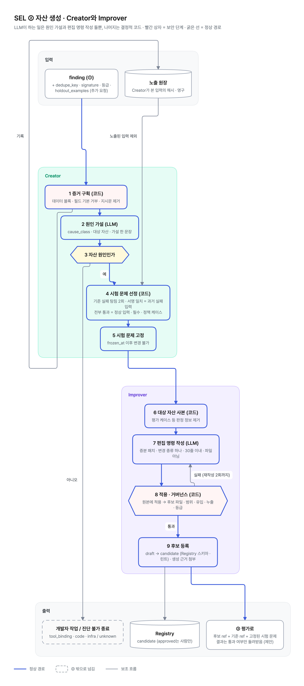

# SEL 세부 설계 계획과 스케줄러 판단 로직

2026-10-28 · **참고안** · PRD v0.11 기준 · 논의용

> **v0.11 정정 (먼저 읽을 것).** SEL 구조 · 역할 · 담당 · 일정의 기준은 모듈 설계 기준 문서(내부) 11장이다. 이 문서는 SEL 전체를 놓고 쓴 참고안이며, 스케줄러 · 분석 규칙(2장)은 ① 입력 파이프라인, 상태머신 · Verifier · 롤백은 ④ 반영과 SEL 오케스트레이터, 게이트는 ③ 평가에 주는 제안이다. 우리 담당 ② 자산 생성은 `docs/07_SEL_2_asset_generation.md`가 본체다. 아래 본문의 "Q7 = 공용 자산만" 서술(운영 trace 없음, 게이트 원장 · 세션 기록만, 대리 에이전트, 카나리 전 PARKED, R4 · R8 운영 불가)은 철회됐다. 모든 에이전트가 우리 Runtime에서 돌고 SEL 입력은 Phoenix API다(PRD v0.11 0장 정정 표).
>
> **추가 정정 (확인 2026-10-30, 위키 · 기준 문서 기준).** 다음도 본문보다 기준선이 우선한다.
> - SEL 오케스트레이터는 Runtime 위 그래프이고 **상태를 갖지 않는다(체크포인트 없음).** 3장 "SEL 서비스"(상태머신 · 잠금 · outbox)를 어디에 둘지는 ④ · PM과 협의할 제안이다. 브로커는 Kafka(`erp.asset.release.v1`, Registry outbox)로 정해졌다(토픽 생성 권한은 사내 클라우드 협의 대상, 위키 미결).
> - Improver는 "proposed 등록 · 상신"이 아니라 Registry에 **candidate** 등록. 자산 상태는 draft → candidate → approved(사람만) → deprecated → retired, candidate → rejected. "proposed · active"는 없다. 버전은 "패치"가 아니라 행동이 바뀌면 minor.
> - 카나리 · PARKED(자산 저장 규격 v1.1)는 기준 문서에 없다. Promoter는 릴리스 지정을 옮기고, Verifier는 7일 뒤 같은 패턴 감소를 본다.
> - 원천 어댑터의 게이트 원장 · 세션 기록 경로, `eval-job/v1`(Q4), 트레이싱 팀 수집 경로는 낡음. 원천은 Phoenix API(`phoenix.client.Client().spans.get_spans_dataframe`), 관측 적재는 ARD 팀. Tester는 `run_mode: eval`(쓰기 Dry-Run, 모델 고정)로 ERP 사용이 적은 시간대에 돈다(③).

PRD v0.8에서 흐름을 동결했고, v0.9에서 Q7을 "공용 자산만"으로 정했다. Business·Personal 업무는 Runtime 밖 프론티어 도구(OpenAI Dots)가 맡고, Runtime에는 SEL과 평가 샌드박스만 있다. 이 문서는 그 흐름을 지금 아키텍처(Agent Runtime VM 하나 안에 스케줄러, SEL 오케스트레이터, 평가 샌드박스, Admin UI)에 어떻게 올릴지 정리한다. 내용은 세 가지다.

1. 동결된 흐름 요약
2. 스케줄러가 판단하는 것: 작업별 입력, 규칙, 출력, 실패 처리. 신호별로 어떤 개선이 일어나는지
3. 컴포넌트별 세부 설계, 남은 빈틈, 빌드 순서

숫자 중 "제안"은 근거 데이터가 없는 초기값이다. M2a의 A/A와 결함 주입 시험으로 확정한다.

## 1. 동결된 흐름

**사람이 끼는 곳은 승인 화면 한 곳**이다. 승인, 반려, 수정 요청 세 가지만 사람이 고른다. 나머지 판단은 아래 표처럼 모두 코드가 한다. LLM(Creator)은 진단과 패치를 쓰지만, 케이스를 진행하거나 끝내는 결정은 하지 않는다.

| 판단 | 누가 | 규칙 | PRD |
| --- | --- | --- | --- |
| finding을 낼지 | 폴백 분석기 (코드) | 지지 20건, 주체 3명, 기준선 × 1.5 ∧ 2%, 신규 5%, 신호별 절대 상한 | 4장 |
| 케이스를 열지 | SEL 서비스 (코드) | 자산당 활성 케이스 1개, suppressed 아님, 동시 10개, 루프 정지 플래그 없음, 카나리 전 운영 케이스는 에이전트당 1건(PARKED 포함) | 9.3 |
| 원인이 자산인지 | Creator가 `cause_class`를 내고 코드가 분기 | asset → 진행, tool·code·infra → 개발자 큐, unknown → 미진단 | 7장 |
| 무엇으로 판정할지 | 코드 | 노출 원장 밖 held-out, 기준 실패 탐침, 최소 규모·정답 비율·Dry-Run 사전 검사 | 5장 |
| 후보가 형식상 괜찮은지 | 정적 검사 (코드) | 수정 금지 필드, 변경 유형 범위, 유입 검사(안전 절차 줄 삭제는 실패), 누출 검사 | 7장 |
| 후보가 나은지 | Evaluator (코드) | G1–G4, 완전 붕괴 허용치, 앵커 팔 | 6장 |
| 더 시도할지 | 코드 | finding당 판정 예산 3회(세트 고정 때 확인), transient 종료 3회면 중단 | 9.3 |
| **활성으로 바꿀지** | **사람 (Admin UI)** | 승인·반려·수정 요청 | 7장 |
| 효과가 있었는지 | Verifier (코드) | DiD + 급등 전 기준선 비열등, 순차 검정 | 9.3 |
| 되돌릴지 | Verifier + 릴리스 (코드) | 악화 ∧ CAS(현재 활성 = 릴리스한 버전) | 9.3 |
| 다시 시도해도 되는지 | 스케줄러 (코드) | suppressed 해제 조건 ①–⑥ | 9.3 |

규칙으로 판단할 수 없으면 승인 요청을 올리지 않고 끝낸다(REJECTED, DISMISSED, EXPIRED, INCONCLUSIVE). 끝난 이유는 열거값으로 남는다.



### 상태 흐름 (정상 경로와 갈림길)

```
finding ─(개설 규칙)→ OPEN ─ 진단(cause_class) ─ asset ∧ 예산>0 ∧ 세트 고정 ─→ TRIAGED ─(후보, 정적 검사)→ CANDIDATE_READY
   │                   ├─ tool·code·infra → DISMISSED(handoff_dev)
   │                   ├─ unknown → DISMISSED(undiagnosed)
   │                   ├─ 세트 고정 실패 → REJECTED(structural)
   │                   └─ 예산 = 0 → REJECTED(budget)
   └─ 잠금·상한·suppressed → 대기 (케이스 없음)

CANDIDATE_READY ─(슬롯)→ EVALUATING ─(통과 ∧ 앵커)→ GATE_PASSED ─(상신)→ AWAITING_APPROVAL ══ 사람 ══
       └─ 슬롯 없음 → QUEUED   ├─ 실패 → OPEN (예산 차감, 세트 다시 고정)  ├─ 카나리 필요 → PARKED → (카나리 기능) PARKED_CLOSED
                              └─ 일시 장애 → HELD → 재시도 2회 → REJECTED(transient)
                                                                       └─ 승인자 없음 → REJECTED(no_approver)
잠금 상태 어디서든: 기준 버전 변경 → STALE → OPEN (반영 뒤 상태면 INCONCLUSIVE). 모델 변경(루프 정지) → 승인 전 상태만 QUEUED 대기, 반영 뒤 상태는 계속. 운영자 중단 → ABORTED
TRIAGED: 정적 검사 2회 실패 → REJECTED(static). EVALUATING: 유효 표본 미달 → REJECTED(structural)

AWAITING_APPROVAL ─ 승인(CAS) → APPROVED → RELEASED → VERIFYING ─→ VERIFIED
                  ├ 반려 → REJECTED(human)                     ├─→ INCONCLUSIVE (유지)
                  ├ 수정 요청 → OPEN                            └─→ REGRESSED ─ CAS 성립 → ROLLED_BACK
                  └ 7일 → EXPIRED                                              └ CAS 불성립 → ROLLBACK_SKIPPED
```

전이 전체 표는 PRD 9.3이다.

## 2. 스케줄러가 판단하는 것

스케줄러는 판단 자체를 하지 않는다. 시각이 되면 작업을 깨우고, 판단은 각 작업의 결정적 규칙이 한다. 공통 규칙은 다음과 같다.

- 모든 작업은 (작업, 슬롯 시각) 유일 키와 리스 잠금으로 한 번만 돈다. VM이 재시작되면 놓친 슬롯은 가장 최근 것 하나만 돈다(밀린 슬롯을 모두 몰아서 돌리지 않는다).
- 작업 결과는 `analysis_run`에 창, watermark, 완전성, 상태로 남는다.
- 작업은 원천을 **조회(pull)**한다. 원천이 SEL에 밀어 넣지 않는다.

| 작업 | 주기 | 읽는 것 | 판단 | 쓰는 것 |
| --- | --- | --- | --- | --- |
| 폴백 분석 | 매시 | 게이트 사용 원장·감사 기록, 세션 기록 (운영 업무 trace는 없음) | R1–R3, R5, R7 개설 임계 | finding_observation, finding |
| 기준선 재계산 | 매일 | 28일 finding_observation | 열린 finding 기간 제외, 14일 미만이면 "기준선 없음" | baseline |
| 정기 골든셋 | 매일 1회 | 고정 세트, 활성 버전 | R6: 정책 위반 1회 또는 필수 사례 하락 검정 | golden_run, finding |
| suppressed 해제 검사 | 매일 | suppression, 자산 활성 이력, 골든셋 크기, 지지 수, 도구·모델 버전 | 해제 조건 ①–⑥ (④ 삭제) | suppression 해제, 새 예산 epoch |
| Verifier | 6시간 | 반영 후 finding_observation, 대조군 | DiD, 비열등, 순차 경계 | verification, 상태 전이, 롤백 |
| 기한 감시 | 10분 | 비종료 케이스 | 상태별 기한 표 | 상태 전이 |

### 2.1 매시 폴백 분석

**창.** 직전 24시간 롤링 창이다. 창 끝은 "지금"이 아니라 원천 watermark(원천의 최대 지연, 제안 2시간을 뺀 시각)다. 매시 돌지만 24시간을 보는 이유는, 지지 20건·주체 3명을 1시간 창으로 채울 수 있는 자산이 드물기 때문이다. 매시 도는 이유는 급등을 빨리 잡기 위해서다.

**완전성.** 창 안에서 기대 실행 수(사용 원장의 호출 수) 대비 조립된 실행 비율이 95% 미만이면 그 창으로는 finding을 내지 않는다. 원천이 늦게 들어온 것을 "실패가 줄었다"로 읽지 않기 위해서다.

**멱등.** 창별 지표는 `finding_observation(dedupe_key, window_end)`에 덮어쓴다. 같은 창을 다시 분석해도 지지 수가 두 번 세어지지 않는다. finding의 현재 상태는 이 관측들의 projection이다.

**규칙.** 신호별로 집계하고, 모두 같은 개설 임계를 통과해야 finding이 된다.

| 규칙 | 신호 | 무엇을 세나 | 분모 | 기본 가설 → 개선 유형 |
| --- | --- | --- | --- | --- |
| R1 | tool_error | 도구 오류 응답(플랫폼 원인 제외: timeout, denied, llm_unavailable 등) | 그 도구를 부른 실행 | 도구 설명 모호 → SKILL 절차에 인자 결정 규칙 추가 (Tool은 SEL 대상 아님, D15) |
| R2 | arg_invalid | 인자 검증 실패, 위반 인자 경로 분포 | 그 도구 호출 | 스키마 결함 → SKILL 예시·절차에 인자 형식 명시 (D15면 도구 설명) |
| R3 | retry_loop | 같은 도구 3회 이상 연속, 인자 유사 | 실행 | 설명 모호 → SKILL 절차 |
| R4 | hitl_rejected | 사람이 반려한 쓰기 요청 | 쓰기 요청 | v0 운영에서 불가(프론티어 도구의 HITL 기록이 없음) |
| R5 | negative_feedback | 평가 2/5 이하, 세션 기록의 수정·재요청 | 실행 또는 세션 | 지시 누락 → SKILL 절차, persona 표기 규칙 |
| R7 | no_asset_match | 자산 검색 0건, 조회 후 미사용, 같은 검색 반복 | 같은 절차의 세션 | 새 자산 후보 → v0 루프 밖(D18), 후보 리포트 |
| R8 | budget_exceeded | 턴·토큰 상한으로 종료 | 실행 | v0 운영에서 불가. 평가 실행(대리 에이전트)에서만. 프론티어 도구가 Agent 자산을 읽는지 확인 필요 |

**v0에서 각 신호가 어디서 오나** (Q7 = 공용 자산만)
- R1·R2: Tools Gateway 감사 기록. 프론티어 도구가 부른 도구, 인자, 오류 코드가 남는다(gateway 충실도).
- R3: 감사 기록의 호출 순서(action).
- R5: 세션 기록(action). 프론티어 도구가 세션 데이터를 넘겨줄 때만.
- R7: 자산 MCP Gateway 사용 원장(gateway).
- 모델의 추론과 최종 답은 어디에도 없다. 그래서 진단은 평가 샌드박스에서 대리 에이전트로 재현해서 한다.

R6은 매시 분석이 아니라 정기 골든셋 작업에서 나온다(2.3).

**개설 임계** (모두 충족):

```
support ≥ 20
distinct_principals ≥ 3
rate ≥ max(baseline × 1.5, 2%)        # 기준선 있음
rate ≥ 5%                            # 기준선 없음 (신규 패턴)
또는 rate ≥ 신호별 절대 상한            # 만성 결함: tool_error·arg_invalid 5%, budget_exceeded 3%, negative_feedback 10%
```

**finding 다음.** SEL 서비스가 받아 개설 규칙을 본다. 같은 자산에 활성 케이스가 있으면 같은 dedupe_key는 그 케이스의 증거로 붙고, 다른 키는 new로 대기한다. 동시 활성 10개를 넘으면 `rate × reach_weekly × signal_weight` 순으로 다음 매시에 다시 본다.

**왜 이렇게 했나.**
- 지지 20건, 주체 3명: 소수 사례나 한 사람의 습관으로 공용 자산을 바꾸지 않기 위해서다.
- 기준선 × 1.5: 새 버전이 결함을 들여온 급등을 잡는다.
- 절대 상한: 처음부터 있던 결함은 기준선에 섞여 × 1.5를 영원히 못 넘기 때문이다.
- 플랫폼 원인 제외: 자산을 고쳐도 해결되지 않는 실패에 판정 비용을 쓰지 않는다.

### 2.2 매일 기준선 재계산

- 자산 **계열**(버전이 아닌 base)과 신호별로 28일 발생률을 잰다. 새 버전은 이전 버전의 기준선과 비교된다. 버전마다 기준선을 새로 시작하면 모든 새 버전이 "기준선 없음 → 5%" 규칙으로만 판정되어 급등을 놓친다.
- 그 자산에 finding이 열려 있던 날은 뺀다. 결함 기간이 기준선을 끌어올리면 다음 급등이 묻히기 때문이다. 남은 날이 14일 미만이면 "기준선 없음"이다.
- 키에 사내 LLM 모델 버전과 도구 계약 버전을 넣는다. 모델이 바뀌면 이전 기준선과 비교하지 않는다(9.6: 개설 동결과 A/A 재검정).

### 2.3 매일 정기 골든셋 (R6)

운영 트래픽이 없거나 드문 업무의 결함, 쓰기 업무의 정책 위반을 능동적으로 잡는다. 운영 기록을 세는 매시 분석과 달리 LLM을 실제로 호출한다.

- **실행**: 에이전트별 고정 세트(SKILL 내장 "필수" 사례 + 정책 사례 + 인젝션 내성 사례)를 현행 활성 버전으로 k = 3. 에이전트당 약 60회 실행.
- **시각**: 지난 7일 시간대별 부하가 가장 낮은 구간(D13).
- **판단** (하나라도 해당하면 eval_fail finding):
  1. 정책 사례(G3a): 위반 1회. 쓰기 전 승인, 금지 행동, 등급 처리는 한 번이라도 어기면 안 된다.
  2. 필수 사례: 사례마다 "오늘 통과율 < 최근 7일 통과율"을 단측 Fisher 정확 검정, 유의수준 α′ / n_고정. 사례 수로 보정해 우연한 하락을 거른다.
- **증거**: 사례 ID, 실패한 검사 이름, 집계만. 고정 사례 원문은 Creator에 넘기지 않는다.
- **격리 근거**: 최근 3회 연속 실패한 사례는 자동 격리 후보다(5장 격리 규칙의 두 번째 조건).

### 2.4 매일 suppressed 해제 검사

suppressed는 "같은 근거로는 더 시도하지 않는다"이지 영구 포기가 아니다. 새 근거가 생기면 다시 연다.

| 조건 | 대상 사유 | 판단 | 뜻 |
| --- | --- | --- | --- |
| ① 활성 버전이 다른 경로로 바뀜 | budget, human, static, 롤백, transient, ABORTED | 기록 시점 활성 버전 ≠ 현재 활성 ∧ 바꾼 주체가 이 dedupe_key의 케이스가 아님 | 사람이나 다른 패치가 자산을 바꿨으니 같은 결함이 남았는지 다시 볼 가치가 있다 |
| ② 골든셋이 자람 | structural, budget, human, static, 롤백(worse) | 노출되지 않은 사례가 마지막 판정 이후 20% 이상 늘고 최소 규모 충족 | 드문 업무를 판정할 수 있게 됐다 |
| ③ 미진단 증거가 늘어남 | undiagnosed | 지지 수 ≥ 기록 시점의 2배 | 재현·진단의 재료가 늘었다 |
| ⑤ 승인 가능자 생김 | no_approver | 승인 가능자 집합 ≠ ∅ | 승인할 사람이 생겼다 |
| ⑥ 도구·모델이 바뀜 | handoff_dev, transient, ABORTED | 도구 계약 버전 또는 사내 LLM 모델 버전 변경 | 개발자가 도구를 고쳤거나 장애 원인이 바뀌었다 |

해제되면 쿨다운 7일 뒤 새 예산 3회(`budget_epoch` + 1)를 준다.

### 2.5 6시간마다 Verifier

릴리스된 버전이 운영에서 실제로 효과를 냈는지 본다. 게이트 통과는 "평가 세트에서 나았다"이고, Verifier는 "운영에서 줄었다"다.

- **"전" 구간**: 케이스 개설 이후 ~ 릴리스 전(트리거 구간 제외). 트리거 구간을 "전"으로 쓰면 아무것도 안 고쳐도 평균 회귀로 내려가 VERIFIED가 된다.
- **판정**: ① "전" 대비 유의한 감소(대조군 이중차분, 포아송 회귀) ② 급등 전 기준선 대비 비열등.
- **순차 검정**: 6시간마다 엿보므로 중간에는 O'Brien-Fleming 경계(초반 z > 3.0 수준)로 큰 악화만 잡고, 최종 판정은 창이 끝날 때 한 번 한다.
- **결과**: VERIFIED(finding fixed), REGRESSED → CAS 성립 시 자동 롤백, 결론 없음 14일 → INCONCLUSIVE(버전 유지, 7일 쿨다운).
- **R6 케이스는 운영 발생률이 아니라 정기 골든셋으로 본다**: 실패했던 고정 사례가 반영 후 7일 동안 반영 전보다 유의하게 통과(Fisher) + 그 자산의 운영 게이트 신호 비열등(트래픽 없으면 생략). 카나리 기능 전에 VERIFIED까지 갈 수 있는 유일한 경로다.
- **저장 키**: (case_id, look_no). 원천 지연으로 마지막 창이 불완전하면(완전성 95% 미만) 그 look은 건너뛴다.

### 2.6 10분마다 기한 감시

단계가 멈춰도 케이스가 영원히 열려 있지 않게 한다. 목적지는 상태별로 하나다.

| 상태 | 기한 | 넘기면 |
| --- | --- | --- |
| OPEN | 24시간 (QUEUED 시간 제외) | HELD(resume = OPEN) |
| TRIAGED | 2시간 | HELD(resume = TRIAGED) |
| CANDIDATE_READY · GATE_PASSED · APPROVED · STALE · RELEASED | 30분 | HELD(resume = 그 상태) |
| QUEUED | 7일 | REJECTED(transient) |
| EVALUATING | 6시간 (실행 시작부터) | HELD(resume = EVALUATING) |
| HELD | 48시간 또는 재시도 2회 | REJECTED(transient). 같은 finding의 3번째 transient 종료면 suppressed |
| AWAITING_APPROVAL | 7일 | EXPIRED, finding known |
| PARKED | 없음 | – |
| CANARY | 14일 | 관측 부족 → 코호트 해제 → ROLLED_BACK(insufficient_obs) |
| VERIFYING | 7일, 관측 부족 시 14일 | INCONCLUSIVE |
| REGRESSED | 롤백 연산 실패 시 10분마다 재시도 3회 | kill switch(릴리스 단계), 플랫폼 신호 |

kill switch로 멈춘 단계의 기한 시계는 멈춘다.

### 2.7 한 바퀴 예시: 기간이 없는 미결 조회

D01 결함(SKILL에서 "기간이 없으면 당월로 조회" 줄이 빠짐)을 sel-lab에서 돌린 흐름이다. 시각은 운영 기준으로 바꿔 적었다. sel-lab은 운영 트래픽도 우리 워커로 돌려서 full 충실도로 보이지만, v0(Q7 = 공용 자산만)의 운영 신호는 Tools Gateway 감사 기록(gateway)이다. 그래서 아래 표는 **카나리 기능이 생긴 뒤**의 경로다. 카나리 전에는 이 케이스가 게이트(대리 에이전트 비열등) 통과 뒤 PARKED에서 멈춘다.

| 시각 | 작업 | 판단 | 결과 |
| --- | --- | --- | --- |
| D일 | 사람이 SKILL 1.4.3 릴리스 (결함 포함) | – | 활성 1.4.3 |
| D+1 10:00 | 매시 분석 | Tools Gateway 감사 기록에서 `tool_error`(ROW_LIMIT) 발생률 11.4%, 기준선 × 1.5와 2% 초과, 지지·주체 충족 | finding, 케이스 OPEN |
| 10:05 | Creator 진단 | 증거 5건(구획 거침, 노출 원장 기록) → `cause_class = asset`, 대상 `skill/fi-open-items@1.4.3` | – |
| 10:06 | 판정 세트 고정 | 노출 원장 밖 held-out을 기준 버전으로 탐침 2회 → 실패 서명(ROW_LIMIT)이 같은 사례가 목표, 전부 통과한 사례가 가드 | TRIAGED, `frozen_at` |
| 10:10 | Creator 패치 | "기간이 없으면 당월로 조회하고 당월 기준임을 밝힌다" 한 줄 추가 | 정적·유입 검사 통과 → CANDIDATE_READY |
| 10:11–10:25 | Tester · Evaluator | 목표 d̄ 0.63, LCB 0.52 > 0 ∧ ≥ MMI, 가드 비열등, 정책 위반 0, 붕괴 0 | GATE_PASSED (예산 1/3) |
| 10:26 | Improver | 1.4.4 proposed 등록, 승인 요청 | AWAITING_APPROVAL |
| D+1 14:00 | **사람** | diff와 게이트 리포트를 보고 승인 | APPROVED → CANARY(주체 10%) → 비열등이면 RELEASED → VERIFYING |
| D+2 ~ D+8 | Verifier (6시간) | 게이트 감사 기록에서 tool_error 11.4% → 1.9%, DiD 유의, 급등 전 기준선 비열등 | VERIFIED, finding fixed |

같은 흐름에서 악화가 났다면 REGRESSED → CAS 확인 → 1.4.3으로 자동 롤백 → finding suppressed다. sel-lab에서 CAS 성립·불성립 두 경로를 모두 확인했다.

### 2.8 신호별로 어떤 개선이 일어나나

| 신호 | 흔한 원인 | Creator가 만드는 변경 | 판정에서 특히 보는 것 | sel-lab 결함 |
| --- | --- | --- | --- | --- |
| tool_error (ROW_LIMIT 등) | SKILL이 조회 범위를 정하지 않음 | SKILL 절차에 기본 범위 규칙 (instruction) | 목표에서 오류 소멸 + 재현 사례 필수 조건(인자 제약 준수) | D01 |
| negative_feedback (재요청) | 모호한 대상을 묻지 않고 하나를 고름 | SKILL에 되묻기 규칙 | 되묻기 사례 통과, 가드에서 불필요한 되묻기 없음 | D02 |
| negative_feedback (수정) | 표기 규칙 누락 | persona Prompt 파생본에 표기 규칙 | 형식 검사, 정답 있는 사례 값 일치 | D03 |
| eval_fail (정책) | 쓰기 전 승인 단계 삭제 | SKILL 절차에 dry_run → 승인 요청 → 토큰 본실행 | G3a 위반 0, 실패한 고정 사례가 목표 | D04 |
| budget_exceeded | `max_turns` 부족 | Agent 허용 필드 (composition) | 다단계 업무 완료, 가드 비용 | D05 |
| arg_invalid | 인자 형식 설명 없음 | SKILL 예시, D15면 도구 설명 | 인자 형식 일치 | D06 |
| no_asset_match | 공용 자산 없음 | v0 루프 밖, 후보 리포트 | – | D09 |

Tool·코드·인프라 원인은 개발자 큐로 간다. 평가 케이스 결함 의심은 표시만 하고, 격리는 결정적 규칙이 한다.

## 3. 컴포넌트별 세부 설계

모두 Agent Runtime VM(Aegra) 안이다. 저장소 접근은 Database Connector 경유(예외: Redis, 별도 VM Phoenix의 읽기 전용 API), LLM은 사내 LLM Gateway 고정 버전만.

| 컴포넌트 | 책임 | 인터페이스 | 저장 | 미결 의존 |
| --- | --- | --- | --- | --- |
| 스케줄러 | 2장 작업 기동, 리스 잠금, 놓친 슬롯 처리 | 작업 함수 호출 | analysis_run | Aegra 스케줄 기능 유무 (없으면 VM cron + 리스) |
| 원천 어댑터 | 게이트 사용 원장·감사 기록, 세션 기록 증분 조회, 요청 ID로 연결, 완전성 계산. 평가 실행 기록은 별도 VM의 Phoenix API로 조회(VM 간, `limit`에 닿으면 창 분할) | `fetch(window) → RunRecord[]` | 없음 (trace는 ID로만 참조) | 세션 기록 제공 여부, Q9, D5 |
| 폴백 분석기 | R1–R3, R5, R7(운영), 개설 임계, 기준선 | `analyze(window) → finding[]` (finding 계약) | finding_observation, baseline | 세션 기록 제공 여부 (R5) |
| SEL 서비스 | 상태머신, 잠금, 예산, suppressed, outbox | 상태 전이 API, 이벤트 소비 | improvement_case, case_event, judge_budget, suppression, outbox | 브로커 유무 (없으면 outbox 폴링) |
| 증거 구획 | 데이터 블록, 필드 기본 거부, 지시문 제거, 노출 원장 기록 | `fence(evidence) → FencedEvidence` | exposure | Q6 (내용 유무), 허용목록 필드 소유자 |
| Creator | 진단(`cause_class`), 패치 | LangGraph 그래프. 입력 FencedEvidence + 자산 사본(평가 케이스 필드 제거), 출력 JSON 스키마 | hypothesis, candidate(draft) | 사내 LLM 사양 |
| 판정 세트 고정 | 분할, 기준 실패 탐침, 사전 검사 | `freeze(case) → eval_set` | eval_set, probe_run, case_usage | Q5 (정답 있는 사례 30%) |
| 정적 검사 | 수정 금지 필드, 변경 범위, 유입·누출 검사 | `check(candidate) → ok/errors` | candidate | Q8 (누출 등급 기준) |
| Tester | 기준·후보·앵커 팔 실행, 동시 상한, 비용 계측 | `erp.runtime.jobs.v1` 또는 eval-job/v1 | eval_run, eval_result, llm_usage | Q4 (eval-job/v1 규격), Q5 |
| Evaluator | 규칙 채점, G1–G4, 붕괴 허용치, 앵커 비교 | `decide(results) → gate_decision` | gate_decision | A/A로 k·MMI 확정 |
| Improver | proposed 등록, 상신, 승인 가능자 계산 | 자산 저장소 API (Database Connector) | approval_link | 자산 저장 규격 v0 (2026.11) |
| Admin UI | 승인 화면(필수 필드 L6), 운영 조치 | SEL API (9.5) | – | D8, D10 |
| 릴리스 · 롤백 | 활성 전환 CAS, 자동 롤백 CAS | 자산 저장소 원자 연산 | release_link, rollback | 자산 저장소가 CAS를 지원하는지 |
| Verifier | 카나리 코호트 비교, DiD, 순차 검정, 대조군 선정. 신호는 게이트 기록·세션 기록 | `verify(case, look)` | verification | 카나리 기능 (자산 저장 규격 v1.1) |
| LLM 클라이언트 | 재시도·백오프, 429, 파싱 실패, 사용량 원장, 모델 버전 감지 | 공통 래퍼 | llm_usage | D12 |
| SEL 자체 관측 | 작업 성공률·지연, watermark 지연, 큐 깊이, 상태별 체류 시간, DLQ, LLM 429 비율, 상한 소진율 | OTel → Phoenix VM 직접 (Collector 없음) | – | 트레이싱 팀 수집 경로 |

**Creator 그래프** (LangGraph, sel-lab의 `sel.py`가 로컬 판):

```
fence_evidence → diagnose(cause_class, target, hypothesis) ─ asset ─→ [코드: freeze_eval_set] → write_patch → static_check
                                                         └ 그 밖 ─→ [코드: dismiss]
static_check 실패 → write_patch (최대 2회) → REJECTED(static)
```

게이트 실패, 수정 요청, STALE 뒤에는 OPEN으로 돌아가 진단부터 다시 한다. 세트를 다시 고정하므로 수정 요청 때 노출된 사례가 빠진다.

Creator에는 도구를 주지 않는다. 입력은 구획을 거친 증거와 평가 케이스 필드를 지운 자산 사본, 이전 반복의 피드백(게이트별 통과 여부)뿐이다.

## 4. 빈틈

v0.7 독립 리뷰 2건(흐름 동결, 빌드 관점)과 sel-lab 시험에서 나온 것을 정리했다.

**v0.8에 반영**

| 발견 | 반영 |
| --- | --- |
| 기한 초과 목적지가 "HELD 또는 REJECTED", HELD 출구 없음 | 상태별 목적지 하나, HELD에 resume 상태 (9.3) |
| EVALUATING → STALE 누락, 승인 시 기준 버전·digest CAS 없음 | 추가 (9.3, 9.5) |
| 판정 예산과 "반복 ≤ 3" 이중, 수정 요청·STALE에서 4번째 판정 가능 | 예산 하나로, TRIAGED 진입마다 확인 (9.3) |
| suppressed 영구, finding regressed 정의 모순 | 해제 조건 ①–③, regressed는 재발만 (9.3) |
| 카나리 전 승인 대기 정지가 7일 기한과 충돌 | PARKED (D14) |
| Creator(LLM)가 케이스 종료를 결정 | `cause_class` 열거값 + 코드 분기 (7장) |
| 유입 검사 "사람 검토 필수"가 승인 외 사람 단계 | fail-closed (7장) |
| 승인자가 릴리스 범위 선택, 승인 가능자 없음이면 7일 정지 | 코드가 계산, REJECTED(no_approver) (9.6) |
| 격리 비율 정지 해제 조건 없음 | 자동 해제, 신규 개설만 막음 (5장) |
| 목표 세트 선정이 문장 분류로는 실패 (sel-lab D02) | 기준 실패 탐침 (5장) |
| R6 증거가 고정 사례 원문을 Creator에 넘김 (sel-lab) | 사례 ID·검사 이름·집계만 (5장, sel-lab 수정) |
| 사례 사용 상한 10회면 골든셋이 판정 십여 번에 고갈 | 피드백을 게이트별 통과 여부로 축소, 상한 50회(보장 없는 제안값, M2c 재사용 점검) (5장) |
| (검증 리뷰) 기준 변경을 EVALUATING·승인 대기에서만 받음 | 잠금 상태 전체에서 STALE (9.3) |
| (검증 리뷰) PARKED가 잠금을 안 잡아 새 케이스와 충돌 | PARKED 진입 시 finding suppressed(parked), 해제 ④, 해제 때 잠금 획득 필요 (9.3) |
| (검증 리뷰) transient 종료가 예산을 안 써 매일 재개설·재탐침 | 같은 finding의 3번째 transient 종료면 suppressed (9.3) |
| (검증 리뷰) ROLLBACK_SKIPPED가 suppressed라 다시 잡히지 않음 | finding known으로 (9.3) |
| (검증 리뷰) 탐침 목표에 정상 사례의 우연 실패가 섞여 d̄ 희석 | 실패 서명 일치 필터, 서명 없는 신호는 k_probe 3에서 2회 이상 실패 (5장) |
| (검증 리뷰) 탐침 선정 세트에 무작위 held-out 가정의 표본 산정을 그대로 씀 | M2a에서 선정 세트 s_d 실측 후 MMI·최소 규모 재산정, 가드에 불안정 사례 층화 (5장) |
| (검증 리뷰) Ladder 보장 과장 | "착안, 보장 없음"으로 정정 (5장) |
| (검증 리뷰) 수정 요청 경로로 사례별 결과가 Creator에 샐 수 있음 | 승인자가 볼 수 있었던 사례 전부를 노출 원장에, 세트 재고정 (7장) |
| (검증 리뷰) 모델 변경 후 A/A 실패 시 사람이 풀어야 함 | 7일마다 A/A 재시도, 통과 시 자동 해제, 승인 대기 케이스는 STALE (9.6) |
| Dry-Run 미지원 처리 모순(HELD vs REJECTED) | 세트 고정 때 구조적 REJECTED (5장) |
| 매시 분석의 창·멱등·완전성, R6 규칙, 기준선 산식 없음 | 9.1, 이 문서 2장 |
| 모델 교체 시 기준선·A/A 무효 | 개설 동결 → A/A 자동 재실행 (9.6) |
| LLM 실패 처리 없음 | 9.6 |
| D12·judge 숫자 오류 | 정정 (9.4, 12장) |
| 데이터 모델 테이블 누락 | 14개 추가 (9.6) |
| new_asset은 골든셋이 없어 항상 구조적 REJECTED | v0 루프 밖 (D18) |

**v0.9에 반영** (Q7 = 공용 자산만, 재검증 리뷰)

| 발견 | 반영 |
| --- | --- |
| R6 케이스는 운영 신호가 없어 Verifier가 판정 불가 | 정기 골든셋 기반 R6 판정 (9.3) |
| 운영 finding의 "재현 필수"와 "G1 비열등"이 모순 | 재현된 서명에서 G1 개선 기준, 프론티어 효과는 카나리 (2장, 6장) |
| PARKED 해제 규칙 이중, 예산 0이면 영구 잔류 | 카나리 기능 이벤트에 PARKED_CLOSED, 일반 개설 규칙으로 재개 (9.3) |
| 카나리 전 운영 finding이 판정 비용만 쓰고 쌓임 | 카나리 전에는 에이전트당 1건만 개설 (9.3) |
| 모델 변경 직후 A/A 전에 판정 재개 | 루프 정지 동안 진행 케이스 QUEUED (9.3) |
| ABORTED·EXPIRED·INCONCLUSIVE 즉시 재개설 | suppressed 또는 7일 쿨다운 (9.3) |
| CANARY 중 기준 변경·카나리 롤백 미정의 | 코호트 해제 후 종료, 카나리 롤백 CAS는 코호트 할당 (9.3) |
| 운영 재현 사례는 세션 기록 없으면 만들 수 없음 | 한계로 명시, 골든셋은 D16에 더 의존 (5장) |
| 앵커 비용·finding 최악 비용 산술 오류 | 863회 실행, 약 22만 회 호출로 정정 (9.4) |

**남은 빈틈** (v0.8에서 정하지 못함)

| 빈틈 | 왜 못 정했나 | 언제 |
| --- | --- | --- |
| 탐침 범위(자산이 쓰인 held-out)를 정하는 `erp.asset.refs`가 평가 실행에 남는지 | 런타임 계측 규격 확인 필요 | M2a 전 |
| 탐침 비용(판정당 +800회 실행 추정)이 감당되는지 | 사내 LLM 한도 미확인 (D12) | M2a 전 |
| 실패 서명 일치 비교의 정의(신호별 서명 필드) | 원천 스키마와 평가 결과 스키마가 정해져야 함 | Q6·Q4 후 |
| 선정 세트의 s_d와 그에 맞는 MMI·최소 규모 | 실측 필요 | M2a |
| 탐침 선정에서 A/A 오판률이 5% 이하인지 | 오프라인 가짜 에이전트는 결정적이라 0으로 나옴. 사내 LLM으로 59회 필요 | M2a |
| 앵커 팔 비용과 효과 | 앵커와 기준이 다른 빈도를 모름 | M2c |
| 골든셋 고갈 속도 | 에이전트별 골든셋 크기, 판정 빈도를 모름 | M2c 측정 |
| 대리 에이전트(사내 LLM)가 프론티어 도구(OpenAI Dots)의 실패를 얼마나 재현하나 | 백테스트 필요 | M2b |
| 세션 기록 제공 형태와 범위 | 프론티어 도구 쪽 확인 필요. 없으면 R5가 사라짐 | M0 |
| 드문 업무는 판정 불가 | 설계의 한계. 골든셋이 자라야 함 (D16) | 상시 |
| 브로커 유무에 따른 이벤트 경로 이중화 | 인프라 확인 필요. 없으면 outbox 폴링 하나로(빼는 쪽) | M0 |
| 증거 구획 허용목록의 필드별 소유자 | 원천 스키마(Q6)가 정해져야 함 | Q6 후 |
| 군집 보정, 게이트 조기 종료 규칙(G2·G3b 중간 실패 판정) | 수식은 6장에 있으나 구현 기준값 없음 | M2a |
| Q7 "공용 자산만" 설계자 확인 | 옛 설계 방향 문서 근거. 이후 전제와 충돌 | M0 |
| ARD 정본 적재 경로 (Q9) | Collector가 빠져 누가 적재할지 미정. 정본 없이 Phoenix만이 빼는 쪽 | M0 |
| SDK 등급별 내용 제거 | Collector에서 하던 일을 계측 SDK span processor로 옮김. 규칙과 시험 방법은 트레이싱 팀과 합의 필요 | M0 |
| ITGC 적용 여부(D17) | 적용이면 사람 개입을 승인 하나로 둔 결정과 자동 롤백을 다시 검토 | M0 |

## 5. 빌드 순서

미결 질문과 무관한 것부터 만든다. Tester·Evaluator를 Creator·Improver보다 먼저 만든다는 원칙(PRD 10장)은 그대로다.

| 단계 | 내용 | 선행 | 완료 기준 | 달력 |
| --- | --- | --- | --- | --- |
| B0 | sel DDL 전체(9.6 테이블 포함), 상태머신(9.3 표 그대로, 전이 단위 테스트), outbox, 스케줄러 리스, LLM 클라이언트 래퍼, 사용량 원장 | 없음 | 9.3의 모든 전이와 기한 목적지가 테스트로 고정 | 2026.11 |
| B1 | 게이트 통계 완성(G4 최소 규모·정답 비율, 군집 보정, 앵커 팔), Tester 동시성·비용 한도, A/A 하네스(탐침 선정 포함) | B0 | 결함 주입 D01–D06이 sel-lab에서 같은 판정, A/A 하네스 동작 | 2026.11 |
| B2 | 증거 구획, 유입·누출 검사, 노출 원장, 판정 예산, suppressed와 해제 검사, 사례 사용 상한, 격리 | B0 | 인젝션 내성 사례 G3a 통과, 노출 사례가 held-out에 안 들어감 | 2026.11–12 |
| B3 | 원천 어댑터와 폴백 분석기(창, watermark, 완전성, 멱등, 기준선). 원천은 게이트 기록과 세션 기록, 평가 실행 기록은 Phoenix VM | 세션 기록 제공 형태, Phoenix VM 접근(key·VM 간 경로) | 같은 창 재분석 시 finding 불변, 원천 완전성 | 2026.12 |
| B4 | 평가 도구 어댑터. 실제 도구면 평가 계정 정책 5종, 합성 세계면 최소 세계. M2a 업무로 A/A 59회 → k·MMI·허용치 확정 | **Q5**, Q2, Q4 | A/A 오판률 각 5% 이하 | 2027.1–3 |
| B5 | Creator 진단 경로(정본 또는 샌드박스 재현), Improver, 승인 화면(L6 필수 필드), 릴리스 CAS | Q6, 자산 저장 규격 v0 | 결함 주입 시험 1회 완주(승인은 API 대역 가능) | 2026.12 |
| B6 | Verifier(DiD, 순차 검정, 대조군), 자동 롤백 CAS. 먼저 R6 경로, 카나리 기능 뒤 운영 경로 | B5, 카나리 기능 | R6 케이스 1건 VERIFIED (2027.1–3), 운영 finding 첫 VERIFIED (카나리 뒤) | 2027.1– |
| B7 | SEL 자체 관측 대시보드, kill switch | B0 | 운영 지표 수집 | 2027.1–3 |

Q7은 정했으므로 B3은 세션 기록 제공 형태만 확인되면 시작할 수 있다. B4는 Q5에 막혀 있다. 그 전까지 sel-lab(가짜 원천, 가짜 도구)으로 B0–B2·B5를 먼저 굳힌다.

## 6. sel-lab이 확인한 것과 못 한 것

sel-lab은 v0.8의 다음을 구현했다: 노출 원장, 기준 실패 탐침 선정, R6 증거 집계만, 판정 예산 3회와 suppressed, HELD 일시적·구조적 구분, CAS 자동 롤백(성립·불성립 두 경로 확인).

오프라인 결함 주입 결과 (2026-10-27, `SEL_OFFLINE=1`, n 250, k 3):

| 결함 | 결과 | 목표 사례 수 |
| --- | --- | --- |
| D01 기간 누락 | VERIFIED | 4 |
| D02 되묻기 삭제 (`--focus`) | VERIFIED | 2 |
| D03 표기 규칙 | VERIFIED | 12 |
| D04 승인 단계 삭제 | VERIFIED (실패한 고정 사례가 목표) | 6 |
| D05 턴 상한 | VERIFIED | 3 |
| D06 인자 형식 | VERIFIED | 6 |

목표가 2–12건이라, 운영 게이트(목표 최소 86건)였다면 모두 REJECTED(structural)다. sel-lab 골든셋(135건)은 배관 검증용이고 검정력이 없다. 가짜 에이전트가 결정적이라 A/A 오판률은 0으로 나오며, 의미 있는 값은 사내 LLM으로 재야 한다.

못 한 것: 증거 구획, 유입 검사, 앵커 팔, 격리, 사례 사용 상한, Verifier의 DiD·순차 검정, 기한 감시, 모델 변경 처리, 탐침의 실패 서명 필터(지금은 탐침 실패 전부가 목표).

sel-lab의 상태 전이는 PRD 9.3과 다음이 다르다. 코드를 읽을 때 PRD로 착각하지 않게 적어 둔다.
- GATE_FAILED 상태가 따로 있고, 실패 뒤 OPEN으로 돌아가 다시 진단한다(PRD: EVALUATING → OPEN 직행). 예산은 CANDIDATE_READY에서 확인한다(PRD: 세트 고정 때).
- Creator 출력 실패는 HELD가 아니라 DISMISSED, 증거가 이미 교체된 버전에서 나왔으면 DISMISSED로 끝낸다(PRD에 없는 전이).
- STALE, QUEUED, PARKED, EXPIRED, ABORTED가 없다. 승인은 CLI 대역이다.
