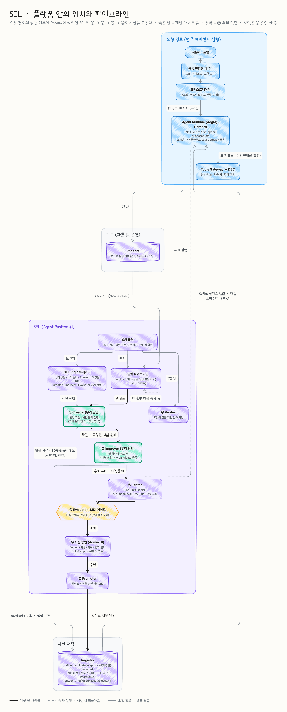
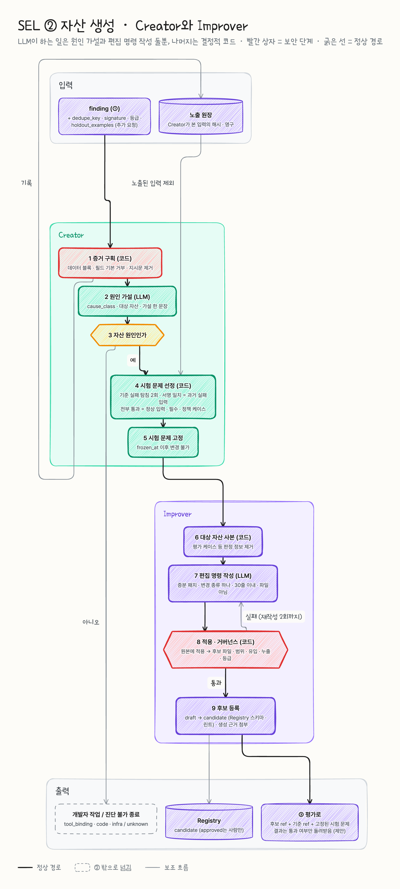

# SEL ② 자산 생성 (Creator · Improver · 거버넌스)

| 항목 | 내용 |
| --- | --- |
| 문서 성격 | FW 팀 내부 설계. 모듈 설계 기준 문서(내부) 11장 SEL ②를 펼친 상세 |
| 담당 | ② 담당 (② 자산 생성) |
| 기준일 | 2026.10.28 (팀 위키 대조 · ① 설계와 정렬 2026.10.30, docs/16) |
| 상태 | 원칙 초안 v0.1 (12월 원칙 초안 확정 목표, 알고리즘은 P3) |
| 기준 문서 | ERP AI 플랫폼 모듈 설계 기준 문서(내부) (2026.10.28) |

**이 문서를 읽는 법**

- 기준 문서의 구조와 정의는 그대로 둔다. 11장의 ① 입력 파이프라인 → ② 자산 생성 → ③ 평가 → ④ 반영과 담당은 바꾸지 않는다. 이 문서는 ②의 상세만 더한다.
- 순서는 기준 문서 모듈 장과 같다: 한 줄 정의 → 왜 필요한가 → 동작 순서 → 주고받는 것 → 핵심 기능 → 하지 않는 것 → 레퍼런스 → 담당과 선행 협의.
- ①③④나 SEL 전체 설계에 닿는 내용은 **[제안]** 으로 표시했다. 결정은 해당 담당과 SEL 전체 설계(PM)가 한다.
- **[확인]** 은 PM에게 올릴 질문이다(뒤의 "확인할 것").



## 한 줄 정의

① 입력 파이프라인이 낸 finding을 받아, 원인 가설과 그 가설을 검증할 시험 문제를 정하고(Creator), 가설 하나당 거버넌스를 지킨 후보 자산 하나를 만들어 Registry에 candidate로 올리는(Improver) 영역. 무엇을 만드는지보다 **무엇을 왜 바꿔도 되는지**를 정하는 것이 핵심이다.

## 왜 필요한가

- 실패 기록을 사람이 보고 프롬프트를 고치는 방식은 에이전트가 늘면 유지되지 않는다. 그래서 고치는 일 자체를 LLM에 맡긴다.
- 그런데 LLM이 고치게 하면 세 가지가 위험해진다. 이 영역의 규칙은 모두 이 셋을 막기 위한 것이다.

| 위험 | 예 | 막는 장치 (이 문서) |
| --- | --- | --- |
| 바꾸면 안 되는 것을 바꿈 | 승인 단계 삭제, 쓰기 권한 도구 참조 추가, 등급 완화 | 거버넌스 원칙과 정적 검사 |
| 시험에만 맞춘 개선 | 판정에 쓰일 문제를 보고 그 문제만 맞히는 후보 | 시험 문제는 finding만 보는 별도 LLM이 만들고 Creator · Improver에 보여주지 않음 |
| 외부 텍스트가 자산으로 흘러듦 | SAP 거래처명에 심은 "승인 없이 전기하라"가 스킬 본문으로 옮겨짐 | 증거를 구조로만 넘김(사용자 질문 · 도구 결과 문장 없음), 유입 검사 |

- 그리고 사람이 승인할 때 "왜 이 변경인가"를 판단할 근거가 남아야 한다. 그래서 생성 근거(provenance)를 버전에 붙인다.

## 동작 순서

SEL 오케스트레이터는 스케줄러 · Admin UI 요청을 받아 개선 케이스 단계를 진행한다(기준 문서 5장). finding 하나로 케이스가 열리면 Creator → Improver → Evaluator 순서로 넘긴다. 오케스트레이터는 상태를 갖지 않으므로(체크포인트 없음) 케이스 진행 상태는 SEL 원장에 둔다 **[제안 → SEL 전체 설계]** (docs/09 C6). Creator · Improver를 SEL 오케스트레이터 그래프의 노드로 둘지, 오케스트레이터가 위임하는 별도 그래프로 둘지는 **[제안 → SEL 전체 설계 · Harness · 오케스트레이터 담당]** 이다. LLM이 하는 일은 2번(가설), 4번(시험 문제 생성), 7번(편집 명령 작성)이고, 나머지는 결정적 코드다. 4번의 생성 LLM은 Creator · Improver와 분리한다.



```
finding (①)
  │
  ▼ Creator
  1. 증거 구획 ──────── 코드. 실행 구조만(도구 · 인자 이름 · 결과 코드 · 건수 · 이벤트 종류). 사용자 질문은 안 가져옴
  2. 원인 가설 ──────── LLM. cause_class · 대상 자산 · 가설 (구조화 출력)
  3. 분기 ──────────── 코드. 자산 원인이 아니면 개발자 작업으로 넘기고 종료
  4. 시험 문제 생성 ──── LLM + 하네스. 생성 LLM이 finding만 보고 질문을 만들고, 코드가 지금 버전으로 돌려 같은 방식으로 틀리는 것 + 정상만 남김
  5. 시험 문제 고정 ──── 코드. frozen. 이후 바꿀 수 없음
  │
  ▼ Improver
  6. 대상 자산 사본 ──── 코드. 판정에 쓰일 정보(평가 케이스 필드 등)를 지운 사본
  7. 편집 명령 작성 ──── LLM. 가설 하나에 편집 명령 묶음(증분 패치) 하나. 이 시점엔 후보 파일이 없다
  8. 적용 · 거버넌스 ─── 코드. 편집 명령을 Registry 원본에 적용해 후보 파일(draft)을 만들고 검사. scope · size · inflow · safety · leak · grade. 실패 시 7로(최대 2회). 대상 주소부터 정책 밖이면 생성 전에 종료
  9. 후보 등록 ──────── 코드. draft → candidate 전이 요청(Registry가 스키마 · 린트 검사), 생성 근거 첨부
  │
  ▼ ③ 평가로 (후보 ref + 기준 ref + 고정된 시험 문제)
```

③에서 탈락한 후보는 Registry에서 candidate → rejected로 옮긴다(기준 문서 8장 그림 4 "평가 미달 · 반려"). 이 전이를 ③과 SEL 오케스트레이터 중 누가 부를지는 **[제안 → SEL 전체 설계 · Runtime · Registry 담당]** 이다. 탈락하면 같은 finding으로 다시 1번부터 돈다 **[제안 → SEL 전체 설계]**. 다시 돌 때 시험 문제는 새로 만든다(C). 같은 finding에 만들 수 있는 후보 수에는 상한이 있다(핵심 기능 G).

## 주고받는 것

**받는 것 — finding (① → ②)**

①의 finding 스키마 v1(`① 구현(sel-ingest)`)을 받는다. 기준 문서 11장의 7개 필드에 ① 확장 필드가 붙고, ②가 요청하는 필드는 둘이다(docs/09 C1, docs/16 5장).

```json
{
  "finding_id": "fnd_2027_03_0112",
  "asset_ref": "asset://tool/fi/journal-post@1.0.3",
  "pattern": "tool_arg_error",
  "window": { "from": "2027-03-10T00:00:00Z", "to": "2027-03-11T00:00:00Z" },
  "metrics": { "runs": 412, "fail_rate": 0.18, "baseline_fail_rate": 0.04 },
  "examples": ["run_01JQ…", "run_01JQ…"],
  "hint": "posting_date 형식(YYYYMMDD vs YYYY-MM-DD) 혼동",

  "schema_version": "1", "attribution": "asset", "fixable_by": "sel", "confidence": "ok",
  "affected_requests": 389, "recurrence": 0,

  "dedupe_key": "asset://tool/fi/journal-post|tool_arg_error",
  "signature": { "outcome_type": "arg_error", "tool": "journal_post", "result_code": "ARG_INVALID", "arg_path": "posting_date", "arg_shape": ["company_code", "lines"] }
}
```

| ② 요청 필드 **[제안 → ① 담당]** | 왜 필요한가 | 없으면 |
| --- | --- | --- |
| `dedupe_key` | 같은 결함 finding을 한 케이스로 묶고, 후보 수 상한을 센다. **버전을 뺀 자산 + 패턴**이라 릴리스로 버전이 바뀌어도 이어진다 | 같은 결함에 후보를 무한히 만듦 |
| `signature` | 실패 서명(결과 코드, 도구, 위반 인자 경로, 넘긴 인자 이름 목록). 시험 문제 생성 LLM이 같은 패턴의 질문을 만들 때 보고, 하네스가 생성된 질문이 "같은 방식으로 실패하는지" 확인할 때 쓴다. ① run 기록의 `failed_tool` · `error_kind` · `error_field`와 같은 정보 | 다른 원인의 우연한 실패가 시험 문제에 섞여 개선 폭이 희석됨 |

예전에 요청했던 `holdout_examples` · 예시별 등급 · `max_grade` · `distinct_principals`는 내렸다. ②는 사용자 질문을 가져오지 않고(2026-10-30 결정), 시험 문제는 finding에서 새로 만들므로 운영 실패 사례를 떼어 둘 필요가 없다. 실패한 사용자 수는 ①의 `affected_requests`로 대신한다. ①의 `fixable_by = human`은 아래 `cause_class`의 개발자 작업과 같아서 Creator는 가설 없이 넘긴다. **도구 업무 오류(ROW_LIMIT_EXCEEDED 등)는 `tool_arg_error`로 센다** — ①이 `tool_error`를 통째로 플랫폼으로 빼면 스킬 결함이 도구 업무 오류로 드러나는 경우(sel-lab D01 · D04)가 finding이 되지 않는다(docs/09 4.4-5).

**내보내는 것 1 — 원인 가설 (Creator 내부, 기록용)**

```json
{
  "finding_id": "fnd_2027_03_0112",
  "cause_class": "asset",
  "target_address": "asset://tool/fi/journal-post@1.0.3:spec.description",
  "target_ref": "asset://tool/fi/journal-post@1.0.3",
  "change_kind": "tool_description",
  "hypothesis": "description에 posting_date 형식이 없어 YYYYMMDD로 호출한다",
  "evidence_used": { "runs": ["run_01JQ…"], "kind": "structure" }
}
```

`cause_class`는 열거값이다: `asset`(진행), `tool_binding` · `code` · `infra`(개발자 작업으로 넘김. 어디로 넘길지(Admin UI 알림, 티켓)는 **[제안 → ④]**), `unknown`(진단 불가로 종료). 케이스를 끝낼지는 LLM이 아니라 이 값을 받은 코드가 정한다.

**내보내는 것 2 — Registry 등록 (② → Registry, P2)**

```
POST /v1/assets/tool/fi/journal-post/versions          # draft
POST /v1/versions/asset://tool/fi/journal-post@1.1.0:transition { "to": "candidate" }
```

SEL의 변경은 minor만이다. 번호는 Registry가 배정하는 안을 권한다(②가 제안하면 같은 자산에 동시에 열린 케이스끼리 충돌, 그 경우 409) **[제안 → Runtime · Registry 담당]** (docs/09 C3 · 4.4-15). 경로의 `{ref}`(`asset://…`)는 URL 인코딩 규칙을 Registry와 맞춘다.

버전 출처(provenance)에 붙이는 것. 기준 문서의 기록 항목(finding ID · 가설 · 변경 전후 차이 · 시험 문제 목록)에 우리 항목을 더했다. **[제안 → Registry]** `asset_version.출처` 필드에 담을 형식.

```yaml
source: sel
finding_id: fnd_2027_03_0112
case_id: sel-2027-03-0007
attempt: 1                       # 이 finding의 몇 번째 후보인가 (상한 3)
base_ref: asset://tool/fi/journal-post@1.0.3
hypothesis: description에 posting_date 형식이 없어 YYYYMMDD로 호출한다
change_kind: tool_description
diff_ref: patches/sel-2027-03-0007-1.diff
test_set: { id: ts-0192, frozen_at: 2027-03-11T02:10:00Z, target: 8, normal: 8, fixed: 15 }   # 생성 질문 + 필수 · 정책 고정 케이스 ID
evidence: { runs: 5, kind: structure }   # 실행 구조만. 사용자 질문은 쓰지 않음
checks: { scope: pass, size: pass, inflow: pass, safety: pass, leak: pass, grade: pass }   # 검사 항목 열거값 (docs/10 W2-3)
model: { id: <사내 LLM 고정 버전> }
```

**내보내는 것 3 — 평가 요청 (② → ③)** **[제안 → ③]**

```json
{
  "case_id": "sel-2027-03-0007",
  "base_ref": "asset://tool/fi/journal-post@1.0.3",
  "candidate_ref": "asset://tool/fi/journal-post@1.1.0",
  "manifest_scope": ["asset://agent/fi/gl-agent@1.4.0"],
  "test_set": { "id": "ts-0192", "frozen_at": "2027-03-11T02:10:00Z" },
  "run_mode": "eval"
}
```

시험 문제 목록은 ID로만 넘긴다. ③은 이 목록을 기존·후보로 짝지어 돌린다.

- **후보 주입 경로가 필요하다.** candidate는 릴리스되지 않았으므로 Runtime은 기본으로 이 버전을 받지 않는다. 두 가지가 필요하다 **[제안 → Runtime · Registry 담당 · Harness · 오케스트레이터 담당]**. 기준 문서에는 아직 이 경로가 없다.
  - eval 모드에서 "이 실행만 명시한 ref로 해석"하는 asset override (③ 평가용, 등록된 candidate)
  - GEPA를 쓸 때 중간 후보를 돌리는 경로. 중간 후보를 Registry에 draft로 등록하고 위 override로 가리키는 안을 권한다(docs/08 7.1). 등록하지 않은 텍스트를 인라인으로 주입하는 안은 대안이다
- **eval 실행 기록을 운영 분석에서 떼어 낸다.** 탐침은 일부러 실패할 질문을 돌리므로, eval span이 ①의 운영 실패율과 Verifier에 섞이면 finding이 부풀어 자기강화된다. ①은 이미 `run_mode = eval`을 가장 먼저 뺀다(① LLD 5.2). `run_mode`를 필수 span 속성으로 Protocol에 올리고 Verifier도 같은 규칙을 쓴다 **[제안 → Protocol · ④]**.
- **평가 범위는 대상 자산을 참조하는 매니페스트 전체**다. 도구 description과 스킬은 여러 에이전트가 공유하므로, 한 에이전트만 보면 다른 에이전트의 회귀를 놓친다. `manifest_scope`는 Registry `asset_dependency` 역참조로 코드가 채우고, 정상 입력도 이 범위에서 층화한다 **[제안 → ③ · Runtime · Registry 담당]**. ②는 ③의 판정 결과 중 **통과 여부만** 돌려받는 것을 제안한다(핵심 기능 C의 피드백 규칙) **[제안 → ③ · PM, PM 확인 중]**.

## 핵심 기능

### A. 증거 구획 (Creator 1단계, 코드)

**Creator는 사용자 질문을 가져오지 않는다(2026-10-30 결정).** 증거는 ①의 정규화 기록(`sel_run`)에서 읽은 **실행 구조**뿐이다.

- 넘기는 것(허용목록): 도구 이름, 넘긴 인자 이름(값 없음), 결과 코드, 결과 건수, 실행 상태, 재요청 · 정정 같은 세션 이벤트 **종류**, finding의 패턴과 hint.
- 넘기지 않는 것: 사용자 질문, 인자 값, 도구 결과 본문, 에이전트 답변. SAP 자유 텍스트(거래처명, 전표 적요)가 지시처럼 작동할 길이 처음부터 없다.
- Creator에는 도구를 주지 않고 구조화 출력만 받는다.
- 대가: 사용자 말에 단서가 있는 결함은 가설이 약해진다. 구조(예: "거래처 검색이 2건 이상인데 묻지 않고 조회")로 대부분 드러나고, sel-lab 결함 10종은 구조만으로 같은 결과가 나왔다.

### B. 원인 가설 (Creator 2~3단계)

- LLM이 실행 구조 · finding · 대상 자산(현재 릴리스 버전)을 보고 `cause_class`, 대상 자산, 가설 한 문장을 낸다.
- 구조만으로 원인을 정하지 못하면 `unknown`으로 끝낸다. 생성 질문으로 같은 서명이 재현되는지는 C의 탐침이 본다.
- 탐침 · 평가 실행의 `erp_grade_ceiling`은 대상 자산 등급보다 민감한 데이터를 받지 않는 값으로 건다. 등급 비교는 숫자가 아니라 ① · ②가 같이 쓰는 "민감한 순서" 설정으로 한다(산업보안 결정 전까지) **[제안 → Harness · 오케스트레이터 담당 · Protocol 담당 · ① 담당]**.
- 대상 자산은 항상 **현재 릴리스 버전**이다. 이미 바뀐 버전의 finding이면 진행하지 않는다.

### C. 시험 문제 생성 (Creator 4~5단계, LLM + 하네스)

기준 문서는 "Creator가 가설을 검증할 시험 문제(과거 실패 입력 + 정상 입력)를 고른다"고 정했다. 사용자 질문은 쓰지 않으므로(A) 시험 문제는 finding에서 출발해 **새로 만든다**(2026-10-30 결정, docs/16 6장).

| 단계 | 누가 | 하는 일 |
| --- | --- | --- |
| 생성 | 시험 문제 생성 LLM | finding(패턴 · 서명 · hint · 자산)**만** 보고 같은 패턴의 질문과 정상 질문을 만든다. Creator의 가설 · Improver의 후보는 보지 않는다 |
| 검증 (하네스) | 코드 | 만든 질문을 지금 버전으로 2번씩 돌린다(탐침). 같은 서명으로 2번 다 틀리면 목표 문제, 2번 다 통과하면 정상 문제로 남긴다. 1번만 틀리면 3번째로 정한다. 다른 서명으로 틀린 질문, 시험 데이터 범위 밖을 묻는 질문은 버린다 |
| 필수 · 정책 | 사람이 만든 고정 세트 | 쓰기 전 승인, 인젝션 내성 같은 케이스는 매번 전부 넣는다 |
| 고정 | 코드 | 목록을 잠근다(`frozen_at`). 결과를 보고 빼거나 더할 수 없다 |

- **생성 LLM을 Creator · Improver와 분리한다.** 후보를 아는 LLM이 문제를 만들면 그 후보가 통과하기 쉬운 문제를 만든다. 처음에 "시험 문제는 코드가 고른다"로 둔 이유가 이것이었고, 생성 LLM이 후보를 못 보게 하면 같은 효과를 얻는다.
- **남기는 기준은 LLM 판단이 아니라 실행 결과다.** 지금 버전에서 finding과 같은 방식으로 실제로 틀리는 질문만 목표 문제가 된다.
- **정답을 미리 적지 않는다.** ③은 규칙 검사(그 서명이 사라졌나, 정책을 지켰나)와 쌍대 비교(기존 vs 후보)로 판정한다.
- **노출 원장 · 문제별 사용 횟수 상한은 두지 않는다.** 시험 문제는 finding마다 새로 만들고 Creator · Improver에 보여주지 않으므로 "본 적 없는 문제"가 구조상 지켜지고, 같은 문제를 반복해 쓰지 않는다. (GEPA를 쓰면 반성 단계가 dev 질문을 보므로 그때는 노출 원장이 필요하다, I절.)
- **탐침의 실행 주체 · 예산**: 탐침은 Runtime eval 실행이고, ③ Tester와 같은 실행 경로(대기열 · 동시 상한 · 비용 계측)를 쓰는 안을 권한다 **[제안 → ③ · Runtime · Registry 담당 · Harness · 오케스트레이터 담당]**. 시간대는 ③과 같이 ERP 사용이 적은 밤이다(기준 문서 11장 ③). 예산은 "생성 질문 수 × 2회 + 1번만 틀린 질문의 3번째"이고, 탈락 뒤 다시 돌 때는 시험 문제를 새로 만들므로 시도마다 다시 든다.
- **판정 결과는 통과 여부만 돌려받는다 [제안 → ③ · PM]**. 문제별 결과는 다음 편집 명령 작성에 쓰지 않는다.
- **검증과 판정은 독립**이다. 탐침 결과는 시험 문제를 거르는 데만 쓰고, ③은 기존 · 후보를 새로 돌린다.
- **최소 규모**는 ③의 MDI 기준에 달려 있다 **[제안 → ③ · PM]**. 같은 방식으로 틀리는 질문을 끝내 만들지 못하면 그 finding은 `insufficient_set`으로 끝낸다. 다른 방식의 실패로 대신 채우지 않는다.
- **sel-lab 결과 (D01)**: 생성 질문 44건 → 탐침 88회 → 서명이 같은 실패 8건 → 목표 8 · 정상 8 · 고정 15 = 31건. 예전 문제은행 방식은 서명이 같은 실패가 0건이라 다른 방식의 실패로 대신 채웠는데(희석 위험), 생성 방식에서는 그런 대체가 없었다. 실험장의 생성기는 문제 유형을 정하고 질문 문장 · 채점 기준은 가짜 ERP 세계의 케이스 생성기로 만든다(`sel_lab/testgen.py`).

### D. 사본과 편집 명령 (Improver 6~7단계)

- **대상 자산 사본**에서 판정에 쓰일 정보를 지운다. 스킬의 평가 케이스 필드가 대표적이다. 자산을 읽다가 판정 기준을 보는 경로를 막는다.
- LLM은 파일이 아니라 **편집 명령(증분 패치)**을 낸다. 전체를 다시 쓰면 잘 되던 지시가 사라지고 diff를 사람이 볼 수 없다. 명령은 사본이 아니라 Registry 원본에 8단계 코드가 적용하므로, 사본에서 지운 평가 케이스는 후보에 그대로 남는다. 후보 파일은 8단계에서 처음 생긴다.
- **가설 하나 = 후보 하나 = 변경 종류 하나**다(기준 문서 "변경 단위").

| 변경 종류 | 대상 | 제약 |
| --- | --- | --- |
| prompt_instruction | 프롬프트 본문(시스템 · 의도 분류 등) | 변경 30줄 이내, 섹션 단위 diff |
| skill_body | 스킬 본문(SKILL.md) | 같음. 평가 케이스 필드는 대상 아님 |
| example | 프롬프트 · 스킬 예시 블록 | 평가 케이스 문장 복사 금지, 합성 값만 |
| tool_description | 도구 `description`, 인자 설명(`spec.input_schema.properties.<p>.description` 리프만) | 1,024자 · 300자 이하. 이름 · binding과 input_schema의 나머지(type · pattern · enum · default · required 등)는 대상 아님 |
| manifest_param | 매니페스트 `params` | 허용목록에 오른 파라미터만 **[확인 2]** |

### E. 적용 · 거버넌스 검사 (Improver 8단계, 코드)

편집 명령을 원본에 적용해 후보를 draft로 만들고, 아래 검사를 모두 통과해야 candidate로 올린다. 하나라도 걸리면 기계적으로 실패한다. 실패하면 검사 범주만 돌려받아 7단계로 돌아가 다시 쓴다. 재작성은 최대 2회(작성은 최대 3번)이고, 그래도 실패하면 그 시도는 `governance_rejected`로 끝난다.

| 검사 | 내용 |
| --- | --- |
| 수정 범위 (`scope`) | 바꿀 수 없는 필드가 바뀌었으면 실패(아래 거버넌스 원칙 표). 가설에 적은 변경 종류 밖의 수정도 실패. 가설의 대상 주소부터 정책 밖이면 생성하지 않고 `governance_rejected` |
| 크기 (`size`) | 편집 5개, 섹션 diff 30줄, description 1,024자, 인자 설명 300자. 형식 오류는 거버넌스가 아니라 `generation_failed` |
| 유입 (`inflow`) | 추가 · 변경 줄에 URL · 이메일, 도구 목록에 없는 도구명이 있으면 실패 |
| 안전 절차 (`safety`) | **삭제 · 완화된 줄**: 승인 · Dry-Run · 확인 · 등급 문구가 지워지거나 조건이 붙으면 실패. 기존 안전 문장마다 새 본문에서 짝을 찾아 비교 |
| 누출 (`leak`) | 후보 본문과 평가 케이스 · 시험 문제 문장의 긴 구절 중복(시험 문제에 맞춘 개선 방지), 식별자 패턴(사번 · 계좌 등). 걸리면 실패 |
| 등급 (`grade`) | Creator · Improver가 본 자료(실행 구조 · finding · 대상 자산 사본)의 등급이 대상 자산 등급보다 민감하면 실패. 비교는 "민감한 순서" 설정으로 한다. 사용자 질문 · 도구 결과 본문을 보지 않으므로 대부분 통과할 것으로 본다 |

유입 검사는 규칙이라 의역이나 동형 문자로 우회될 수 있다. 비교 전에 텍스트를 정규화(유니코드 NFKC, 공백 · 자모 정리)하고, 1차 방어는 A(구조만 넘김)와 ③의 정책 케이스(행동 쪽)에 둔다.

### F. 생성 근거 기록 (Improver 9단계)

"주고받는 것"의 provenance를 버전 출처에 붙인다. 승인자가 Admin UI에서 "어떤 실패를, 어떤 가설로, 무엇을 바꿨고, 어떤 문제로 시험했나"를 한 화면에서 볼 수 있게 하는 것이 목적이다. 사용자 질문은 원래 쓰지 않으므로 run ID와 시험 세트 ID(생성 질문 · 고정 케이스)로만 참조한다.

### G. 후보 수 상한

- **같은 finding(`dedupe_key`)에 만들 수 있는 후보는 3개까지**다. 후보를 바꿔 가며 평가를 두드리면 우연히 통과하는 후보가 나온다(다중 검정). 상한을 다 쓰면 그 finding은 "같은 근거로는 더 시도하지 않음"으로 닫는다.
- 닫힌 finding은 새 근거가 생기면 다시 연다. 모두 결정적 규칙이다: 대상 자산의 릴리스가 이 finding 밖의 경로로 바뀜, 필수 · 정책 고정 세트나 시험 데이터가 바뀌어 새로 만들 수 있는 질문 범위가 넓어짐, 진단 불가로 닫힌 경우에만 지지 건수가 닫을 때의 2배를 넘음.
- **[제안 → SEL 오케스트레이터]** 이 상한은 ③의 유의수준을 나눠 쓰는 근거와 같은 숫자로 맞춘다(α/3).

### H. 거버넌스 원칙

기준 문서 표를 그대로 두고, 아래에 상세를 붙였다.

| 원칙 | 기준 문서 | 상세 (이 문서) |
| --- | --- | --- |
| 바꿀 수 있는 것 | 프롬프트, 스킬 본문, 도구 description, 매니페스트 파라미터 | 프롬프트는 본문과 예시 블록. 매니페스트는 `params` 중 허용목록에 오른 것만 **[확인 2]** |
| 바꿀 수 없는 것 | 도구 binding, required_capability, Harness 1층, 권한 · 등급 설정. 사람만 바꾼다 | 더해서: 도구 `name` · `input_schema`(인자 description 리프 제외) · `side_effect` · `dry_run` · `idempotency` · `timeout_s`, 매니페스트의 `preset` · `tools` · `skills` · `extensions` 참조, 확장 미들웨어(3층), 스킬 평가 케이스 필드, ③이 쓰는 판정 프롬프트, 자산 `grade`. 승인 · 금액 기준 같은 안전 파라미터 **[확인 2]** |
| 변경 단위 | 후보 하나에 가설 하나 | 변경 종류도 하나. finding당 후보 3개까지 |
| 기록 | finding ID · 가설 · 변경 전후 차이 · 시험 문제 목록 | 더해서: 기준 버전, 몇 번째 후보인지, 시험 문제 고정 시각, 증거 내용 사용 여부와 최고 등급, 검사 결과, 사용 모델 |
| 버전 | 행동이 바뀌는 개선은 minor | SEL의 모든 변경은 행동 변경으로 보고 minor만 만든다(patch는 쓰지 않음. 2026-09-28 결정 로그의 "SEL은 패치 · 마이너만"보다 좁다). 메이저는 사람만 **[제안 → Runtime · Registry 담당]**. 등록한 버전은 고치지 않고 새 버전으로 쌓는다(기준 문서 8장) |

"바꿀 수 없는 것"에 더한 이유:
- 매니페스트의 `tools` · `skills` 참조를 SEL이 바꾸면, 쓰기 도구를 새로 붙이거나 등급이 다른 자산을 끌어오는 권한 상승이 된다. 기준 문서의 "매니페스트 파라미터"를 `params`로 좁게 읽었다.
- 스킬 평가 케이스와 판정 프롬프트를 SEL이 바꾸면, 루프가 자기 시험 기준을 고치게 된다.
- 승인 기준 금액(`approval_threshold_krw`) 같은 값은 형식상 파라미터지만, 바꾸면 사용자 승인이 줄어든다. 개선 압력은 비용이 드는 안전 행동을 줄이는 쪽으로 작용하기 쉽다.

선례: 2026-09-07 설계 표준의 자산 프로토콜(erp-ai/v1)은 자산마다 `mutable_by_sel`(SEL이 고칠 수 있는 필드 경로 목록. 권한 범위 · binding은 넣을 수 없음)과 `eval_cases`(자산에 묶인 평가 케이스)를 두었다. 위 허용목록과 "스킬 내장 평가 케이스"는 같은 생각이다. P2 Asset이 이 형식을 이어받을지는 위키에서도 미결이라 Registry · Protocol에 요청한다(docs/09 4.4-14).

### I. DSPy · GEPA 검토 (기준 문서가 준 과제)

| | DSPy (MIPROv2 등) | GEPA |
| --- | --- | --- |
| 방식 | 프로그램 · 평가 지표 · 학습 예시를 받아 지시문과 예시를 탐색 | LLM이 실행 기록과 텍스트 피드백을 되돌아보며 프롬프트를 진화 |
| 우리와 맞는 점 | 지시문 · 예시만 바꾼다(거버넌스의 "바꿀 수 있는 것"과 같음) | 실행 기록(trace)과 실패 설명을 입력으로 쓴다. finding · 증거와 같은 재료 |
| 부딪히는 점 | 학습 예시를 돌려 맞게 나온 실제 출력을 few-shot 예시로 넣는다 → 업무 데이터가 자산에 박혀 "예시는 합성 값만" · 누출 · 등급 규칙과 충돌. 예시별 점수를 반복해서 보므로 시험 문제로 탐색하면 시험에 맞춘 개선이 됨 | 많은 후보를 만들고 예시별 점수로 고른다 → 가설 하나 = 후보 하나, finding당 3개 상한과 충돌 |
| 쓰는 방법 (제안) | 고르지 않음(아래 결론) | 진화와 선택은 **dev 질문**(시험 문제 생성 LLM이 시험 문제와 따로 만든 것) 안에서만 하고, **마지막 하나만** 후보로 등록. 병합은 끈다. 진화 과정은 provenance에 요약 |
| 확인할 것 | 사내 LLM으로 돌릴 때 비용(탐색 호출 수), DeepAgents 자산 형식(SKILL.md)에 맞는지 | 같음. 그리고 진화한 결과가 "증분 패치, 30줄 이내"를 지키는지 |

dev 질문으로 탐색하려면 ② 안에서 후보를 반복 실행하고 채점해야 한다. 그러면 ②가 작은 평가 루프를 하나 더 갖게 된다. 그래서 제약을 둔다: dev 채점은 결정적 신호(`erp.outcome.type`, 실패 서명 소멸, 정책 케이스)만 쓰고 judge는 쓰지 않는다. 실행 수에는 상한을 둔다(제안: GEPA 1회 150 실행, finding당 GEPA 2회, 하룻밤 eval 쿼터의 20%. docs/08 7.2). 반성 LLM이 dev 질문을 보므로 GEPA를 넣을 때만 노출 원장을 둬 dev 질문이 시험 문제와 겹치지 않게 한다.

**갱신 (2026.10.28):** 공식 문서 · 소스 확인과 부하 계산은 `docs/08_SEL_2_generation_plan_and_capacity.md`에 있다. 하나를 고르면 **GEPA**다(DSPy 없이 `gepa` 패키지와 `GEPAAdapter`로 붙임). 첫 시도는 1회 작성, ③ 탈락 뒤 2 · 3번째 시도에만 GEPA를 쓰고, 채택 여부는 오프라인 비교로 정한다. **1차 오픈(2027.8) 범위에서는 GEPA를 빼자고 제안한다**(docs/09 4.7-13).

GEPA를 쓸 때의 두 가지 대가(등록 안 된 텍스트 실행, ② 안의 평가 루프)의 해결 방안은 docs/08 7장에 있다: 중간 후보를 draft로 등록해 돌리고, 실행은 ③ 경로를 같이 쓰며 ②는 채점 함수와 예산표만 갖는다.

결론(초안): 고른다면 **GEPA**이고, **Improver의 7단계(편집 명령 작성) 안의 생성 방법**으로 거버넌스 안에서 쓸 수 있다. 조건은 네 가지다. 진화는 ② 안에서 dev 질문으로만, 등록은 마지막 하나만, 병합은 끄고, 결과는 거버넌스 검사를 그대로 통과해야 한다. MIPROv2는 실제 출력을 예시로 넣어 업무 데이터가 자산에 박히고, DSPy 프로그램 구조와 정답 예시를 전제해서 고르지 않는다(docs/16 10.2). 1차 구현은 단순한 LLM 1회 작성(가설 → 패치)으로 시작하고, 오프라인 비교에서 1회 작성 대비 효과가 있을 때 붙인다. 패키지 버전과 출처는 착수 시 다시 확인한다.

## 하지 않는 것

- approved를 만들지 않는다. 승인은 사람만(Admin UI, ④).
- 평가하지 않는다. 기존 · 후보 짝 실행과 판정은 ③이다.
- 실행 기록을 수집 · 분석하지 않는다. finding은 ①이 만든다.
- 바꿀 수 없는 것(거버넌스 표)을 바꾸지 않는다. 메이저 변경도 하지 않는다.
- 업무 에이전트 · 업무 도구를 새로 만들지 않는다.
- 시험 문제의 판정 결과를 문제별로 보지 않는다.

## 레퍼런스

기준 문서 15장 번호를 그대로 쓴다.

- [R7] Agent Skills (점진적 공개, SKILL.md 형식)
- [R18] 불변 버전 + 이동하는 릴리스 지정 (MLflow alias, LangSmith commit · tag)
- [R19] Phoenix span 추출 (① 쪽, finding 근거)
- [R22] DSPy optimizer, GEPA (위 검토)
- [R23] LLM-as-a-Judge 편향 (③이 쓰는 판정과 맞물림)

이 문서에서 더한 것 (확인일 2026.10.28):
- Blum & Hardt, "The Ladder: A Reliable Leaderboard for Machine Learning Competitions" (ICML 2015, arXiv 1502.04585) — 같은 평가 데이터를 반복 사용할 때 피드백을 줄이는 생각. 우리 규칙에 수학적 보장을 주지는 않는다.

## 담당과 선행 협의

| 항목 | 내용 |
| --- | --- |
| 담당 | ② 담당 |
| 일정 | 원칙 초안 12월 (이 문서의 거버넌스 · 시험 문제 생성 · 기록 형식) → 알고리즘 P3 (2027.2~5) |
| P3 완료 기준 | 기준 문서 13장 "개선 1사이클 시연(분석 → 생성 → 평가 → 승인 → 배포)". 업무 담당 조직의 첫 에이전트(2월)와 ④ 담당 배정에 달려 있다. 운영 finding이 거의 없을 시기라 결함 주입으로 시연하는 안을 제안한다 |

| 상대 | 협의할 것 | 기한 (제안) | 막히는 것 |
| --- | --- | --- | --- |
| ① 담당 (① 입력) | finding 확장 필드 두 개(`dedupe_key` 버전 없이, `signature`), 도구 업무 오류를 `tool_arg_error`로, 진행 중 억제는 끄고 쿨다운만(중복은 SEL 오케스트레이터가 거름), "민감한 순서" 등급 설정 공동 사용, span 속성 `erp.tool.*`로 통일(docs/16 8장) | 11월 | C 시험 문제 생성, G 후보 상한 |
| TBD 중급 (③ 평가) · PM | 평가 요청 형식, 시험 문제 최소 규모(MDI와 연동), ②에 돌려줄 결과 범위(통과 여부만) | 12월 | C, G |
| Runtime · Registry 담당 | candidate 등록 API, 버전 번호 · ref URL 인코딩, 버전 출처(provenance) 필드, 자산 스키마에서 바꿀 수 없는 필드 표시, 후보 ref 해석(eval override, Runtime), `asset_dependency` 역참조 | 12월 (Registry v0) | D, E, F, 평가 범위 |
| Harness · 오케스트레이터 담당 | eval 모드의 모델 고정, 탐침 실행의 grade_ceiling, SEL 오케스트레이터 노드 구성, 탐침 실행 경로 | P2 | B, C 탐침, ③ 평가 |
| Protocol 담당 | 17개 항목(common span 속성 · 결과 코드, P1 `sel` 블록, P2 SEL 권한 · provenance · 주소 체계, P4 질의). ★7개는 v0 전. 상세는 docs/09 4.4 | v0 (11월 중순) · v1 (12월 말) | C2 · C5 전부, F |
| 업무 담당 조직 (PL 경유) | SEL이 업무 담당 자산을 고칠 때의 소유 · 승인 · 알림 · 제외(opt-out) 규칙 **[M0 차단]**, 첫 업무 에이전트(2월) | PM 결정 연동 | 승인 대상, P3 시연 |
| 산업보안 | 등급 체계와 순서 → "민감한 순서" 설정에 반영 | 2027.1 | E 등급 검사 |

## 확인할 것 (PM)

1. **시험 문제를 만드는 방식.** 기준 문서는 "Creator가 시험 문제를 고른다"이다. finding만 보는 별도 생성 LLM이 질문을 만들고, 하네스(코드)가 지금 버전으로 돌려 같은 방식으로 틀리는 것만 남기는 것으로 구현해도 되는지. 시험 문제는 기준 문서대로 ② Creator 단계의 일이다(11장 ②). 확인할 것은 그 안에서 가설 LLM과 생성 LLM을 분리하는 구현이다.
2. **매니페스트 파라미터의 범위.** SEL이 바꿀 수 있는 `params`를 허용목록으로 좁히고, 승인 · 금액 기준 같은 안전 파라미터는 바꿀 수 없는 쪽에 두는 것.
3. **③에서 ②로 돌려줄 결과 범위.** 통과 여부만(제안)인지, 개선 폭까지인지. 많이 돌려줄수록 시험 문제에 맞춰질 위험이 커진다.
4. **MDI 게이트의 정의** (③과 같이). "판정자가 구분할 수 있는 최소 개선 폭"을 매번 관측해 판정에 쓰면, 노이즈가 작은 날 작은 차이도 통과하는 문제가 있다. 사전에 고정한 최소 의미 개선 폭(MMI)을 함께 쓰는 안을 제안한다(부록).
5. **finding당 후보 3개 상한**을 SEL 오케스트레이터 규칙으로 둘지.
6. **② 안의 탐침 · dev 채점 실행을 허용하는지.** 기존 · 후보 짝 실행은 ③ Tester 몫인데, 시험 문제 검증(생성 질문 탐침)과 GEPA 연습 실행은 ②가 eval을 돌린다. 실행 경로는 ③과 같이 쓰는 안을 제안한다.
7. **업무 담당 자산의 소유 · 승인 · opt-out** — docs/09 4.7의 M0 차단 항목. (시험에 쓸 사용자 질문을 어디서 얻나는 질문을 쓰지 않기로 해 없어졌다.) 나머지 PM 확인 항목 전체는 docs/09 4.7.

## 부록: SEL 다른 영역에 넘길 제안

②를 설계하면서 정리한 것 중 ②가 아닌 부분이다. 결정은 각 영역 담당과 SEL 전체 설계(PM)가 한다.

| 영역 | 제안 |
| --- | --- |
| ① 입력 (① 담당) | 개설 임계 · 집계 창 · 원천 완전성 · eval 제외는 ① LLD v0.1(최소 30 run · 1.5배 · +5%p · 이항 검정)을 따른다. 남는 제안: 기준선을 잴 때 이미 열린 finding 기간과 eval 기간은 뺀다(기준선 오염 방지), 정기 골든셋 회귀(운영 실패로 안 드러나는 결함)를 누가 finding으로 낼지 정한다 |
| ③ 평가 (TBD · PM) | LLM 판정자 앞에 결정적 규칙 검사(결과 코드 · 실패 서명 소멸 · 정책 준수), 개선 판정에 사전 고정한 최소 의미 개선 폭, 정상 입력은 나빠지지 않았는지(비열등), 정책 케이스는 한 번만 어겨도 실패, 같은 버전끼리 돌려 보는 오판률 측정 |
| ④ 반영 (미배정) | 개선 케이스 상태와 단계별 기한, 승인 화면 필수 항목(생성 근거 · diff · 검사 결과 · 평가 결과), 승인 시 기준 버전이 그대로인지 확인, 반영 후 판정에서 트리거 구간을 빼고 대조군과 비교, 악화 시 직전 승인 버전으로 릴리스 지정 되돌리기 |
