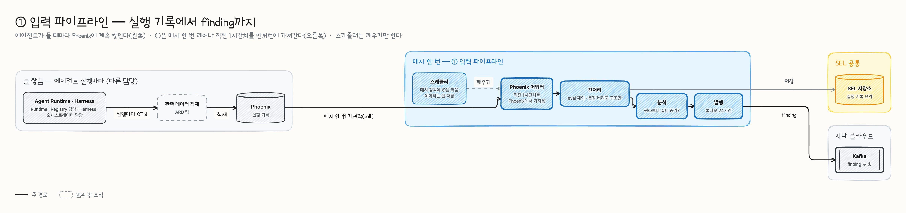
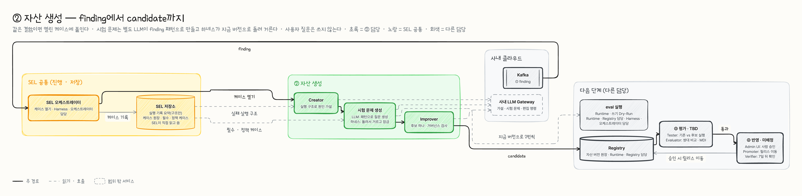
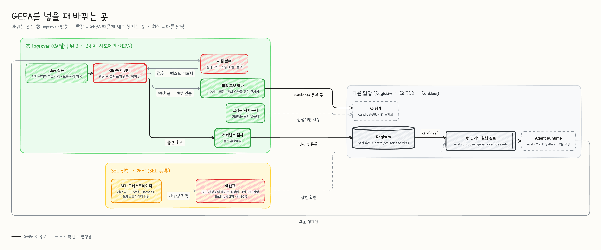

# SEL ① 입력 파이프라인 · ② 자산 생성 설계

| 항목 | 내용 |
| --- | --- |
| 범위 | SEL ① 입력 파이프라인(① 담당)과 ② 자산 생성(② 담당). ③ 평가 · ④ 반영은 경계만 적는다 |
| 기준 | 모듈 설계 기준 문서(내부)(2026.10.28) 11장, 팀 위키 `팀 위키`(커밋 f8e75c1) |
| 바탕 | ① `① 구현(sel-ingest)` LLD v0.1과 코드, ② `docs/07` · `docs/08` · `docs/09`, 실험장 `sel-lab` |
| 상태 | 초안 v0.2 (2026.10.30). 후보 생성은 LLM 1회 작성이 기본이고, GEPA 검토는 10 · 11장. **[제안]** 은 기준 문서에 없는 우리 설계라 합의가 필요하다 |

## 1. 요약

- ①은 매시 실행 기록을 분석해 "이 자산이 평소보다 자주 실패한다"는 **finding**을 낸다.
- ②는 finding을 받아 **원인 가설 하나**를 세우고, 그 가설대로 **고친 후보 하나**를 Registry에 candidate로 올린다.
- 둘은 finding 형식 하나와 SEL 저장소(PostgreSQL `sel` 스키마)로만 이어진다. 흐름은 Phoenix → ① → ② 한 방향이다.
- SEL은 사용자 질문을 쓰지 않는다. ①은 실행 기록에서 구조만 남기고, ②는 그 구조만 본다. 시험 문제는 별도 LLM이 finding 패턴만 보고 만들고, 하네스(코드)가 지금 버전으로 돌려 실제로 같은 방식으로 틀리는 것만 남긴다.

## 2. 설계 원칙

| 원칙 | 출처 | 이 설계에서 |
| --- | --- | --- |
| finding 형식은 고정한다. 분석 방식이 바뀌어도 뒤 단계가 바뀌지 않게 | 기준 문서 11장 ① | ①과 ② 사이 계약은 finding 하나. 기준 문서 7개 필드 + ① 확장 + ② 요청 2개 |
| LLM은 판단만, 집행은 소프트웨어 | 기준 문서 1.3 원칙 2 | LLM은 원인 가설(Creator), 시험 문제 생성, 편집 명령(Improver) 세 곳. 생성된 시험 문제가 맞는지 검증 · 잠금 · 검사 · 등록은 결정적 코드(하네스) |
| SEL은 approved를 못 만든다. 바꿀 수 있는 것만 바꾼다 | 기준 문서 8 · 11장 | ②는 candidate까지만. 프롬프트 · 스킬 본문 · 도구 description · 매니페스트 파라미터만 고친다 |
| 상태는 한 곳에 | 기준 문서 5장(오케스트레이터는 상태 없음) | 케이스 진행 상태는 SEL 케이스 원장 하나에만 둔다. ①은 ②의 원장을 읽지 않는다 |
| 우리가 소유하지 않는 데이터는 정본처럼 쌓지 않는다 | 위키 "계속 지키는 전제", v3 규칙 R5 | 사용자 질문 · 도구 결과 본문은 저장하지 않는다. 구조만 남긴다 |

## 3. 아키텍처

**한눈에 보기** (번호 순서대로 한 사이클, 점선 테두리는 범위 밖)

<!-- html -->
<div class="flow">
<div class="st ext" style="border-color:var(--ext-s)"><b class="h"><span class="n" style="background:var(--ext-s)">1</span>실행 · 관측</b><span class="who">다른 담당 · 범위 밖</span><ul><li>Agent Runtime · Harness (Runtime · Registry 담당 · Harness · 오케스트레이터 담당): 에이전트 실행, 실행 기록 내보냄</li><li>ARD 팀: Phoenix에 적재</li><li>Phoenix: 실행 기록 보관</li></ul></div>
<div class="st" style="border-color:var(--code-s)"><b class="h"><span class="n" style="background:var(--code-s)">2</span>① 입력 파이프라인</b><span class="who">① 담당</span><ul><li>스케줄러: 매시 ①을 실행</li><li>Phoenix 어댑터: 직전 1시간치 가져옴</li><li>전처리 → 분석 → 발행: finding</li></ul></div>
<div class="st" style="border-color:var(--llm-s)"><b class="h"><span class="n" style="background:var(--llm-s)">3</span>SEL 공통</b><span class="who">Harness · 오케스트레이터 담당 · SEL 전체 설계</span><ul><li>SEL 오케스트레이터: 케이스 열기 · 단계 진행, 중복 finding은 열린 케이스에 붙임</li><li>SEL 저장소: 실행 요약 · 케이스 원장</li></ul></div>
<div class="st" style="border-color:var(--store-s)"><b class="h"><span class="n" style="background:var(--store-s)">4</span>② 자산 생성</b><span class="who">② 담당</span><ul><li>Creator: 실행 구조로 원인 가설</li><li>시험 문제 생성: LLM이 만들고 하네스가 돌려서 거름</li><li>Improver: 후보 하나 + 거버넌스 검사</li></ul></div>
<div class="st" style="border-color:var(--ext-s)"><b class="h"><span class="n" style="background:var(--ext-s)">5</span>Registry</b><span class="who">Runtime · Registry 담당</span><ul><li>candidate 등록</li><li>탈락하면 rejected</li><li>승인되면 릴리스 지정 이동</li></ul></div>
<div class="st" style="border-color:var(--human-s)"><b class="h"><span class="n" style="background:var(--human-s)">6</span>③ 평가</b><span class="who">담당 TBD</span><ul><li>Tester: 기존 vs 후보를 같은 시험 문제로 실행(eval · 쓰기 Dry-Run · 모델 고정)</li><li>Evaluator: 쌍대 비교(순서 바꿔 2번) · MDI 게이트</li></ul></div>
<div class="st" style="border-color:var(--warn-s)"><b class="h"><span class="n" style="background:var(--warn-s)">7</span>④ 반영</b><span class="who">담당 미배정</span><ul><li>Admin UI: 사람 승인</li><li>Promoter: 릴리스 이동</li><li>Verifier: 7일 뒤 같은 패턴이 줄었나 확인. 안 줄면 다음 주기에 다시 finding(→ 2)</li></ul></div>
</div>
<!-- /html -->

아래 두 그림은 2 ~ 4(①과 ②)를 자세히 그린 것이다.





파랑은 ① 담당, 초록은 ② 담당, 노랑은 SEL 공통(오케스트레이터 · 저장소), 회색은 다른 담당, 점선 상자는 우리 범위 밖 조직 · 서비스다. 첫 그림의 Kafka가 둘째 그림의 시작이다.

**한 사이클**

1. 에이전트가 돌 때마다 Runtime · Harness가 실행 기록(span)을 내보내고, ARD 팀이 Phoenix에 적재한다(우리 범위 밖). 모든 span에 `erp.request_id` · `erp.asset.refs` · `erp.outcome.type`이 붙는다(기준 문서 7장).
2. **스케줄러**가 매시 정각에 ①을 실행한다. 스케줄러는 실행만 시키고 데이터는 다루지 않는다.
3. **① Phoenix 어댑터**가 직전 1시간치를 한꺼번에 가져간다. Phoenix를 읽는 곳은 이 어댑터 하나다.
4. **① 전처리**: eval 실행을 가장 먼저 빼고, 문장(본문)은 버리고 구조만 `sel_run`에 저장한다.
5. **① 분석**: 자산 버전별 실패율을 평소와 비교해 이상하면 후보로 올린다.
6. **① 발행**: 쿨다운(24시간) 안이 아니면 finding을 outbox → Kafka로 보낸다.
7. **SEL 오케스트레이터**: 같은 결함의 케이스가 이미 열려 있으면 finding을 그 케이스에 기록만 한다. 열린 케이스가 없으면 새 케이스를 열고 ②를 호출한다.
8. **② Creator**: `sel_run`에서 실패 실행의 구조를 읽어 원인 가설을 세운다(LLM). 시험 문제는 별도 LLM이 finding 패턴으로 만들고, 하네스가 검증해 잠근다.
9. **② Improver**: 가설대로 편집 명령을 한 번 쓰고(LLM), 거버넌스 검사를 통과하면 Registry에 candidate로 올린다.
10. ③ 평가 · ④ 승인으로 넘어간다.

## 4. ① 입력 파이프라인 (① 담당)

| 단계 | 하는 일 | 근거 |
| --- | --- | --- |
| 스케줄러 | SEL 스케줄러는 하나이고, 일정은 두 가지다. 매시에는 ①을 실행하고(앞 실행이 끝나지 않았으면 건너뜀), ERP 사용이 적은 밤에는 SEL 오케스트레이터에 평가 배치를 요청한다. 둘 위치(Runtime VM 안 cron 또는 별도 워커)는 협의한다 | 기준 문서 11장 ① · ③, 5장 |
| 수집 | Phoenix 어댑터가 Trace API(`phoenix.client`)로 읽는다. 커서 + 늦게 오는 span 대기(10분) + 겹쳐 읽기(1시간). 꽉 찬 페이지(1,000개)는 구간을 반으로 쪼개 다시 읽는다 | 기준 문서 11장 ①, Phoenix 실측(기본 limit 1,000에 잘림 표시 없음) |
| 전처리 | eval 제외 → run 조립 → 자산 버전 부착 → 결과 코드 정규화 → 본문 제거(남길 필드만 적는 방식) | 기준 문서 11장 ① |
| 분석 | 최소 30 run · 기준 대비 1.5배 · +5%p · 단측 이항 검정 p < 0.01. 기준선은 직전 28일 같은 요일, 월말은 따로, 바닥 1% | ① LLD 7장 (설계값, P2 실측 후 조정) |
| 발행 | 쿨다운(24시간) 안이면 억제. 한 번에 20건 넘으면 멈추고 알림 | ① LLD 8장 |

**패턴** (기준 문서 11장 5종): `tool_arg_error` · `wrong_tool_selection` · `user_approval_rejected` · `limit_exceeded` · `repeat_question`

**결과 코드는 누구 탓인가**

| 결과 | 귀속 | 이유 |
| --- | --- | --- |
| 도구가 돌려준 업무 오류(ROW_LIMIT_EXCEEDED · UNBALANCED · APPROVAL_REQUIRED · ARG_INVALID 등, 도구 정의의 `errors`) | 자산 → `tool_arg_error` | 넘긴 인자나 절차 때문에 난다. 자산을 고치면 줄어든다 |
| timeout · 429 · 권한 거부 · 런타임 오류 | 플랫폼 → 분자 · 분모에서 모두 뺀다 | 자산을 고쳐도 안 줄어든다 |

기준 문서 9장이 결과 코드를 표준화한 목적이 "자산 탓과 플랫폼 탓 구분"이다. 코드별 목록의 정본은 Protocol `common/errors.md`(Protocol 담당)에 둔다. 도구 오류를 통째로 플랫폼으로 빼면, 스킬 결함이 도구 업무 오류로 드러나는 경우(예: 기간 기본값을 지운 스킬 → ROW_LIMIT_EXCEEDED, 승인 단계를 지운 스킬 → APPROVAL_REQUIRED)가 finding이 되지 않는다.

## 5. ① → ② 계약: finding

```json
{
  "finding_id": "fnd_2027_03_0112",
  "asset_ref": "asset://tool/fi/journal-post@1.0.3",
  "pattern": "tool_arg_error",
  "window": { "from": "2027-03-10T00:00:00Z", "to": "2027-03-11T00:00:00Z" },
  "metrics": { "runs": 412, "fail_rate": 0.18, "baseline_fail_rate": 0.04 },
  "examples": ["run_01JQ…", "run_01JQ…"],
  "hint": "posting_date 형식(YYYYMMDD vs YYYY-MM-DD) 혼동",

  "schema_version": "1",
  "attribution": "asset", "fixable_by": "sel", "confidence": "ok",
  "affected_requests": 389, "recurrence": 0,

  "dedupe_key": "asset://tool/fi/journal-post|tool_arg_error",
  "signature": { "outcome_type": "arg_error", "tool": "journal_post", "result_code": "ARG_INVALID", "arg_path": "posting_date", "arg_shape": ["company_code", "lines"] }
}
```

| 묶음 | 필드 | 정한 곳 |
| --- | --- | --- |
| 기준 문서 7개 | `finding_id` · `asset_ref` · `pattern` · `window` · `metrics` · `examples` · `hint` | 기준 문서 11장. 바꾸지 않는다 |
| ① 확장 | `schema_version` · `attribution` · `fixable_by` · `confidence` · `affected_requests` · `recurrence` | ① LLD 8.1. ②와 합의 후 켠다 |
| ② 요청 | `dedupe_key` · `signature` | **[제안]** |

- **`dedupe_key`** = 버전을 뺀 자산 + 패턴. Registry는 버전을 바꾸지 않고 새로 쌓는다(기준 문서 8장). 자산을 고쳐 버전이 바뀌어도 같은 결함으로 이어 세야 후보 상한, 재발 횟수, Verifier의 7일 확인이 맞는다.
- **`signature`** = 어느 도구가 · 어떤 결과 코드로 · 어떤 인자에서 실패했나. ①의 run 기록에 이미 있는 정보(`failed_tool` · `error_kind` · `error_field`)다. 시험 문제 생성 LLM은 이 서명을 보고 비슷한 질문을 만들고, 하네스는 생성된 질문이 "같은 방식으로 실패하는지"를 이 서명으로 확인한다. 넘긴 인자 이름 목록(`arg_shape`, 값 없음)을 더하는 이유는, 같은 결함이 다른 결과 코드로 드러날 수 있어서다.
- **`hint`** 는 ①이 실패 묶음을 보고 규칙으로 만든 한 줄 요약이다(오류 난 인자, 오류 종류, 도구). 사용자가 입력한 문장은 들어가지 않는다.
- 실패한 사용자 수는 받지 않고 `affected_requests`로 대신한다. 사용자 신원은 토큰으로만 다니고(위키 요청 컨텍스트), ①의 통계 검정이 우연한 실패를 거른다.

## 6. ② 자산 생성 (② 담당)

| 단계 | 누가 | 하는 일 |
| --- | --- | --- |
| 1 증거 읽기 | 코드 | `sel_run`에서 실패 실행의 **구조만** 읽는다: 도구 이름, 인자 이름, 결과 코드, 결과 건수, 재요청 · 정정 같은 이벤트 종류. 사용자 질문 · 인자 값 · 답변은 넘기지 않으므로, 외부 텍스트가 지시문처럼 섞여 들어올 수 없다 |
| 2 원인 가설 | LLM | 원인 종류 · 대상 자산 · 가설 한 문장. `fixable_by = human`(binding · 권한 등)이면 가설 없이 개발자 작업으로 넘긴다 |
| 3 분기 | 코드 | 자산 원인이 아니면 종료 |
| 4 시험 문제 생성 · 검증 | LLM + 하네스 | 시험 문제 생성 LLM이 finding(패턴 · 서명 · hint)만 보고 같은 패턴의 질문과 정상 질문을 만든다. 하네스가 지금 버전으로 2번씩 돌려, 같은 서명으로 틀리는 것(목표)과 2번 다 통과하는 것(정상)만 남긴다. 1번만 틀리면 3번째로 정한다. 시험 데이터 범위 밖을 묻는 질문은 버린다. 필수 · 정책 케이스(승인 단계, 인젝션 내성)는 사람이 만든 고정 세트에서 매번 넣는다 |
| 5 고정 | 코드 | 시험 문제 목록을 잠근다. 결과를 보고 바꿀 수 없다 |
| 6 사본 | 코드 | 대상 자산에서 판정 정보(평가 케이스 필드)를 지운 사본을 Improver에 준다 |
| 7 편집 명령 | LLM | 가설 하나에 편집 명령 하나. 파일 전체가 아니라 "이 섹션을 이렇게" |
| 8 적용 · 검사 | 코드 | 원본에 적용해 후보를 만들고 거버넌스 검사(범위 · 크기 · 유입 · 안전 절차 · 누출 · 등급). 걸리면 7로, 재작성 2회까지 |
| 9 등록 | 코드 | draft → candidate(Registry가 스키마 · 린트 검사), 생성 근거 첨부 |

**시험 문제는 왜 LLM이 만들고 하네스가 거르나.** 기준 문서은 시험 문제를 "과거 실패 입력 + 정상 입력"으로 정했지만, 그 입력을 어디서 얻는지는 정하지 않았다. 사용자 질문을 쓰지 않으므로 질문을 새로 만들어야 하고, 미리 만든 문제은행은 새로 생기는 실패 유형을 따라가지 못한다. 그래서 finding 패턴을 보고 LLM이 질문을 만들되, 그 질문이 정말 같은 결함을 건드리는지는 하네스가 지금 버전으로 돌려서 확인한다. 세 가지를 지킨다.

1. **문제를 만드는 LLM은 finding만 본다.** Creator · Improver와 분리하고 가설 · 후보는 보여주지 않는다. 후보를 아는 LLM이 문제를 만들면 그 후보가 통과하기 쉬운 문제를 만든다.
2. **남기는 기준은 실행 결과다.** 지금 버전에서 finding과 같은 서명으로 실제로 틀리는 질문만 목표 문제가 된다. LLM의 판단으로 고르지 않는다.
3. **정답을 미리 적지 않는다.** ③은 규칙 검사(그 오류가 사라졌나, 승인 단계를 지켰나)와 쌍대 비교(기존 vs 후보 중 어느 답이 나은가)로 판정한다. 기준 문서 ③은 원래 정답지 없이 두 결과를 비교하는 방식이다.

대가: 생성 질문은 실제 사용자 질문보다 덜 현실적일 수 있어서, 필수 · 정책 케이스는 사람이 만든 고정 세트를 쓴다. 생성이 같은 방식으로 틀리는 질문을 끝내 만들지 못하면 그 finding은 "판정 불가"(`insufficient_set`)로 끝난다. 다른 방식의 실패로 대신 채우지 않는다.

**노출 원장은 두지 않는다.** 시험 문제는 Creator가 본 적 없는 입력이어야 한다. 시험 문제는 finding마다 새로 만들고, Creator · Improver에는 보여주지 않으므로 별도 기록 없이도 이 조건이 지켜진다. 같은 문제를 반복해 쓰지 않으니 문제에 맞춘 개선도 생기기 어렵다.

**거버넌스** (기준 문서 11장 + 우리 상세)

| 원칙 | 내용 |
| --- | --- |
| 바꿀 수 있는 것 | 프롬프트, 스킬 본문, 도구 description, 매니페스트 파라미터(허용목록에 오른 키만 **[제안]**) |
| 바꿀 수 없는 것 | 도구 binding, required_capability, Harness 1층, 권한 · 등급. 더해서 도구 이름 · 입력 형식, 매니페스트의 도구 · 스킬 참조, 평가 케이스 필드 · 필수 · 정책 케이스, 승인 금액 같은 안전 파라미터 **[제안]** |
| 변경 단위 | 후보 하나에 가설 하나, 변경 종류도 하나. 같은 결함에 후보 3개까지 **[제안]** |
| 기록 | finding ID · 가설 · 변경 전후 차이 · 시험 문제 목록 + 기준 버전 · 몇 번째 후보 · 검사 결과 · 사용 모델 |
| 버전 | SEL 변경은 전부 minor. 등록한 버전은 고치지 않는다 |

## 7. 자가 개선은 어떻게 일어나나

자가 개선은 이 **루프 자체**에서 일어난다. 실패를 관측하고 → 원인을 세우고 → 고친 후보를 만들고 → 비교 평가하고 → 사람이 승인해 반영하고 → 다시 관측한다.

| 순서 | 무엇이 일어나나 | LLM |
| --- | --- | --- |
| 1 | ①이 매시 실행 기록을 분석해 finding을 낸다 | 없음 |
| 2 | Creator가 실행 구조와 finding을 보고 원인 가설 하나를 세운다 | 1회 |
| 3 | 시험 문제 생성 LLM이 finding 패턴으로 질문을 만들고, 하네스가 지금 버전으로 돌려 같은 방식으로 틀리는 것과 정상인 것만 남겨 잠근다 | 1회 |
| 4 | Improver가 가설대로 편집 명령을 한 번 쓴다 → 거버넌스 검사 → candidate 등록 | 1회(검사에 걸리면 최대 2회 더) |
| 5 | ③이 기존 · 후보를 같은 시험 문제로 돌려 비교한다 | ③의 판정자 |
| 6 | 통과하면 ④ 사람 승인 → 릴리스 이동 → 7일 뒤 Verifier가 같은 패턴이 줄었는지 본다 | 없음 |
| 7 | 탈락하면 같은 finding으로 2번부터 다시 돈다(새 가설 · 새 후보, finding당 3번까지). 이전 시도에서 받는 것은 통과 여부 · 사유 코드와 이전 가설 기록뿐이다 | — |
| 8 | 반영 뒤에도 패턴이 안 줄면 다음 분석 주기에 다시 finding이 된다(기준 문서 11장 ④). 나빠졌으면 직전 승인 버전으로 되돌리는 것은 ④에 낸 제안이다 | — |

한계는 후보를 한 번에 작성한다는 점이다. 가설이 맞더라도 고친 문장이 부족해 탈락하면, 그 가설을 다듬지 않고 다음 시도로 넘어간다. 실험장(sel-lab)의 결함 10종 결과는 이 방식으로 얻었다.

## 8. 정한 것

| 항목 | 결정 | 근거 |
| --- | --- | --- |
| 1. 도구 오류 귀속 | 결과 코드 단위로 나눈다. 도구 업무 오류는 `tool_arg_error`, 인프라 오류만 플랫폼 | 기준 문서 9장 |
| 2. finding 형식 | ① 스키마 그대로, ② 요청은 `dedupe_key` · `signature` 둘 | 기준 문서 11장 "정해진 형식으로만" |
| 3. 진행 중 중복 | SEL 오케스트레이터가 거른다(열린 케이스에 붙임). ①은 쿨다운만 | 상태는 한 곳에, 흐름은 한 방향 |
| 4. 같은 결함 묶기 | 버전을 뺀 자산 + 패턴 **[제안]** | Registry 불변 버전 · Verifier 7일 |
| 5. 등급 비교 | 숫자로 비교하지 않는다. "민감한 순서" 목록 하나를 ① · ②가 같이 읽고, 모르는 등급은 가장 민감한 것으로 본다 **[제안]** | 등급 체계 미정(산업보안 2027.1) |
| 6. 실패 사용자 수 | 받지 않고 `affected_requests` 사용 | 신원은 토큰으로만 |
| 7. 사용자 질문 | **쓰지 않는다**(2026.10.30 ② 담당 결정). Creator는 구조와 finding만 본다. 저장도 하지 않는다 | 기준 문서에 질문을 어디서 얻는지가 없다. Phoenix 보존 기간 · 산업보안에 묶이지 않는다 |
| 8. 시험 문제 | 별도 LLM이 finding 패턴으로 만들고 하네스가 실행 결과로 거른다. 필수 · 정책 케이스는 사람이 만든 고정 세트. 미리 만든 문제은행은 쓰지 않고, 노출 원장 · 문제별 사용 횟수 상한도 두지 않는다(2026.10.30 ② 담당 결정) | 문제은행은 새 실패 유형을 못 따라간다. 생성 LLM을 Creator · Improver와 분리해 공정성 유지 |
| 9. span 속성 이름 | `erp.tool.name` · `erp.tool.result_code` · `erp.tool.arg_path` · `erp.tool.arg_shape`로 통일해 함께 Protocol에 올린다 | 정본은 `common/span-attributes.md` |
| 10. 판정 기준 숫자 | ① 값을 따른다. 다만 기준선을 잴 때 이미 열린 finding 기간과 eval 기간은 빼자고 제안한다 | 분석은 ① 소관 |
| 11. SEL 저장소 접근 | SEL이 직접 읽고 쓴다. DBC는 업무 데이터를 건드릴 때만, Registry는 Registry API로 **[제안]** | 9장 |

## 9. SEL 저장소 (PostgreSQL `sel` 스키마)

| 테이블 | 쓰는 쪽 | 읽는 쪽 |
| --- | --- | --- |
| `sel_run` (실행 기록 요약, 구조만) | ① | ① 분석, ② Creator |
| `sel_finding` · `sel_outbox` | ① | ① 발행 |
| 케이스 원장 (진행 상태 · 후보 수 · 시도 기록) **[제안]** | SEL 오케스트레이터 · ② | SEL 오케스트레이터(중복 판단), ④ |
| 필수 · 정책 케이스 (고정 세트) | 사람(업무 담당 · SME) | ② 시험 문제 구성, ③ |
| 시험 세트 (생성 질문 + 고정 케이스, 잠근 목록) | ② | ③ |
| 등급 순서 설정 **[제안]** | 사람(산업보안 결정 후) | ① · ② |

SEL 내부 저장소는 SEL이 직접 읽고 쓴다. DBC는 SEL이 업무 데이터를 건드릴 때만 거치고, Registry는 Registry API로 부른다(Registry가 DBC를 거친다, 기준 문서 8장). 기준 문서 10장의 한 줄 정의 "에이전트 · Registry · SEL이 데이터를 조회하는 유일한 창구"는 업무 데이터에 대한 규정으로 해석한다 **[제안]**. SEL 내부 저장소는 기준 문서에 정의되지 않았고, ①과 ②가 설계한 것이다.

## 10. GEPA 도입 여부

기준 문서 11장 ②가 준 과제는 "DSPy(MIPROv2 등) · GEPA를 거버넌스 원칙 안에서 쓸 수 있는지 검토한다"이다. 넣으라는 결정은 없다. 결론부터: **둘 중 고른다면 GEPA이고, 거버넌스 안에서 쓸 수 있다. 다만 1차 오픈(2027.8)에는 넣지 않는 것을 제안한다.**

### 10.1 GEPA가 하는 일 (쉽게)

지금 설계에서 Improver는 고친 문장을 **한 번** 쓴다(7장 4번). GEPA는 이것을 "써 보고 → 연습 질문으로 돌려 보고 → 왜 틀렸는지 읽고 → 고쳐 쓰기"를 예산 안에서 여러 번 반복하는 방식으로 바꾼다. 반복 중에 나온 후보들 가운데 연습 점수가 가장 좋은 **하나**를 최종 후보로 낸다. 바뀌는 것은 Improver의 "쓰기" 한 칸뿐이고, ①, Creator, 시험 문제, ③ · ④는 그대로다.

### 10.2 왜 GEPA인가 (DSPy MIPROv2와 비교)

| 기준 | MIPROv2 (DSPy) | GEPA |
| --- | --- | --- |
| 하는 일 | 지시문과 예시(few-shot)를 함께 탐색. 예시는 학습 예시를 돌려 맞게 나온 출력에서 뽑는다 | 실행 기록과 실패 설명을 LLM이 되돌아보고 지시문을 고쳐 쓴다 |
| 필요한 재료 | 정답이 있는 예시와 점수 | 실행 기록 + 텍스트 피드백. 우리 finding · 실패 서명과 같은 재료다 |
| 거버넌스와 맞나 | **안 맞는다.** 예시를 실제 실행 출력에서 뽑아 프롬프트에 넣는다(아래 이유 1) | 맞출 수 있다. 고친 문장을 내기 직전에 우리 편집 명령 · 거버넌스 검사를 끼워 넣는 자리가 있다 |
| 고칠 대상 형식 | DSPy 프로그램 구조를 전제한다. 우리 자산(SKILL.md · 도구 description)을 DSPy로 다시 짜야 한다 | 아무 텍스트 덩어리나 다룬다. 스킬 섹션 · 도구 description을 그대로 넣을 수 있다 |
| 보고된 성능 | — | 논문 v2(2026-02): 6개 과제에서 MIPROv2보다 우수, 강화학습(GRPO) 대비 실행 수 최대 35배 적음 |

**MIPROv2를 고르지 않은 이유**

1. **업무 데이터가 자산에 박힌다.** MIPROv2는 예시를 돌려서 맞게 나온 **실제 출력**을 few-shot 예시로 프롬프트에 넣는다. 평가 실행은 조회를 실제 도구로 하므로 그 출력에는 실제 거래처명 · 금액 같은 업무 데이터가 들어간다. 그대로 넣으면 모든 사용자가 쓰는 프롬프트 · 스킬에 업무 데이터가 남는다. 위키의 "우리가 소유하지 않는 데이터를 쌓지 않는다"(v3 규칙 R5)와 등급 규칙에 어긋난다. 그래서 우리는 예시 블록을 고칠 때 "합성 값만" 쓰고 누출 검사로 막는다는 규칙을 두었다(이 규칙은 기준 문서이 아니라 우리 거버넌스 상세다, docs/07 D절 **[제안]**). MIPROv2는 이 규칙과 정면으로 부딪힌다.
2. **우리 자산 형식에 맞추려면 다시 짜야 한다.** MIPROv2는 DSPy 프로그램(모듈 · 시그니처) 구조를 전제한다. 우리 자산은 매니페스트 · SKILL.md · 도구 정의 같은 텍스트 파일이라 DSPy로 감싸는 별도 층을 만들어야 한다. GEPA는 텍스트 덩어리를 그대로 받는다.
3. **필요한 재료가 다르다.** MIPROv2는 정답이 붙은 예시와 숫자 점수로 탐색한다. 우리 시험 문제는 정답을 미리 적지 않는다(6장). GEPA는 실행 기록과 실패 설명(텍스트 피드백)을 쓰므로 finding · 실패 서명과 그대로 맞는다.
4. **보고된 성능도 GEPA가 낫다.** GEPA 논문 v2(2026-02)의 비교에서 MIPROv2보다 개선 폭이 컸다(docs/08 3장).

MIPROv2의 예시 탐색을 끄고 지시문만 탐색하게 하는 방법도 있지만, 그러면 1번은 피해도 2 · 3번이 남고 GEPA보다 나은 점이 없다. 확인 출처와 패키지 정보(`gepa` 0.1.4, MIT, DSPy 없이 사용 가능)는 docs/08 3장(확인일 2026.10.28).

### 10.3 거버넌스 원칙 안에서 쓸 수 있나

| 거버넌스 원칙 | GEPA 기본 동작 | 판정 · 조건 |
| --- | --- | --- |
| 바꿀 수 있는 것만 | 프롬프트 텍스트만 고친다 | 맞음. 허용된 섹션만 주고, 결과는 같은 검사를 통과해야 한다 |
| 바꿀 수 없는 것 | 텍스트 밖은 안 건드린다 | 맞음 |
| 후보 하나에 가설 하나 | 후보 수십 개, 합치기(병합)도 한다 | **조건**: 진화는 ② 안에서만, Registry에는 마지막 하나만 candidate. 병합은 끈다 |
| 기록 | 진화 과정이 안 남는다 | 진화 요약을 생성 근거에 넣는다 |
| 시험 문제는 Creator가 본 적 없는 입력 | 예시별 점수를 반복해서 본다 | **조건**: 연습용 dev 질문(시험 문제와 따로 생성)으로만 탐색. 시험 문제는 절대 안 쓴다 |
| approved는 사람만 | 무관 | 맞음 |

충돌하는 두 줄은 조건으로 풀린다. 그래서 "쓸 수 있다"가 결론이다.

### 10.4 넣으면 아키텍처에 추가되는 것

| 추가되는 구조 | 왜 필요한가 | 없으면 |
| --- | --- | --- |
| dev 질문 | 다듬는 동안 연습으로 돌릴 질문이 필요하다. 시험 문제 생성 LLM이 시험 문제와 따로 만든다 | 시험 문제로 연습하면 시험에 맞춘 개선이 되고, ③ 판정이 의미를 잃는다 |
| 중간 후보 실행 경로 (draft 등록 + `overrides.refs`) | 써 본 후보를 실제 에이전트로 돌려 봐야 나아졌는지 안다. 중간 후보를 Registry에 draft로 올리고 eval 실행이 그 버전을 가리킨다 | 등록 안 된 텍스트를 직접 넣어야 해서 보안 예외(인라인 주입)가 생긴다 |
| 채점 함수 | 돌린 결과를 점수와 짧은 피드백(결과 코드, 서명이 사라졌나, 정책을 지켰나)으로 바꿔야 LLM이 반성할 수 있다. judge 없이 결정적으로 | 반성할 재료가 없다 |
| 노출 원장 | 반성 LLM은 dev 질문과 그 실행 결과를 본다. 그 질문이 나중 시험 문제와 겹치지 않도록 기록해 둔다(GEPA가 없으면 LLM이 시험 입력을 볼 일이 없어 필요 없다) | 본 질문으로 시험하게 된다 |
| 예산표 + 오케스트레이터 집행 | 반복은 실행을 많이 쓴다(GEPA 1회 실행 150). 1회 · finding당 · 하룻밤 상한을 SEL이 지켜야 ③ 평가와 운영을 밀어내지 않는다 | 실행 비용과 LLM 쿼터가 끝없이 늘 수 있다 |
| 진화 요약 기록 | 거버넌스의 "기록" 원칙. 승인자가 어떻게 이 후보가 나왔는지 봐야 한다 | 최종 후보 하나만 남아 근거가 사라진다 |

그림과 바뀌는 점 표는 11장.

### 10.5 넣으려면 필요한 것

| 필요한 것 | 누가 | 지금 상태 |
| --- | --- | --- |
| eval 실행이 릴리스 안 된 버전(draft · candidate)을 가리키는 경로(`overrides.refs`) | Runtime · Registry 담당 · Harness · 오케스트레이터 담당 | 미정. ③이 candidate를 돌리는 데도 필요하다 |
| Registry가 중간 후보를 draft로 받는 번호 규칙(예: `1.5.0-sel.0007.3`) | Runtime · Registry 담당 | 미정 |
| ③과 같이 쓰는 실행 경로(대기열 · 동시 상한 · 비용 계측) | ③ 담당(TBD) | ③ 미배정. 그 전엔 sel-lab `tester.py`가 대신 |
| 반성용 사내 LLM과 평가 트래픽 쿼터 | 사내 클라우드 LLM Gateway (PL 경유) | 협의 전 |
| `gepa` 패키지 버전 고정 · 내부망 반입 | ② · 사내 클라우드 | 0.1.4로 고정 예정, 반입 경로 협의 전 |
| 1회 작성보다 낫다는 근거 | ② | sel-lab · 오프라인 세트에서 같은 시험 문제로 비교해야 한다(아직 안 함) |

### 10.6 1차 오픈에는 넣지 않자는 이유

- P3 완료 기준은 "개선 1사이클 시연"이다. 1회 작성으로 채워진다(sel-lab 결함 10종 결과).
- 1회 작성보다 낫다는 근거가 우리 자산으로는 아직 없다.
- 10.5의 선행 조건이 다른 담당 일정(Runtime · Registry · ③ 배정)에 걸려 있다. ② 한 명이 P3(2027.2~5) 안에 감당할 범위를 넘는다.

**넣을 때 켜는 조건**: 첫 후보는 1회 작성. ③에서 떨어진 2 · 3번째 시도에만 GEPA를 쓰고, 오프라인 비교에서 1회 작성을 이길 때만 켠다.

## 11. GEPA를 넣으면 아키텍처가 어떻게 바뀌나



바뀌는 곳은 **② Improver 안**과 거기에 붙는 경로뿐이다. ①과 3장의 나머지는 그대로다.

| 바뀌는 것 | 지금(1회 작성) | GEPA를 넣으면 | 왜 이렇게 |
| --- | --- | --- | --- |
| 언제 쓰나 | 모든 시도 | 첫 후보는 1회 작성. ③에서 떨어진 2 · 3번째 시도에만 GEPA | 1회 작성이 기준선이고, 안 풀린 finding에만 비용을 쓴다 |
| 후보를 만드는 방법 | LLM 한 번 | GEPA 어댑터가 반성 → 고쳐 쓰기를 반복. 중간 후보마다 거버넌스 검사. 병합은 끈다 | 원칙을 벗어난 중간 후보는 실행도 하지 않는다. 병합하면 가설 하나 = 후보 하나가 깨진다 |
| 중간 후보를 돌리는 방법 | 없음 | 중간 후보를 Registry에 **draft로 등록**하고(번호는 `1.5.0-sel.0007.3` 같은 pre-release), eval 실행이 그 ref를 가리킨다 | 그림 4가 "SEL 작성 → draft"를 이미 허용한다. 등록 안 된 텍스트를 실행하는 예외(인라인 주입)와 산업보안 승인이 필요 없다. 돌린 것이 전부 Registry에 남는다 |
| 실행 경로 | 없음 | ③과 같은 실행 경로를 쓴다(eval 요청 `purpose: gepa`). 쓰기는 Dry-Run, 모델 고정 | 실행 체계를 둘 만들지 않는다. 비용 계측도 한 곳 |
| 채점 | 없음 | 결정적 채점 함수(결과 코드 · 서명 소멸 · 정책 준수). 판정용 LLM은 쓰지 않는다. 구조 결과만 받으므로 사용자 질문 · 답변이 없다 | 등급 문제가 없고 결과가 재현된다 |
| 예산 | 없음 | 케이스 원장에 예산표. 오케스트레이터가 넘으면 중단: GEPA 1회 실행 150 · 60분, finding당 2회, 하룻밤 eval 쿼터의 20%, 4회 연속 개선 없으면 종료, 플랫폼 오류가 몰리면 중단 | GEPA 설정값에만 기대지 않고 SEL이 집행한다 |
| 시험 문제 | ③ 판정에만 | 그대로. GEPA는 보지 않는다 | dev 질문과 시험 문제를 따로 생성하고 노출 원장으로 겹침을 막는다 |
| Registry | candidate 등록 | + 중간 draft 다수(목록 · ④ 화면에서 숨김 표시) | 불변 버전이라 감사 기록이 된다 |
| 기록 | 가설 · 변경 전후 차이 | + 진화 요약(몇 번 돌았나 · 어떤 실패를 보고 무엇을 고쳤나)을 생성 근거에 | 최종 후보 하나만 candidate가 되므로, 승인자가 과정을 볼 근거가 필요하다 |

넣기 전에 정해져야 하는 것: eval 실행이 릴리스 안 된 ref를 해석하는 경로(`overrides.refs`, Runtime · Harness), Registry v0의 pre-release 번호 지원, ③ 담당 배정(그 전엔 sel-lab `tester.py`가 실행기를 대신). `overrides.refs`는 ③이 candidate를 돌리는 데도 필요하므로 GEPA 때문에 새로 생기는 일은 아니다.

## 12. 협의

| 상대 | 무엇 | 기한 |
| --- | --- | --- |
| ① 담당 ↔ ② 담당 | 8장 결정 합의. ① 스키마에 `dedupe_key`(버전 없이) · `signature` 추가, 도구 업무 오류를 `tool_arg_error`로, 진행 중 억제는 끄고 쿨다운만, `sel_run`에 결과 건수 같은 구조 값 유지, 등급 순서 설정 공동 사용 | 11월 |
| Protocol 담당 | 결과 코드별 자산/플랫폼 귀속(`common/errors.md`), span 속성 `erp.tool.*` · `erp.run_mode` | v0 11월 중순 · v1 12월 말 |
| Runtime · Registry 담당 | `sel` 스키마를 둘 PostgreSQL, eval 실행이 릴리스 안 된 candidate를 해석하는 경로(`overrides.refs`), (GEPA 시) pre-release draft | 12월 |
| PM (SEL 전체 설계) | 1차 오픈 GEPA 제외(10장), 케이스 원장의 위치와 소유, ② Creator 단계 안에서 가설 LLM과 분리된 생성 LLM + 하네스로 구현하는 것 확인(시험 문제는 기준 문서 11장 ②대로 Creator 단계), 정기 골든셋 회귀를 누가 finding으로 내는지(①은 eval을 빼므로 못 봄) | 12월 |
| Phoenix 운영 측 (PL 경유) | 접근 권한, 보존 기간(① 기준선 28일 이상) | 11월 |
| 산업보안 (PL 경유) | 등급 체계와 순서 → 등급 순서 설정 | 2027.1 |

## 13. 지금 상태

| 항목 | 상태 |
| --- | --- |
| ① 코드 (`① 구현(sel-ingest)`) | 수집 · 전처리 · 분석 · 발행, 합성 trace, 테스트 57개. 남은 것: Kafka 전송, PostgreSQL, 백필, Verifier 연동. 8장 결정 1 · 3 · 4 반영 필요 |
| ② 실험장 (`sel-lab`) | 반영됨: 패턴 이름 기준 문서 5종, 도구 업무 오류 = `tool_arg_error`, 판정 기준 ① 값, 묶음 키 버전 없음, finding을 ① 스키마 + 요청 2개로(계약 테스트), 증거는 ① 기록에서 구조만, 사용자 질문 미사용, SEL 저장소 직접 접근. **시험 문제 생성 + 하네스**(`sel_lab/testgen.py` → `testset.select`). 테스트 339개 통과. 아직 안 함: 등급 순서 설정, span `arg_shape`, 노출 원장 · 문제은행 코드 정리, 서명 일치가 부족할 때 반복 실패로 대신 채우는 예전 동작을 `insufficient_set`으로 바꾸기 |
| 결함 10종 | 결정 반영 전후 결과가 같다. 시험 문제 생성으로 바꾼 뒤 D01은 finding과 같은 방식으로 틀리는 질문 8건을 얻었다(문제은행 방식은 0건이라 다른 실패로 대신 채웠다). ① 기준으로 D01 · D04 · D05 · D06은 잡히고, D02 · D03은 재요청일 때 근사로 잡힌다. D10(예시 오류)은 골든셋으로만 보인다 |
